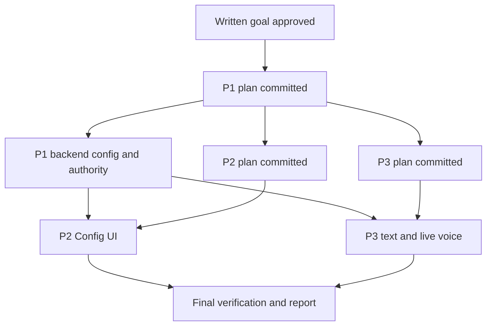

# State & Dependency Graph: Aurvin User and Dev modes

## Workflow configuration

- Keep all workflow artifacts directly in `docs/aurvin-dev-mode/`.
- Skipped phases: `--skip research,review`. No researcher, unified reviewer, or review-triggered fixer.
- Mandatory phases: brainstorming and approval, planning, worker execution, and final verification.
- Current authorization: the user approved the written goal and workflow and authorized proceeding, with simplicity and no extra model or pre-dispatch I/O overhead.
- The user approved event-driven planner dispatch in this session because the available subagent tool cannot run in the foreground. Dispatch independent planners together and advance on completion notifications without polling.
- Implement in Aurvin only. Treat `SayCart/Con-Comm` as read-only. Preserve existing changes, local configuration, credentials, and generated files. No deployment or live provider calls.

## Workflow milestones

- [x] Step 1: Brainstorming & Goal Alignment ([goal.md](goal.md) initially committed at `2da108c`; explicitly approved).
- [x] Step 2: Technical Research (skipped via `--skip research`).
- [x] Step 3: Planning Completed (`plan1.md` `b7880f7`, `plan2.md` `bec5aeb`, `plan3.md` `4c394d1`).
- [x] Step 4: Execution Completed (P1 `0c1e43e`–`68cff91`, P2 `e09eceb`–`89a80ab`, P3 `27da971`–`f0a86a4`, parity fix `4e6182e`).
- [x] Step 5: Unified Code Review (skipped via `--skip review`).
- [x] Step 6: Final Verification & Report (`final_report.md`; backend 17 failed files / 66 failed / 4104 passed vs baseline 18 / 74 / 4070, frontend 938 passed, builds and lints exit 0).

## Brainstorming tasks

- [x] Explore related code and recent commits in SayCart and Aurvin.
- [x] Clarify requirements, edge cases, and scope; compare separate selector vs. Config checkbox alone.
- [x] Present the design and record the choice: separate **User / Dev** selector, with controls accessible only from Config.
- [x] Write and commit `goal.md`; check it for scope, consistency, and ambiguity.
- [x] Obtain approval of the written specification.
- [x] Prepare the dependency graph, file ownership, acceptance criteria mapping, and resume procedure.

## Initial findings

- SayCart's `frontend/src/App.tsx` owns the User / Dev selection for text and forwards selection changes to live voice. Its current diagnostic backend has a separate prompt path in `backend/src/agent/context.ts`. Aurvin follows the requested behavior, not SayCart's diagnostic prompt or routing verbatim.
- Aurvin's `AdminDashboard.tsx` already separates super-admin and ordinary user tabs. The settings contract has strict backend and frontend mirrors, and managed settings become active through revisioned saves.
- Aurvin uses authenticated principals at chat HTTP and voice admission boundaries. An identity or a client payload alone is not evidence of super-admin session authority. Live voice final speech reaches the shared chat runtime through `AgentVoiceAdapter`.
- The runtime has a memory-first path and uses `ReferencedContextAssembler` for model context. Keep the mode decision off persisted records and on the model-bound turn only; account for tool-specialized dispatch paths and alternate prompt builders when planning.

## Confirmed product decisions

- Feature enablement and User / Dev selection are separate controls; both live only in Config and are restricted to full-access super admins.
- Persisted enablement, per-authenticated-session selection, text/live-voice parity, and a single model-only prefix after a mode change are approved.
- Keep the implementation small. A synchronous mode check over existing in-process state is sufficient; use the current model call with no extra inference, network round trip, DB operation, or async wait for mode handling. Off and ordinary users must see unchanged prompts and calls.

## Dependency matrix & execution status

There is no research dependency. P1 defines the backend wire and internal authority contracts. The P2 and P3 planners may start once P1's plan is committed and its contract summary is provided; both workers wait for P1's implementation and tests. P3 takes over central application wiring from P1 only after P1 finishes. P2 and P3 workers can then run in parallel.

| Plan ID | Title & scope | Worker dependencies | Write boundary | Planner status | Worker status | Commits |
| --- | --- | --- | --- | --- | --- | --- |
| P1 | Backend config and session authority | None | Backend config contracts, admin-config, identity lifecycle, initial app wiring | [x] b7880f7 | [x] Complete | `0c1e43e`, `e15b6b9`, `0f5d178`, `68cff91` |
| P2 | Config-only controls | P1 | Frontend Config dashboard and paired API contracts | [x] bec5aeb | [x] Complete | `e09eceb`, `28d8463`, `c9e12b9`, `86af5a0`, `89a80ab` |
| P3 | Text and live-voice model integration | P1 | Backend turn boundaries, context, dispatch, and runtime wiring | [x] 4c394d1 | [x] Complete | `27da971`, `7e98382`, `9b30909`, `f0a86a4` |

### Execution graph

| Planner | Earliest planning prerequisite | Worker start condition |
| --- | --- | --- |
| P1 | Written goal approved | P1 plan committed |
| P2 | P1 plan committed; wire contract summarized | P2 plan committed; P1 worker verified and committed |
| P3 | P1 plan committed; authority contract summarized | P3 plan committed; P1 worker verified and committed |

- Dispatch ready planners in parallel using the approved event-driven exception; dispatch each ready worker immediately. Up to three child agents alongside the orchestrator.
- Serialize git commits, stage explicit paths only, and reconcile changed upstream contracts before starting affected work. Verify planner commits with `git log -1 --stat <hash>`; do not read the plan bodies in the orchestrator.

## Plan scopes, ownership, and exit gates

### P1 — Backend Config and session authority

- **Deliverable:** `plan1.md`; define default-off settings compatibility, revisioned activation, strictly authorized mode reads/writes, and a shared in-process authority for per-session mode and one-shot announcements.
- **Owns:** `backend/src/admin-config/`, admin-config-specific contracts in `backend/src/contracts/`, `backend/src/platform/config/`, relevant auth/identity lifecycle wiring, `backend/src/app.service.ts` config/authority composition until handoff, and matching admin-config/authorization tests.
- **Exit gate:** Missing enablement reads as off; failed saves do not activate; ordinary, restricted, and unauthenticated callers cannot read/change selection; disablement and session invalidation reset selection. Deterministic authority tests cover idempotent and rapid switches, and atomic competition for the one-shot prefix. Report wire shapes, invalidation behavior, and internal turn contract for P2/P3.

### P2 — Config-only controls

- **Deliverable:** `plan2.md`; accessible Config controls using the saved setting and server-owned session selection.
- **Owns:** `frontend/src/features/admin-config/`, `frontend/src/api/admin-config-client.ts`, `frontend/src/api/admin-config-protocol.ts`, and matching frontend tests or fixture support.
- **Exit gate:** Only the super-admin Config view exposes controls. The selector appears after confirmed enablement; unsaved/failed changes are not treated as active. Mode changes and API errors have accessible state. No chat or voice controls are added.

### P3 — Model integration for text and live voice

- **Deliverable:** `plan3.md`; wire validated text and finalized live-voice turns into P1's authority, freeze the mode for model dispatch/retry, and assemble conditional instructions and the model-only prefix without affecting persistence.
- **Owns:** turn-related `backend/src/http/`, `backend/src/chat-runtime/` (including relevant internal contracts), `backend/src/context/`, `backend/src/instructions/` (do not change the unconditional prompt), the voice agent/session binding surfaces in `backend/src/voice/`, and the runtime sections of `backend/src/app.service.ts` after P1. Owns runtime, context, and voice regression tests.
- **Exit gate:** Assert exact off/ordinary prompt parity; both channels honor authorization and a single announcement; inputs and stored transcripts stay untouched; prefix is not consumed without dispatch; Dev invokes no tools; User continues to use the normal memory-first path. Exercise dedicated tool paths and existing latency and isolation fixtures if those paths change.

## Acceptance coverage

| Criterion | Primary owners | Integrated evidence | Status |
| --- | --- | --- | --- |
| AC1 - role, UI location, request authority | P1, P2, P3 | Admin API + role-aware UI + turn contract tests | Met |
| AC2 - default, save, disable, prompt parity | P1, P2, P3 | Config compatibility and active runtime tests | Met |
| AC3 - one-shot semantics | P1, P3 | Mode authority and model request fixtures | Met |
| AC4 - channel parity, concurrency, session isolation | P1, P3 | Text/live competition and authenticated-session isolation fixtures | Met |
| AC5 - clean history and read-only diagnostics | P3 | Captured model requests; persistence, tool, and memory-first regressions | Met |

## Research handoff

Skipped via `--skip research`; no `research.md` will be created. The findings above are local context for goal alignment, not a separate research phase.

## Planning and contract handoff

- **P1 (`b7880f7`):** persists `settings.devModeEnabled` (missing reads as `false`). Config-only `GET`/`PUT /api/admin/config/dev-mode` returns `200 { protocolVersion: 1, enabled, mode }` where `mode` is `null` when inactive, else `"user"` or `"dev"`; `PUT` accepts exactly `{ protocolVersion: 1, mode }` and returns the same shape. Errors: `400 INVALID_CONFIG_REQUEST`, `401 UNAUTHENTICATED`, `403 FORBIDDEN`/`PASSWORD_CHANGE_REQUIRED`, `409 DEV_MODE_DISABLED`, `503 NOT_READY`. The mode `GET`, not draft settings or chat activation, confirms enablement. P1 composes one `AppService.devMode` for Config and runtime with synchronous `peek(principal)` / `consumeForDispatch(principal)` returning immutable `{ mode, announce }` or `null`; consume happens only at an eligible dispatch, and the decision is frozen for retries and continuations.
- **P3 runtime rule:** text and live voice pass the existing trusted, owner-matched `AuthPrincipal`; confirmed disable, restart, and auth-session invalidation reset selection to User; in-flight decisions stay fixed. P3 owns production wiring, prompt and tool behavior, and the call-count checks proving no added inference, I/O, or async work before dispatch.
- **P1 complete (`0c1e43e`, `e15b6b9`, `0f5d178`, `68cff91`):** routes and contract as summarized above are implemented and verified. One shared `AccountAuthority` in `AppService` drives `DevModeAuthority`; session fences (login replacement, logout, password change/reset, deactivation) invalidate selection, and only a confirmed active snapshot enables the feature. P1 reports backend build/lint pass and 137 focused admin/auth tests plus 207 auth regression tests passing.
- **P2 handoff (resolved):** the red `catalogCoverage` test now includes `devModeEnabled`, fixed under P2. P1 also added `DEV_MODE_DISABLED` to `ADMIN_ERROR_COPY` to keep the exhaustiveness check green.
- **P2 complete (`e09eceb`, `28d8463`, `c9e12b9`, `86af5a0`, `89a80ab`):** client read/set control-plane calls, revisioned enablement draft, Config-gated checkbox, confirmed-only selector, and fail-closed error handling. Frontend `npm test` 938 passed / 110 files, `npm run lint` and `npm run build` pass, headless-Chrome fixture checks for checkbox, selector, save, and errors pass. The previously red `catalogCoverage` test is fixed by adding `devModeEnabled` honestly. Only test-only voice/fixture edits were made; no chat or voice production controls.
- **P3 complete (`27da971`, `7e98382`, `9b30909`, `f0a86a4`):** trusted principals now reach text and live execution; one local handle per admitted execution peeks at the dispatch cut, then consumes and freezes (including frozen `null`) for retries and web/Calendar continuations. Off/ineligible adds no handle and no projection, with raw request bodies asserted identical. User keeps the assembled messages and tools with bounded guidance; Dev replaces tool-bearing groups with public-safe guidance, rejects tool-call output, denies Calendar/voice tool paths, and drops visual artifacts. Lint and build pass; full backend run is 18 failed files / 67 failed tests / 4103 passed / 14 skipped versus the 18 / 74 / 4070 baseline, so no new P3 failure.
- **Recorded limitations (accepted, not hidden):** no filter strips an injected marker if a model deliberately echoes it in its own reply (injected text is never persisted). Planned Task 4 extras were not added: compaction-specific assertions, `postCounts` operation-count additions, voice sign-in-fence, cancel-before-final-dispatch, winner-ordering, and reasoning-canary tests. Existing compaction and Calendar-latency suites pass, so the no-added-work claim rests on those regressions plus the focused dispatch-count assertions, not new wave measurements.
- **Baseline movement to explain in final verification:** 8 `test/operations/bootstrap.spec.ts` failures did not reproduce in the P3 run (the known shared-`dist` rebuild race, not a claimed fix), and `test/performance/memory-first-voice.spec.ts` reproduces the pre-existing worker-fork crash.

## Final verification commands and evidence

| Directory | Commands | Purpose |
| --- | --- | --- |
| `backend/` | `npm test`; `npm run lint`; `npm run build` | Backend and regression verification |
| `backend/` | `npm run test:e2e` | Run offline scenarios; run native integration only with authorized isolated MongoDB prerequisites and record any unrun cases |
| `frontend/` | `npm test`; `npm run lint`; `npm run build` | Frontend and regression verification |

Pre-change baseline (2026-11-18, Node v24.18.0, `main` at `96a4c02`, `npm test` in `backend/`): **18 failed files / 74 failed tests / 4070 passed / 14 skipped**, plus one Vitest worker-fork error. Failures are the documented pre-existing set: assembled admin/calendar HTTP, bootstrap, durable-latency performance gates, local persistence owner/open, Calendar confirmation/voice, finalization repair, and multi-calendar integration. Full log: `~\AppData\Local\Temp\opencode\aurvin-dev-mode-baseline-backend.log`.

Final verification (2026-11-18, Node v24.18.0, `main` at `4e6182e`):

| Check | Result |
| --- | --- |
| `backend/`: `npm test` | 17 failed files / 66 failed / 4104 passed / 14 skipped, 1 worker-fork error. No failing file is new; no dev-mode test fails; baseline-only `bootstrap.spec.ts` did not reproduce (shared-`dist` race). |
| `backend/`: `npm run lint` | exit 0, pre-existing warnings only |
| `backend/`: `npm run build` | exit 0 |
| `backend/`: `npm run test:e2e` | 1 failed file / 4 passed / 44 skipped; 8 failed / 38 passed / 141 skipped. All eight are `voice-bootstrap.e2e-spec.ts`; reproduced identically on `b3cf86e` in an isolated worktree (8 failed / 22 passed, same test names). Native skips lack `AURVIN_TEST_MONGODB_URI`. |
| `frontend/`: `npm test` | 110 files / 938 tests passed |
| `frontend/`: `npm run lint` | exit 0, pre-existing warnings only |
| `frontend/`: `npm run build` | exit 0 |
| Dev-mode browser fixture | checkbox, selector, save, and error checks PASS (headless Chrome) |

Scope: 54 files, 1917 insertions, 89 deletions against `b3cf86e`; 885 of those insertions are production source across 35 files, the rest are tests and fixtures. Reported results are deterministic fixture and offline checks; native, live, paid, and staging runs were not authorized and were not performed.

## Artifact and commit record

| Artifact | State | Commit |
| --- | --- | --- |
| `goal.md` | Approved; latency constraints recorded | `2da108c`, `96a4c02` |
| `state.md` | Initial graph, milestone and evidence updates | `59dce2c`, `ab82544`, `542e541`, `370e649`, `f6f19e5`, `de5005c`, `c9ad83d`, `c5bfcaa`, final report commit |
| `research.md`, `review.md` | Skipped; no files created | - |
| `plan1.md` | Written and executed | `b7880f7` |
| `plan2.md` | Written and executed | `bec5aeb` |
| `plan3.md` | Written and executed | `4c394d1` |
| `final_report.md` | Complete | Final report commit |

## Current gate and resume procedure

**CURRENT GATE: COMPLETE.** All milestones are recorded, review is recorded as skipped, and final verification is committed in [final_report.md](final_report.md).

1. Read the approved goal, this state, and `final_report.md`; preserve any intervening user changes.
2. Treat the recorded baseline and final numbers as the comparison point for later work; do not re-open this workflow for unrelated pre-existing failures.
3. Manual UI validation with a running backend/frontend pair remains optional and unrun here; it requires private credentials and is not a substitute for the recorded checks.
