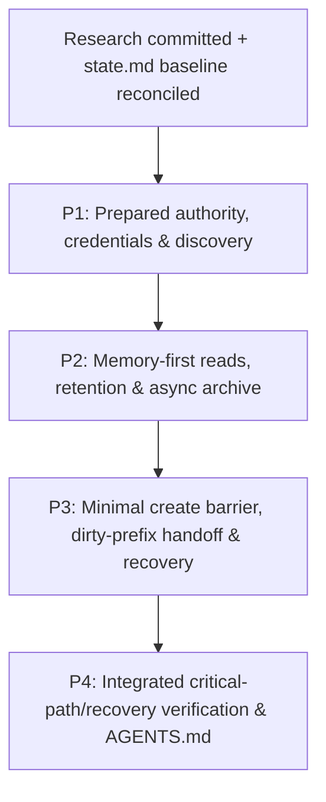

# Calendar Tool Latency — Technical Research and Reconciled Architecture

Date: 13 November 2026
Baseline HEAD: `7c4ac68` (`docs(voice-canvas-control): close workflow checkpoint`), atop `8816250`, `ba614a2` (`docs(calendar-tool-latency): add approved goal and brainstormed design`), `2f5f49c`, `0d62020`.
Workflow mode: **MAW, `--skip review`** (technical research and planning/execution authorized on 13 November 2026; code review skipped).

## 1. Baseline Facts, Environment, and Verification State

### 1.1 Workspace and Dependency Baseline

- `git status --short` shows uncommitted edits **only** on `docs/calendar-tool-latency/goal.md` and `docs/calendar-tool-latency/state.md`. The 13 historical dirty code/test files listed in pre-research `state.md` against `0d62020` were committed on `main` prior to `7c4ac68`. Reconcile that baseline note in `state.md` before P1–P4 dispatch.
- Installed backend stack (`backend/package.json`): `@langchain/langgraph` `^1.4.19`, `@langchain/core` `^1.2.16`, `@langchain/langgraph-checkpoint-mongodb` `^1.4.1`, `@nestjs/common` / `@nestjs/core` `^12.0.1`, `mongodb` `^6.21.0`, `zod` `^3.25.32`, `vitest` `^4.1.2`, `oxlint` `^1.58.0`. Context7 MCP is not declared in this runtime environment; design relies on inspected workspace contracts and installed package interfaces with zero new dependencies.
- All policy limits remain fixed in repo config: `CALENDAR_LIMITS` (`backend/src/contracts/calendar-policy.ts:55-60`) and `PROPOSED_MEMORY_TEXT_POLICY` (`backend/src/chat-runtime/memory-text.ts:67-75`: `maxOperationsPerSave: 32`, `maxEnvelopeBytes: 524_288`, `maxEvidenceBytes: 131_072`, `maxBacklogBytes: 16_777_216`, `maxDirtyAgeMs: 60_000`, `maxAttempts: 3`, `writeTimeoutMs: 15_000`).

### 1.2 Baseline Deterministic Checks Run on `7c4ac68` (`AURVIN_TEST_MONGODB_URI` cleared)

| Check / Suite | Result | Observed Details / Telemetry |
| --- | --- | --- |
| `backend` `npm run lint` | Passed (`0` errors) | `711` warnings across `744` files (`111` rules) |
| `backend` `npm run build` | Passed (`0`) | `nest build` clean |
| Focused Vitest 7-file run (`calendar-memory-first.spec.ts`, `memory-calendar-state.spec.ts`, `memory-text-archive.spec.ts`, `calendar-voice-latency.spec.ts`, `calendar-critical-path.spec.ts`, `tools-boundaries.spec.ts`, `tools-multi.spec.ts`) | `7 passed (7)`, `124 passed (124)` (`7.36s`) | All deterministic provider/mock-store checks green |
| `CALENDAR_P3_LOOKUP_PROFILE` (read `calendar_list_events`) | Measured | `wireReads: 197`, `wireWrites: 73`, `waves: 262`, `elapsedMs: 45440`, `firstDispatchMs: 14595`, `firstDeltaMs: 34410`; `storageWaves`: `preDispatch: 81, firstAnswer: 200, postSeal: 32`; `collections`: `sessions: 69`, `messages: 7`, `agent-memory: 6`, `metadata: 118`, `checkpoints: 22`, `checkpoint_writes: 26`, `integration_connections: 22` |
| `CALENDAR_P3_CONFIRM_COMPARISON` (`0` turns, unreferenced) | Measured | `wireReads: 158`, `wireWrites: 45`, `waves: 199`, `elapsedMs: 30523`, `receiptMs: 21108`; `integration_connections: 23`, `metadata: 101`, `sessions: 37`, `checkpoints: 14`, `checkpoint_writes: 18` |
| `CALENDAR_P3_CONFIRM_COMPARISON` (`8` turns, unreferenced) | Measured | `wireReads: 182`, `wireWrites: 45`, `waves: 223`, `elapsedMs: 32131`, `receiptMs: 22716`; `attachment` waves increase `11 -> 27`, `integration_connections: 23`, `metadata: 125` |

---

## 2. Current End-to-End Call Chain and Bottlenecks

Tracing the production chain proves that removing `await this.promote()` alone leaves repeated connection-store lookups, cold session initialization gaps, and retention holes intact:

1. **HTTP ingress & session initialization (`configure-private-http.ts:57` -> `AppService.prepareOwner` -> `GoogleCalendarConnections.statusV2`):**
   `configurePrivateHttp` awaits `o.prepareOwner(p)` on every private `/api/**` call. `AppService.prepareOwner` calls `connections.statusV2()` (`connection.ts:259-274`), which unconditionally queries `this.storeV2.get(this.userId)`. Inside `MemoryText.hydrate` (`memory-text.ts:183`), cold hydration reads `p.calendarConnectionsV2.get(u)` again; meanwhile brand-new sessions (`memory-text.ts:285-291`) do not populate `cold.accountBinding`, leaving `CalendarLoop` with `'memory-unbound'` (`memory-text.ts:879-880`).
2. **Plugin admission, discovery & credential access (`connection.ts`, `discovery.ts`, `tools.ts`, `calendar-assembly.ts`):**
   - `GoogleCalendarConnections.currentAccount()` (`connection.ts:351`) and `requireAccountCurrent()` (`connection.ts:374`) unconditionally read `storeV2.get`.
   - `CalendarDiscoveryService.ensureFresh` (`discovery.ts:111`) and `checkTarget` (`discovery.ts:175, 195, 198, 255`) invoke `requireAccountCurrent` multiple times per target check.
   - `CalendarApiTools.invoke` (`tools.ts:264-292`) calls `this.v2Deps!.connections.get(binding.userId)` once at entry and **twice** inside `admit(kind)` (before and after `consumeRequest`). `calendar-assembly.ts:93` wires raw `input.storeV2` directly to `CalendarApiTools` and calls `requireAccountCurrent` again in `readDiscovery` (`L96`).
   - `GoogleCalendarConnections.withAccessToken` (`connection.ts:1147-1164`) calls `requireAccountCurrent` once before refresh check (and again after refresh), then AES-GCM decrypts `record.credentials.access` per invocation.
3. **Runtime read dispatch (`calendar-loop.ts:1268`, `memory-text.ts:497-611`, `memory-calendar-state.ts`, `memory-calendar-ledger.ts`):**
   - `CalendarLoop.execute` calls `await this.promote()` unconditionally before `executeReadV2` as well as `executeCreateV2`.
   - `MemoryText.promoteTurn` (`memory-text.ts:497-611`) awaits `foundation.flushSession` (stalling behind all prior dirty text/read turns), runs `sessions.createIfAbsent`, `owner.acquire`, `owner.reserveAttempt`, `messages.appendConfirmed`, `metadata.putAttemptConfirmed`, `owner.confirmAcceptance`, `transitionConfirmed(..., 'generating')`, `sequence-counter`, `memory.put`, `currentAccount()`, `calendarAccountingV2` budget creation + loop replay of **every prior dispatch, decision, rejection, and result** (`L557-582`), `requireAccountCurrent()`, `CalendarTurnLedger`, and `graph.updateState(..., 'prepare')`.
   - `executeReadV2` (`L1967-2051`) requires `durableLedger()` (since `MemoryCalendarLedger` omits `chargeLogicalTool` / `chargeCalendarRequest` / `chargeRefreshRequest` / `chargeCreate`), awaits `calendarRetention.registerSource` (`calendar-retention.ts`), awaits `calendarResultsV2.put` (`metadata`), and `publishPromoted` writes seal/boundary/assistant message/attempt finish/lease release (`26` checkpoint writes + `118` metadata ops + `69` session ops in `CALENDAR_P3_LOOKUP_PROFILE`).
4. **In-memory schema & retention gaps for native read archival (`memory-calendar-state.ts`, `calendar-retention.ts`, `memory-calendar-reader.ts`):**
   - `memoryCalendarStateSchema` (`memory-calendar-state.ts:21-62`) restricts `results` to `localSkillResultRecordSchema` and rejects `decision.sources.length > 0`, blocking unpromoted Calendar read results from consolidated `MemoryTextArchive` persistence.
   - `MongoCalendarRetention.sweepPage` and `invalidateAccountRevisionPage` (`calendar-retention.ts:260-352`) scan individual `calendar-source`/`calendar-tool-result`/etc. kinds in `metadata`, **not** `memory-calendar-native` documents; furthermore, `readMemoryCalendarStates` (`memory-calendar-reader.ts:57`) validates `hashPayload(JSON.stringify(record.state)) !== dependency.contentHash`, which would throw `NOT_READY` on post-redaction cold hydration.
   - `MemoryFirstFoundation.complete` (`memory-first-foundation.ts:324`) does not copy `sourceProvenance` onto `TerminalEnvelope.output`, and `MemoryFirstFoundation.invalidateCalendarAccount` (`L415-424`) redacts `messages` but does not scrub `s.baseCalendar` / `envelope.calendar` payloads.

---

## 3. Target Design — P1: Prepared Authority, Credentials & Invalidation

### 3.1 Single Authority Owner (`GoogleCalendarConnections`)

Keep ONE per-user `PreparedAuthorityV2` cache inside `GoogleCalendarConnections` (`backend/src/plugins/google-calendar/connection.ts`), rather than duplicating authority state in `AppService` or `MemoryText`:

```ts
type PreparedAuthorityV2 = {
  populated: boolean;
  record: CalendarConnectionRecordV2 | null;
  account: CalendarAccountBinding | null;
  authorityEpoch: number; // incremented on every invalidation, disconnect, fence, close, revision change
  decryptedAccess: {
    ciphertextHash: string;
    token: string; // strictly private to GoogleCalendarConnections; NEVER exported or logged
    expiresAtMs: number;
    connectionRevision: number;
  } | null;
};
```

- **Secret boundary:** `decryptedAccess.token` never crosses `GoogleCalendarConnections.withAccessToken`'s callback (`action(accessToken)`). It is never stored on `CalendarAccountBinding`, `PreparedAuthorityV2` public status, `MemoryText`, archives, or prompts, and `decryptedAccess` is immediately set to `null` inside `invalidatePrepared(...)`, `fence(...)`, `close()`, `beginConsent()`, `disconnect()`, `settings()`, and every token refresh/replacement.
- **Warming & write-through coherence:**
  - `statusV2()`, `currentAccount()`, and cold `requireAccountCurrent(...)` populate `PreparedAuthorityV2` when `!populated` via one `storeV2.get(this.userId)` (preserving fail-closed if `storeV2` throws or `hardFenced`).
  - `installGrant`, `settings`, `refreshCalendars`, `refreshCurrentV2`, `proactiveRefreshV2`, and `discovery` CAS completion (`recordDiscoveryV2` / store wrapper) synchronously write-through confirmed `next` records into `PreparedAuthorityV2` (clearing `decryptedAccess` if `credentials` changed).
- **Synchronous invalidation (`invalidatePrepared` + `AppService` lifecycle):**
  - `GoogleCalendarConnections.invalidatePrepared(reason?)` increments `authorityEpoch`, nulls `decryptedAccess`, and either clears `populated = false` / `record = null` (on disconnect/reconnect/fence/close) or refreshes cached snapshot deterministically on CAS mutation.
  - Wire `invalidatePrepared` into `fence()`, `close()`, `beginConsent()`, `disconnect()`, `markReconnectRequiredV2()`, `rejectUnauthorizedAccount()`, and **`settings()` on BOTH `authorityChanged` (`enabled` toggle / disable) AND `settingChanged` (`defaultCalendarId` change)** (`connection.ts:654-671` currently only calls `onAccountInvalidated` when `authorityChanged && !enabled`; keep `onAccountInvalidated` focused on revocation while updating/invalidating prepared state and clearing `AppService` status on `settingChanged`).
  - Ensure `AppService.onCalendarInvalidated` (`app.service.ts:645-661`) triggers `connections.invalidatePrepared(...)` and `runtime.invalidateCalendarAccount(account, reason)` synchronously before `quiesceStreams`, AND allow direct test calls to `runtime.invalidateCalendarAccount(account, reason)` (used in `calendar-memory-first.spec.ts:595, 609`) to mark that `(connectionId, connectionRevision)` as invalidated so read-mode prepared checks reject it synchronously!

### 3.2 Read Path vs Fresh Mutation Gate Split

- Extend `CalendarRuntimeV2Dependencies['connection']` (`backend/src/chat-runtime/calendar-ports.ts:55-59`):
  ```ts
  connection: {
    currentAccount(): Promise<CalendarAccountBinding>;
    requireAccountCurrent(
      account: CalendarAccountBinding,
      signal: AbortSignal,
      options?: { fresh?: boolean },
    ): Promise<CalendarConnectionRecordV2>;
  };
  ```
- Extend `CalendarCapabilityGate` (`backend/src/contracts/calendar-authority.ts:197-209`) / `CalendarDiscoveryService` (`discovery.ts`) and `CalendarApiTools` (`tools.ts`):
  - **Reads (`operation: 'read' | 'availability'`):** `statusV2()`, `currentAccount()`, `requireAccountCurrent(account, signal)` (`fresh !== true`), `readDiscovery`, `CalendarDiscoveryService.ensureFresh` / `checkTarget` (for `'read'`), and `CalendarApiTools.invoke` read cases (`calendar_list_events`, `calendar_get_event`, `calendar_check_availability`, `calendar_list_calendars`) validate against warmed `PreparedAuthorityV2` + `CalendarMemoryInvalidation` (**`0` `integration_connections` DB reads when warm**), while still checking `signal.aborted`, `hardFenced/executionFenced/closing`, `enabled`, `status === 'connected'`, grant completeness, `connectionId/connectionRevision/googleSubjectId`, discovery freshness (`now < expiresAt && now < retentionExpiresAt`), and synchronous pre-/post-`consumeRequest` guards in `admit(kind)`!
  - **Mutations (`operation: 'create'` and lifecycle mutations):** `freshCapability` (`create`), pre-create `requireAccountCurrent(account, signal, { fresh: true })`, `CalendarApiTools` `calendar_create_event` `requireAccount` (`fresh`), `settings`, `disconnect`, `installGrant`, `beginConsent`, and `refreshCurrentV2` perform a fresh `storeV2.get(userId)`. `CalendarApiTools` preserves `v2Deps.connections.get` fallback when no prepared read view is passed, so existing standalone plugin unit fixtures (`tools-multi-fixtures.ts:165`) observing direct mock-store edits remain intact, while `calendar-assembly.ts` supplies `connections.getPreparedForRead` (zero DB reads when warmed and unfenced; forces store read if unpopulated or invalidated) for read/availability operations!

---

## 4. Target Design — P2: Memory-First Reads & Consolidated Async Archive

### 4.1 Read Execution Without Durable Promotion (`calendar-loop.ts`, `memory-calendar-ledger.ts`, `memory-text.ts`)

1. **Resolving warmed binding at turn execution (`memory-text.ts:879-880`):**
   Before constructing `CalendarLoop` inside `MemoryText.execute`, resolve active binding via `try { binding = await cal.connection.currentAccount(); } catch { binding = memoryUnbound; }` (using P1's zero-DB warmed `currentAccount()`, falling back cleanly to `'memory-unbound'` when Calendar is disconnected/unconfigured so ordinary text/Canvas turns still work and tool calls fail explicitly when invoked). Eliminate `p.calendarConnectionsV2.get(u)` from `MemoryText.hydrate` (`memory-text.ts:183`) when `cal.connection.currentAccount` is available, or warm through `prepareOwner`/connections.
2. **Skip `promote()` on reads (`calendar-loop.ts:1268`):**
   - `CalendarLoop.execute` must **not** call `this.promote()` for `calendar_list_events`, `calendar_get_event`, `calendar_check_availability`, or `calendar_list_calendars` (and non-mutating early-denial `not-authorized` in `executeCreateV2`).
   - Route `executeReadV2` (`L1967, L1977, L2021`) and `chargeProviderRequest` (`L744`) through `this.ctx.ledger` (works uniformly on both `MemoryCalendarLedger` and `CalendarTurnLedger`).
3. **Full accounting on `MemoryCalendarLedger` (`memory-calendar-ledger.ts`):**
   Implement `chargeLogicalTool(decisionId)`, `chargeCalendarRequest(kind)`, `chargeRefreshRequest()`, and `chargeCreate(intentId)` directly against `CALENDAR_LIMITS` (`logicalTools`, `calendarRequests`, `refreshRequests`, `creates`), preserving exact idempotency per `decisionId` / `intentId` matching `CalendarTurnLedger`.
4. **In-memory read result & provenance recording (`calendar-loop.ts:753-778`):**
   When `this.ctx.memory` is active (unpromoted read turn):
   - Track `'volatile'` sourceIds in `this.volatileSourceIds` (`L759`) and append complete `skillGroup(native, JSON.stringify(invoked.result), [invoked.source])` to `this.groups` for same-turn model continuation (**zero DB writes**: skip `calendarRetention.registerSource` and `calendarResultsV2.put`).
   - Stage `CalendarToolResultRecordV2` in `MemoryCalendarStage`:
     - `permission.content === 'retained'`: store `{ storage: 'retained', source: invoked.source, toolCallId, operationId: null, result: invoked.result }` (bounded by `maxEvidenceBytes` & `CALENDAR_LIMITS.resultBytes`).
     - `permission.content === 'volatile'`: store **reference only** `{ storage: 'reference', source: invoked.source, toolCallId, operationId: null, outcome: 'ok' }` — zero Calendar event fields ever enter `MemoryCalendarStage`, `TerminalEnvelope.calendar`, or `memory-calendar-native`!
   - Propagate `sourceProvenance` (from `native.loop.provenance()`) through `MemoryText.finish()` (`memory-text.ts:434-445`) -> `MemoryFirstFoundation.complete` / `terminalEnvelope` (`memory-first-foundation.ts:324`) onto `envelope.output`, ensuring assistant prose attribution/expiry (`redactCalendarMessage`) matches promoted turns.

### 4.2 Consolidated Native Archive, Retention, Cold Hydration, and Invalidation

- **Schema evolution (`memory-calendar-state.ts`):**
  - Update `memoryCalendarStateSchema`: allow `results: z.array(z.union([localSkillResultRecordSchema, calendarToolResultRecordV2Schema])).max(8)` and permit non-empty `decision.sources` (`z.array(sourceReferenceV2Schema)`) on unpromoted read state while keeping `operationId: null, intentId: null, proposalId: null` forbidden in non-promoted read state (`L44`) until/unless staged cleanly.
  - Validate `calendar-tool-result` pairing against `completeToolGroupV2Schema`: if `resultRef.storage === 'retained'`, pair using `resultRef.result`; if `resultRef.storage === 'reference'`, pair using a bounded redacted/reference placeholder (`CALENDAR_TOMBSTONE` if expired/redacted/volatile) and forbid raw Calendar payloads on `storage: 'reference'`.
  - Extend `memoryCalendarRecordSchema` with optional `redactedAt: isoDateSchema.nullable().optional()` / structured redaction support.
- **Single consolidated save in `MemoryTextArchive` (`memory-text-archive.ts`):**
  - Keep **one** `memory-calendar-native` document per attempt (`key('memory-calendar-native', userId, sessionId, attemptId)`), NOT per-result `calendar-source` / `calendar-tool-result` / `calendar-model-decision` fan-out (which would overflow `maxOperationsPerSave = 32` and add redundant round trips). Total `MemoryTextArchive` ops for a Calendar read turn stay within `<= 21` bounded ops (`<= 32`).
- **Retention & account-revision redaction (`calendar-retention.ts`, `memory-calendar-reader.ts`, `memory-first-foundation.ts`):**
  - Extend `MongoCalendarRetention.sweepPage` (inside `redactDerived` / bounded `memory-calendar-native` cursor) and `invalidateAccountRevisionPage` (`metadata` `$or` branch) (`calendar-retention.ts:260-352`) to match `kind: 'memory-calendar-native'` docs containing expired `expiresAt <= nowMs` or revoked `(connectionId, connectionRevision)` sources/results, redact `resultRef` (`storage: 'reference', outcome: 'redacted'`) + `source.redactedAt = now` + `source.targets` labels, set `redactedAt: now` on the `memory-calendar-native` record, and call `redactAssistantAttempt` for the turn!
  - Update `readMemoryCalendarStates` (`memory-calendar-reader.ts:57`): when `record.redactedAt` is set (post-retention/invalidation redaction), skip the raw pre-redaction `contentHash` exact-equality failure while still strictly verifying `userId`, `sessionId`, `attemptId`, `turnId`, `epoch`, `version`, `fence`, `message` sequence linkage, and structural `decisionId`/`dispatchId`/`toolCallId` integrity (store a small immutable `structureHash` alongside `contentHash` on `attempt.nativePublication` if desired, or verify redacted fields transition cleanly) so cold hydration returns tombstones cleanly instead of throwing `NOT_READY`.
  - Update `MemoryFirstFoundation.invalidateCalendarAccount` (`memory-first-foundation.ts:415-424`), `MemoryFirstFoundation.nativeGroups` (`L450-464`), and `MemoryText.nativeGroups` / `calendarHistory` to: (a) scrub `s.baseCalendar`, `envelope.calendar`, and unpromoted `e.calendar` synchronously on account invalidation, and (b) enforce `now()` expiry (`source.expiresAt <= nowMs` or `'volatile'` cross-turn content) -> emit `{ kind: 'calendar-history-unavailable', message: CALENDAR_TOMBSTONE }` with `sources: []`!

### 4.3 Continuation Under Temporary Archive Failure & Read-Test Reconciliation

- `MemoryFirstFoundation.accept` (`memory-first-foundation.ts:255-295`) already permits subsequent turns in RAM without blocking on `s.jobs`, retrying `MemoryTextArchive.save` up to `maxAttempts: 3` (`retryBackoffMs: 1_000`) while enforcing `maxDirtyAgeMs: 60_000`, `maxBacklogBytes: 16_777_216`, `maxEnvelopes: 32`, and `s.fenced`. Reads continue uninterrupted across text and voice while prepared authority holds and bounds remain unexhausted; any authority invalidation, session fence, or capacity overflow immediately blocks affected admissions.
- **Note on existing P2-precursor read tests (`backend/test/performance/calendar-memory-first.spec.ts`):**
  Existing tests at `L164`, `L306`, `L361`, `L389`, `L574`, `L602` were written specifically to assert the *old* pre-latency behavior where `executeReadV2` called `promoteTurn` synchronously (`flushSession` + `putAttemptConfirmed` + `prepare` checkpoint before `cal.execution.invoke`) and blocked reads if an earlier archive save failed. P2 must update those assertions to reflect approved **AC1/AC2/Decision 1** (reads reach provider with DB blocked, prior dirty turns stay asynchronous, transient save failures do not block reads within bounds, while account invalidation/fencing/exhausted bounds STILL reject external calls without inference replay).

---

## 5. Target Design — P3: Minimal Durable Create Barrier & Recovery

### 5.1 Separating Proposals/Clarifications from Physical `POST /events`

In `CalendarLoop.executeCreateV2` (`calendar-loop.ts:1591-1819`):
- **`interpreted.outcome === 'not-authorized'` (`L1605`):** pure conversational refusal; no `promote()` required.
- **`details` / `clarify` / `needsConfirmation` (`L1615-1776`):** creates a pending `CalendarProposalRecord`, `calendar-source`, and `calendar-proposal-reply-ref` (plus closes superseded incomplete proposal) so proposal survival across cold restart holds, **without** calling `foundation.flushSession` or `POST /events`. Ensuring `sessions.createIfAbsent(..., memoryPublication: { version: 0, ... })` (when `durableVersion === 0`) keeps `MemoryTextArchive` able to flush earlier turns sequentially later.
- **Physical mutation boundary (`writer().executeCreate` from direct explicit create or consumed proposal reply in `decide()`):** requires the minimal self-sufficient pre-create durability barrier **before** `POST /events`.

### 5.2 Minimal Irreducible Barrier vs Redundant Promotion Work

| Operation currently in `promoteTurn` + `executeCreateV2` | Needed before `POST /events`? | Decision in P3 & Rationale |
| --- | --- | --- |
| `foundation.flushSession(sessionId)` (`memory-text.ts:501`) | **NO** | Prior dirty text/read turns do not authorize or identify the create; AC3 requires blocked unrelated saves not to stall creates. |
| Loop replay of `0..N` prior dispatches, decisions, rejected, results (`L557-582`) & `memory.put(manifest)` (`L541`) | **NO** | Unrelated historical bookkeeping; non-essential before mutation. |
| LangGraph `'prepare'` / `'calendar_decide'` / `'calendar_execute'` checkpoints (`L604, L900, L924`) | **NO** before POST | `calendar-operation` (`planned -> dispatching`) + `calendar-proposal` hold exact state for `reconcileCalendarOperationV2`; defer full transcript/manifest checkpointing to post-outcome publication/archive. |
| Duplicate `integration_connections` reads (currently `23` per create) | **Cut to `<= 2-3`** | P1 prepares read/discovery/preflight checks; keep fresh `requireAccountCurrent(..., { fresh: true })` at mutation admission & `CalendarApiTools` create dispatch (`fresh`) + `CalendarDiscoveryService.checkTarget` for write calendar target. |
| `sessions.createIfAbsent` (only if `durableVersion === 0`), accepted user `MessageRecord`, `AttemptRecord` (`generating`) + `AcceptanceRecord` | **YES** (minimal single-turn identity) | Prevents `Orphaned acceptance` in `reconcileSession` (`durable-chat-runtime.ts:2263`) and preserves originating accepted message proof (`CalendarOperationWriter` L384-406). |
| `CalendarTurnLedger` `creates: 1` budget debit (`calendar-turn-budget`), proposal `consume` (or `calendar-intent-reservation`), `calendar-operation` (`planned` -> `dispatching` with `googleEventId = calendarEventId(operationId)`) + `calendar-operation-event-v2` | **YES** (irreplaceable) | Binds single-use authorization, immutable action hash, account/target revision, deterministic Google event key, and crash-safe state transition before `POST /events`. |

### 5.3 Eliminating `MemoryTextArchive` Lock Contention & Preserving Monotonic `memoryPublication`

Inspecting `memory-text-archive.ts:98-194` & `memory-first-foundation.ts:350-359` revealed two critical locks/invariants:

1. **`MemoryTextArchive` lease & `activeAttemptId` race:** Today `MemoryTextArchive.project` acquires `p.owner.acquire` at `L102` (holding `sessions.execution.ownerId` across slow `messages` / `memory.put` / `checkpoints` calls) and returns `{ kind: 'failed', retryable: false }` on `L98` if `session.execution.activeAttemptId !== null`! If Turn 0's archive save is blocked mid-flight holding `ownerId` or sees Turn 1's `activeAttemptId`, Turn 1 stalls or Turn 0 permanently fences the session.
   - **P3 Fix (clean minimal separation):**
     1. Add `foundation.pauseSession(sessionId)` / `resumeSession(sessionId)` while Turn `k`'s create barrier runs so queued retries don't race Turn `k`.
     2. In `MemoryTextArchive.project`: check `p.owner.assertExecutor()` cleanly for idempotent inserts (`ensure` / `$max` / `memory.put` / `'seal'` boundary) OR release/avoid holding `sessions.execution.ownerId` across blocked staging calls, only synchronizing final `sessions.memoryPublication` CAS (`{ _id, userId, sessionId, lifecycle: 'active', 'execution.activeAttemptId': null, 'execution.ownerId': null, 'memoryPublication.version': published.version }`) — **and** treat `session.execution.activeAttemptId !== null || session.execution.ownerId !== null` at `L98` as `{ kind: 'unknown', retryable: true }` (retry after Turn `k` finishes) instead of `{ kind: 'failed', retryable: false }`!
     3. Inside `CalendarOperationWriter`, pre-POST barrier writes (`calendarOperationsV2.reserveByIntent`, `compareAndSwapV2`, `appendEventV2`, `input`, minimal `attempt`) guard using `p.owner.assertExecutor()` + fenced work signal (+ acquiring/updating `sessions` when not blocked by an active background writer, or using a non-blocking operation-level discovery pointer if needed) so an in-flight blocked `MemoryTextArchive` write on `p.memory`/`checkpoints` **cannot** cause `CONFLICT_ACTIVE_TURN` on the foreground create!
2. **Post-`POST /events` outcome surfacing vs monotonic `memoryPublication` (`0 -> 1 -> ... -> k`):**
   - Immediately after Google `POST /events` returns `200`: `CalendarOperationWriter` confirms `calendar-operation` (`'succeeded'` + `receipt`) and `calendar-operation-event-v2` (`'succeeded'`). `CalendarLoop` immediately emits `calendar-operation` (`'succeeded'`) and `createdEventText(action)` deltas (`calendar-loop.ts:1839, 1868`), distinguishing provider confirmation from background archive state.
   - **Clean prefix (`durableVersion === turn.contextVersion` and no paused dirty prefix):** finalize via consolidated publication (`publishPromoted` or streamlined post-create settlement preserving existing sealed create recovery). Note `attempt` already written as `'generating'` during barrier transitions cleanly to terminal `completed`/`truncated` via `compareAttemptConfirmed` (and `MemoryTextArchive.ensure` must allow `'generating' -> terminal` or skip duplicate `'generating'` insert!).
   - **Dirty prefix (`durableVersion < turn.contextVersion`, e.g. Turn 0 archive paused/failing):** `commitPromoted` (`memory-first-foundation.ts:350`) rightly rejects advancing `durableVersion` out of order! Instead, release any temporary create-turn `activeAttemptId` once the operation is terminal (`succeeded`/`definitely-failed`) so Turn `k` never stalls waiting for Turn 0, **return the confirmed result immediately (`status: 'completed'`, `save: { state: 'pending' }`)**, and queue Turn `k`'s transcript/manifest/native archive (`v(k-1) -> vk`) via `foundation.complete(...)` behind Turn 0 (`s.jobs`). Once Turn 0 unblocks, `MemoryFirstFoundation` drains `0 -> 1 -> ... -> k` monotonically!

### 5.4 Crash Recovery & `reconcileSession` Discovery (`durable-chat-runtime.ts`, `calendar-recovery.ts`, `calendar-operations.ts`)

Because P3 omits full pre-create LangGraph `'prepare'`/`'calendar_execute'` checkpoints and may run before `sessions.latestTurnId` advances past a dirty prefix:

- Update `pendingCalendarOperation` (`calendar-recovery.ts:155-169`) to also query `store.listUnresolvedBySession({ userId, sessionId, limit })` (`persistence/calendar-operations.ts`) so `'planned' | 'dispatching' | 'unknown'` operations are always found even without `cursor.pendingIntentId` or updated `sessions.latestTurnId`.
- Ensure `sessions.listForRecovery` (`sessions.ts:214-256`) / `DurableChatRuntime` recovery also detects sessions holding unresolved `'planned' | 'dispatching' | 'unknown'` operations (either via `activeAttemptId`/`ownerId` set during the create barrier until terminal `'succeeded' | 'definitely-failed'`, or a recovery lookup over `calendarOperationsV2` unresolved records).

**Verified 4-Crash-Point Matrix (zero cross-collection transactions assumed):**

| Crash Point | Durable State on Disk | Recovery Outcome (`reconcileSession` / retry) |
| --- | --- | --- |
| 1. Before `reserveByIntent` (`'planned'`) | Either nothing, or durable `CalendarProposalConsumption` | No Google POST occurred. `classifyCalendarContinuationV2` repairs consumed proposal (`'repair-consumption'`) or allows clean retry; never issues duplicate create. |
| 2. After `'planned'`, before `'dispatching'` CAS | `calendar-operation` `'planned'` + event `'planned'` | `listUnresolvedBySession` / `reconcileSession` recovers `'planned'`; dispatch runs at most once **only** after fresh capability/preflight verification (or fails/interrupts safely if authority expired). |
| 3. After `'dispatching'` CAS, before `POST /events` response or receipt save | `calendar-operation` `'dispatching'` with deterministic `googleEventId = calendarEventId(operationId)` | `reconcileCalendarOperationV2` runs **one pinned readback** by `googleEventId`; matched -> `'succeeded' + receipt`, mismatch/absent -> `'unknown'` / `'definitely-failed'`. **Never replays `POST /events`.** |
| 4. After `'succeeded'` + `receipt`, before UI completion or `MemoryTextArchive` save | `calendar-operation` `'succeeded' + receipt` + `'succeeded'` event durable in `metadata` | Repeat `executeCreate` / `getByIntent` / `findSucceededByRequestHash` / `findOwnCreateBySlot` returns `{ outcome: 'existing' }` without model or Google POST; `reconcileSession` publishes receipt if `activeAttemptId` remained set, or future turns see immutable receipt in `metadata` (unarchived chat prose may be lost on crash, external side effect never duplicates). |

---

## 6. Compatibility Constraints, Risks & Mitigations

| Risk / Constraint | Impact if Unaddressed | Mitigation in Design |
| --- | --- | --- |
| Existing `memory-calendar-state` / `calendar-retention` schema mismatch | Staged v2 results rejected by Zod (`results` / `sources.length`) or missed by TTL sweep / account revocation | Extend schema for v2 read `sources` + `CalendarToolResultRecordV2` (reference-only for `'volatile'`), extend `MongoCalendarRetention` (`sweepPage` & `invalidateAccountRevisionPage`) and `MemoryCalendarReader` for `memory-calendar-native` redaction tombstones. |
| `MemoryFirstFoundation` `'volatile'` leakage across turns or cold restart | Volatile calendar events kept in RAM/disk after turn or account disconnect | Write zero event fields to `MemoryCalendarStage`/`TerminalEnvelope` for `'volatile'`; scrub `s.baseCalendar`/`envelope.calendar`/`e.calendar` on `invalidateCalendarAccount`; enforce `expiresAt` in `nativeGroups` & `calendarHistory`. |
| Brand-new session (`cold.accountBinding === undefined`) skipping `promote()` | Read tool fails with `'memory-unbound'` even when Google Calendar is connected | Resolve warmed `cal.connection.currentAccount()` at start of `MemoryText.execute` when Calendar capability is active (`0` DB reads via P1 `PreparedAuthorityV2`). |
| `MemoryTextArchive` permanently fencing session when P3 barrier holds active attempt | Unrelated background archive save turns concurrent create turn into permanent session failure | Treat `execution.activeAttemptId !== null` in `MemoryTextArchive.project` (`L98`) as retryable `{ kind: 'unknown', retryable: true }`; pause queued session archive saves during P3 critical step and avoid holding `execution.ownerId` across blocked staging writes. |
| Premature edits to root `AGENTS.md` or modifying Canvas fast path | Violates goal scope and `state.md` ownership | Preserve local Canvas navigation/control paths unchanged; update root `AGENTS.md` **only** in P4 after implementation & verification evidence complete (using `agents-markdown-setup`). |

---

## 7. Reconciled DAG, Ownership, Prerequisites & Test Plan

### 7.1 DAG Assessment

Keep the **4-unit sequential pipeline (`P1 -> P2 -> P3 -> P4`)** from `state.md`. Merging `P2` and `P3` is **not** recommended: `P2` rewires `CalendarLoop` read routing, `MemoryCalendarLedger`, `MemoryCalendarStage`, `MongoCalendarRetention`, and updates read-promotion expectations in `calendar-memory-first.spec.ts` while keeping create barriers conservative; `P3` then takes clean sequential ownership of `calendar-loop.ts` and `memory-text.ts` to replace heavy `promoteTurn` on mutations with the minimal pre-create barrier, sequential dirty-prefix handoff, and recovery wiring. Unified code review remains **skipped (`--skip review`)**.



### 7.2 Reconciled File Ownership & Dispatch Prerequisites

Note: P1–P3 production edits share sequential boundaries cleanly; orchestrator serializes shared staging/commits even across disjoint branches.

| Unit | Planner Prerequisite | Worker Prerequisite | Owned Production Files (Exact) | Owned / Updated Test & Doc Files |
| --- | --- | --- | --- | --- |
| **P1** | `R` committed & `state.md` reconciled | P1 plan committed | `backend/src/contracts/calendar-authority.ts`, `backend/src/contracts/calendar-operations.ts`, `backend/src/chat-runtime/calendar-ports.ts`, `backend/src/plugins/google-calendar/connection.ts`, `backend/src/plugins/google-calendar/discovery.ts`, `backend/src/plugins/google-calendar/tools.ts`, `backend/src/operations/calendar-assembly.ts`, `backend/src/app.service.ts` | `backend/test/plugins/google-calendar/tools-boundaries.spec.ts`, `backend/test/plugins/google-calendar/tools-multi.spec.ts` (plus unit connection/discovery/prepared-authority specs), `docs/calendar-tool-latency/plan1.md` |
| **P2** | `R` + P1 plan committed | P2 plan committed + P1 worker complete | `backend/src/chat-runtime/calendar-loop.ts` *(reads)*, `backend/src/chat-runtime/memory-text.ts` *(binding + reads + invalidation)*, `backend/src/chat-runtime/memory-first-foundation.ts` *(provenance + baseCalendar scrub)*, `backend/src/chat-runtime/memory-calendar-ledger.ts`, `backend/src/chat-runtime/memory-calendar-state.ts`, `backend/src/chat-runtime/calendar-history.ts`, `backend/src/context/calendar-context.ts`, `backend/src/persistence/memory-text-archive.ts`, `backend/src/persistence/memory-calendar-reader.ts`, `backend/src/persistence/calendar-retention.ts` | `backend/test/performance/calendar-memory-first.spec.ts` *(read/save continuation assertions)*, `backend/test/performance/memory-calendar-state.spec.ts`, `backend/test/performance/memory-text-archive.spec.ts`, `docs/calendar-tool-latency/plan2.md` |
| **P3** | P2 worker complete *(shared runtime/archive files)* + P1 contracts complete | P3 plan committed + P1 & P2 workers complete | `backend/src/chat-runtime/calendar-operation.ts`, `backend/src/chat-runtime/calendar-recovery.ts`, `backend/src/chat-runtime/calendar-publication.ts`, `backend/src/chat-runtime/calendar-preflight.ts`, `backend/src/chat-runtime/durable-chat-runtime.ts`, `backend/src/persistence/calendar-operations.ts`, `backend/src/persistence/sessions.ts`, plus sequential handoff of `backend/src/chat-runtime/calendar-loop.ts`, `backend/src/chat-runtime/memory-text.ts`, `backend/src/chat-runtime/memory-first-foundation.ts`, `backend/src/persistence/memory-text-archive.ts` | Operation / proposal / recovery / crash-point focused Vitest suites (excluding P4 new integrated file), `docs/calendar-tool-latency/plan3.md` |
| **P4** | P2 & P3 plans committed + P1 worker complete | P4 plan committed + P1–P3 workers complete | **Root `AGENTS.md`** *(edited ONLY after verified implementation & evidence via `agents-markdown-setup`; zero production edits)* | `backend/test/performance/calendar-tool-latency.spec.ts`, new disjoint latency fixtures in `backend/test/performance/`, `docs/calendar-tool-latency/plan4.md`, `docs/calendar-tool-latency/verification.md` |

### 7.3 Focused Runnable Checks by Phase (`AURVIN_TEST_MONGODB_URI` cleared)

- **P1:** `npx vitest run test/plugins/google-calendar/tools-boundaries.spec.ts test/plugins/google-calendar/tools-multi.spec.ts` + new unit cases proving warmed `prepareOwner`/`statusV2`/`requireAccountCurrent`/`CalendarApiTools` read dispatch makes `0` `integration_connections` reads, `'create'` still re-reads `storeV2`, `settings`/`disconnect`/`fence` immediately zero decrypted tokens and reject in-flight reads.
- **P2:** `npx vitest run test/performance/calendar-memory-first.spec.ts test/performance/memory-calendar-state.spec.ts test/performance/memory-text-archive.spec.ts` proving warmed read/availability calls reach provider fixtures with storage writes & unrelated flushes blocked, reads continue safely under bounded transient archive failures, `memory-calendar-native` redacts cleanly under retention/invalidation and cold-hydrates safely, and Canvas local navigation stays untouched.
- **P3:** Create barrier + crash-matrix + text/voice races in `calendar-memory-first.spec.ts` & operation/recovery specs proving blocked unrelated `MemoryTextArchive` saves do not stall `calendar_create_event`, failed barriers never call `POST /events`, all 4 crash points reconcile without issuing a second create, and dirty prefixes preserve strict monotonic `memoryPublication`.
- **P4 Final Gates:** `npm run lint`, `npm run build`, `npm test`, `npm run test:e2e` in `backend/`, plus `npx vitest run test/performance/calendar-tool-latency.spec.ts test/performance/calendar-voice-latency.spec.ts test/performance/calendar-critical-path.spec.ts` recording before/after wire reads, wire writes, waves, `integration_connections` counts, prepared vs cold paths across read, availability, direct create, and proposal-confirmed create, plus `AGENTS.md` consistency audit.
