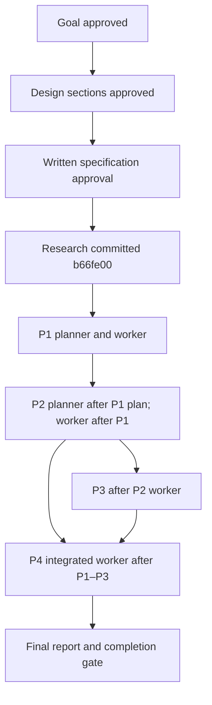

# Calendar tool latency — MAW state

## Workflow configuration

- Artifacts belong directly in `docs/calendar-tool-latency/`.
- User-requested sequence: draft goal -> explicit goal approval -> collaborative brainstorming -> design approval -> research -> dependency/ownership reconciliation -> pipelined planning/execution -> final verification/report.
- **Unified code review skipped (`--skip review`).** Do not dispatch a reviewer or review-triggered fixer. Tests, compatibility checks, defect correction and final verification remain required.
- Current authorization: approved specification; P1 `67bb366`; P2 `3742a38`; P3 implementation/recovery `07f723a` and tests `3cdb07d`; P4 test slice `4c53b47` and evidence `e8e79fa`. P1 owner reports the warm `prepareOwner` storage read fixed locally with focused and P4 warm-path tests passing. P2 owner reports source expiry correctly enforced and adds exact-boundary tests; the P4 failure coincides with the fixture's policy deadline, which correctly denies execution at that instant. A P4 test-owner continuation is separating those deadlines without relaxing authorization. AC8/root policy remain blocked until the integrated acceptance check and final required verification pass. No live/service/deployment authorization. No separate worktree.
- Orchestrator manages graph/status/dispatch and documentation; workers own implementation. Do not ingest `research.md` or `plan*.md` into the orchestrator context.
- At most three child agents alongside the orchestrator. Independent ready planners run concurrently in the foreground; pipeline ready workers, respect file ownership, and serialize shared staging/commits.
- No live services, paid calls, application-database access, provisioning, restart or deployment authorized.

## Delegation configuration & handoffs

- Harness: OpenCode; `functions.subagent` supports a `model` override. Per user direction, all roles use the inherited harness default; no override or effort is supplied.
- Role selections: researcher and planner are configured for consistency but are not being dispatched; worker is configured as `harness-default`.
- Enforcement: inherited worker model is **unverified** because the dispatch result does not expose a confirmed model selector. Do not claim a specific model or effort.
- Review/fixer: skipped by user instruction; do not dispatch.

## Workflow milestones

- [x] Initialize workflow and write draft [`goal.md`](goal.md).
- [x] Obtain explicit user approval of the draft goal: user said "Approved" on 13 November 2026 and added the final `AGENTS.md` deliverable.
- [x] Brainstorm design after goal approval: user approved architecture and failure/recovery/verification sections, then the consolidated written specification.
- [x] Initialize the complete pre-research dependency/ownership graph and commit approved specification `ba614a2`.
- [x] Technical research and handoff summary: `research.md`, commit `b66fe00` (researcher summary supplied in chat; orchestrator did not read artifact).
- [x] Research-reconciled DAG and ownership; implementation plans committed.
- [x] All implementation plans committed (`plan1.md` `4d62254`, `plan2.md` `86253c3`, `plan3.md` `10f2f07`, `plan4.md` `c592e55`).
- [x] P1–P3 worker execution and focused verification complete; P3 test commit `3cdb07d` records the remaining crash-matrix coverage and profiling fixtures.
- [x] P4 integrated acceptance rerun: **47/47 passed**, independently rerun by the orchestrator after the P1 warm-path fix and the P4 policy/source expiry separation.
- [x] Final `verification.md` update and root `AGENTS.md` policy: committed in `b7d0032`; P1 fix `fcb09ae`; P2 boundary tests `327d55d`.
- [x] Integrated final verification: backend build/lint exit 0, integrated spec 47/47, full suite 3,489/39/10 with baseline failures, e2e 35/8/140 (pre-fix) with voice-bootstrap failures.
- [x] Write and commit `final_report.md`; workflow complete with recorded baseline failures and limitations.
- [x] Unified code review: **skipped by user instruction**, not passed.
- [x] Integrated final verification and `final_report.md`: recorded in [`verification.md`](verification.md) and [`final_report.md`](final_report.md); workflow complete with open baseline failures and limitations disclosed.

## Brainstorming and specification — complete

- [x] Refresh current architecture and workspace after goal approval. Researcher's source baseline before `b66fe00`: `7c4ac68` on top of `ba614a2` and `0d62020`. The 13 paths initially seen dirty are committed in `2f5f49c..7c4ac68`, not outstanding user modifications.
- [x] Clarify behavior during asynchronous save failures: user selected continuing reads within existing memory/backlog limits; invalid authority/inconsistent state still stops affected work, and creates require acknowledged action durability.
- [x] Define essential read checks and invalidation responsibilities; research handoff reconciled, exact interfaces delegated to planners.
- [x] Define required durable action/authority/identity/reconciliation evidence and crash-point semantics; exact minimal implementation and physical command profile delegated to plans/tests.
- [x] Specify distinct provider-confirmed/archive-durable states and ordered conflicting mutations without unrelated archive gating.
- [x] Compare three approaches: extend existing memory-first runtime (recommended), separate Calendar executor, and durable-pipeline query tuning (does not meet the prepared-read goal).
- [x] Present architecture section: user approved extending existing runtime/executor, minimal create barrier, async bookkeeping, explicit cold paths and final AGENTS.md policy.
- [x] Present recommended architecture and safety/verification sections: both approved by user.
- [x] Write consolidated design and self-check completeness/consistency/scope; commit only the two named workflow documents. Links, whitespace, placeholder scan and approval/review gates pass.
- [x] Obtain user approval of written design before dispatch: explicit "Approve specification; authorize research" selection on 13 November 2026.
- [x] Complete initial scopes, ownership, planner/worker prerequisites, exit gates and acceptance mapping; reconcile with research commit `b66fe00`.

## Initial findings and research handoff — source facts versus evidence

### Source facts

- **Read path:** `CalendarLoop.execute` promotes both read and create before dispatch. `MemoryText.promoteTurn` flushes session saves, acquires a Mongo lease, replays prior dispatches/decisions/results, writes acceptance/accounting and LangGraph prepare state. `executeReadV2` then durably charges, while `recordResult` awaits retention/result persistence; `publishPromoted` adds finalization work.
- **Provider path:** private HTTP owner preparation (`configure-private-http.ts` -> `AppService.prepareOwner` -> `GoogleCalendarConnections.statusV2`) reads connection storage per request. Hydration and new-session `memory-unbound` state cause further `integration_connections` reads through current-account checks, discovery/capability, tool admission, credential refresh and assembly. `CalendarApiTools.admit` performs required account checks around durable request charging. Research measured 21–23 connection reads on current turns; these are a baseline, not a target for weakening fresh mutation authority.
- **Memory schema/retention:** `memoryCalendarStateSchema` rejects Calendar source-bearing decisions and native Calendar result records; `MemoryCalendarLedger` lacks in-memory logical/request/create charge methods. Calendar retention does not currently redact memory-native docs, and the memory reader errors when such records have been redacted. Invalidation must scrub live and queued memory, while expiry must yield the existing tombstone rather than stale content.
- **Create path:** `CalendarOperationWriter.executeCreate` currently durably reserves planned operation/event and `dispatching` evidence before provider POST; stable provider event ID/readback and no blind write retry are established safety properties. Preserve them while removing unrelated chat flush, accounting replay/checkpoints from the barrier.
- **Other:** Local Canvas already has a memory-first presentation path. No new dependency is needed; research found repository package contracts sufficient. Context7 MCP was unavailable to the researcher; no claim of external-doc verification is made.

### Researcher baseline evidence (not post-change acceptance)

Environment was Windows/Node per research; `AURVIN_TEST_MONGODB_URI` cleared. On `7c4ac68`, backend build and lint exited 0 (lint had 711 warnings); seven focused files passed, 124 tests. Timed synthetic fixture baselines: lookup profile 197 reads/73 writes/262 waves, first dispatch 14,595 ms, first delta 34,410 ms; confirmation profile 0 prior turns 158 reads/45 writes/199 waves, receipt 21,108 ms; 8 prior turns 182 reads/45 writes/223 waves, receipt 22,716 ms. These deterministic timings are not live latency. Full backend/e2e/native/live/frontend checks were not run by research and remain execution/final verification work.

### Reconciled technical contracts

- **P1 prepared authority:** one owner in `GoogleCalendarConnections` for bounded per-user prepared connection/account/authority epoch and decrypted access-token cache. Token remains private to connection service/`withAccessToken`; never put it in Calendar binding, chat memory, prompts or archives; clear on refresh, invalidation, fence and close. Warm/cache confirmed write-through at lifecycle CAS points; reads use prepared authority while creates force current persisted authority/capability. Keep standalone adapter fallback. Wire invalidation from consent, disconnect, reconnect, settings, lifecycle fencing and app-level account invalidation.
- **P2 read path:** resolve account on existing memory-first admission; keep reads/availability in memory through provider result and model continuation. Add in-memory logical/request/refresh/create budgets. Extend bounded schema to hold complete native call/result/source pairs; volatile Calendar content archives only a reference, retained content is byte-bounded. Persist one consolidated memory-native envelope. Extend retention/account-revision invalidation to redact memory-native docs, scrub base/session/queued envelopes and project tombstones on read/history. Stay inside existing bounded save attempts/backlog/age/fence behavior.
- **P3 irreducible create barrier (research finding, not a one-write promise):** retain fresh account/capability/preflight and single-use proposal/intent consumption; ensure session bootstrap if needed; persist accepted input, generating attempt and matching acceptance evidence to avoid orphan recovery; debit create budget; acknowledge `planned` operation/event and `dispatching` CAS with deterministic provider event ID before POST. Do not wait for unrelated dirty chat flush, prior accounting replay, manifest writes or LangGraph prepare/tool checkpoints. Research notes ownership isolation/pause-resume work may be needed to prevent archive-save locks interfering with create; validate minimality and safe sequencing in plans/tests. Operation `planned` may recover with fresh checks; `dispatching` only readbacks the pinned original ID; `succeeded` returns existing result even if prose/archive is missing. Preserve dirty-prefix monotonic archive publication.
- Clarifications/proposals may persist proposal/source/reply-reference data but must not POST. Exact physical command count is measured, never assumed atomic. No exactly-once or cross-collection transaction claim.
- Research handoff source: user-provided researcher summary and verified commit metadata for `b66fe00`; full `research.md` intentionally not read by orchestrator.

## Confirmed direction and pending decisions

The user agreed with the preceding recommendation: memory-first reads, minimal durable intent before mutations, asynchronous consolidated nonessential persistence afterwards. They separately requested goal approval before brainstorming and skipped review.

The user explicitly approved the written goal and design on 13 November 2026 and required adding verified policy to root `AGENTS.md` at the end. Research recommends a reuse-first design and four sequential implementation units; plans must validate the irreducible create barrier and ownership details.

First brainstorming decision: temporary background archive-save failures do not block read-only Calendar tools while safe warmed memory and existing capacity/age limits permit. Reuse tracked retry/failure visibility; unsaved state can be lost on crash. Invalid authority/inconsistency/fencing and exhausted bounds still block affected work. Mutation barriers remain mandatory.

## Dependency matrix and execution status

`R` is complete at `b66fe00`. `P#` worker dependencies require prerequisite implementation and checks, not just a committed plan. The graph remains a four-unit sequential production pipeline; planner dispatch may be pipelined when prerequisites below are met.

| Plan | Title / scope | Planner prerequisites | Worker prerequisites | Planner status | Worker status | Commits |
| --- | --- | --- | --- | --- | --- | --- |
| P1 | Prepared provider authority, credentials, invalidation and fast read admission | R committed + graph reconciled | P1 plan committed | Complete: `4d62254` | Original implementation `67bb366`; owner fix and regression tests are currently uncommitted, worker-reported focused/P4 warm-path checks pass; integration/commit pending | Plan `4d62254`; implementation `67bb366`; fix pending |
| P2 | Memory-first reads, complete Calendar evidence and consolidated async archive | R + P1 plan committed | P2 plan committed + P1 worker complete | Complete: `86253c3` | Original implementation `3742a38`; P2 reports source expiry already correctly enforced and added exact-boundary regression tests; P4 fixture boundary collision being corrected; tests/commit pending | Plan `86253c3`; implementation `3742a38`; regression tests pending |
| P3 | Essential create barrier, dirty-prefix isolation and crash recovery | User-authorized planning pipeline: P1 implementation + P2 plan; P3 plan identifies assumptions | P3 plan committed + P1/P2 implementations complete + M1–M6 reconciled | Complete: `10f2f07` | **Complete** — P3 implementation checkpoint `07f723a`; tests and profiling coverage `3cdb07d`; residual measurement limits passed to P4. | Plan `10f2f07`; implementation `07f723a`; tests `3cdb07d` |
| P4 | Integrated critical-path/recovery verification and final AGENTS.md policy | P2/P3 plans committed; P1 implementation complete | P4 plan committed + P1–P3 implementations complete | Complete: `c592e55` | **Complete** — integrated spec 47/47; final `verification.md` and root `AGENTS.md` policy committed `b7d0032`. | Plan `c592e55`; tests `4c53b47`; evidence `e8e79fa`; final `b7d0032` |

### Execution graph



### Planner readiness and immediate worker dispatch

| Planner | Earliest planning prerequisites | Worker start condition |
| --- | --- | --- |
| P1 | Approved spec and R committed | P1 plan `4d62254` and implementation `67bb366` committed |
| P2 | R + P1 plan `4d62254` committed with agreed interfaces | P2 plan `86253c3` committed; P1 implementation committed |
| P3 | P1 contracts and P2 plan committed; user authorized planning ahead | P3 plan `10f2f07`; P1/P2 implementations committed; reconcile plan's M1–M6 against P2 output before P3 worker |
| P4 | P2/P3 plans committed and P1 implementation complete | P4 plan committed; P1–P3 implementations complete |

Pipeline ready workers while downstream planners work; do not wait for all plans. At the user's direction, P3 planning starts while P2 executes; this overrides the researcher's conservative P3 planner prerequisite, not the P3 worker dependency. P2/P3 production ownership remains sequential because both affect runtime routing. P3 plan must identify P2 output assumptions and be reconciled before its worker starts. P4 may plan independent integrated tests once P3 plan and P1 implementation are committed. Commit permissions remain serialized by the orchestrator, even with disjoint files.

## Plan scopes, ownership and exit gates

### P1 — Prepared provider admission and authority

**Deliverable:** `plan1.md`, narrowly scoped cached/prepared authority and executor interfaces.

**Owned production files:** `backend/src/contracts/calendar-authority.ts`, `calendar-operations.ts`, `backend/src/chat-runtime/calendar-ports.ts`, `backend/src/plugins/google-calendar/connection.ts`, `discovery.ts`, `tools.ts`, `backend/src/operations/calendar-assembly.ts`, and `backend/src/app.service.ts`.

**Tests:** `tools-boundaries.spec.ts`, `tools-multi.spec.ts`, and focused connection/discovery unit suites. The initial 13 dirty paths are committed through `7c4ac68`; refresh `git status` before dispatch and preserve any new changes.

**Scope:** establish connection-service-owned prepared authority/access credentials and invalidation across consent/disconnect/settings/fencing/app callbacks. Keep decrypted token inside the connection owner, clear it on invalidation/refresh/close, keep warm read admission in process memory, force fresh store-backed authority/capability checks for creates, and preserve standalone fixture fallbacks. Research proposes (not mandates) an authority epoch/cache interface; planner minimizes it and defines invalidation races. No generic framework or new dependencies.

**Exit gate:** prepared real executor reaches read provider fixtures with application storage blocked; cold/invalidated credentials, disconnected accounts, changed targets, cancellations and denied access remain safe. No privilege expansion or out-of-budget provider request.

**Worker evidence (`67bb366`; review skipped):** prepared authority remains fresh by default; reads opt into `{ fresh: false }`; uses encrypted stored snapshot, existing lifecycle epoch and bounded revocation watermark; no decrypted-token cache or persistent schema change. Focused report: plugin/assembly selection 32/33 files, 344 passed, with two reported pre-existing failures in `calendar-capability.spec.ts`; build failed on three errors in `calendar-loop.ts`/`calendar-skills.ts`, while lint exited 0 with 720 warnings and no P1-file errors. Those failing files are dirty in the shared checkout and no clean-baseline replay is recorded; treat “pre-existing” as worker-reported, not independently verified. Keep the failures open for final verification; P1 source is committed.

### P2 — Memory-first reads and asynchronous archival

**Deliverable:** `plan2.md`, end-to-end read result continuity on existing memory-first execution.

**Owned production files:** `backend/src/chat-runtime/memory-text.ts`, `calendar-loop.ts`, `durable-chat-runtime.ts`, `memory-first-foundation.ts`, `memory-calendar-ledger.ts`, `memory-calendar-state.ts`, `calendar-history.ts`, `backend/src/context/calendar-context.ts`, `backend/src/persistence/memory-text-archive.ts`, `memory-calendar-reader.ts`, and `calendar-retention.ts`.

**Tests:** `calendar-memory-first.spec.ts` read path assertions, `memory-calendar-state.spec.ts`, `memory-text-archive.spec.ts`, `memory-first-foundation.spec.ts`, and focused history/retention/runtime suites; exclude P4's new integrated file.

**Scope:** resolve prepared account on memory admission; keep read/availability, in-memory budget debit, result pairing and continuation before archive completion. Preserve volatile source references without archiving private content; bounded retained results only where permission allows. Extend existing memory envelopes/archive and retention/tombstone invalidation to Calendar state; scrub invalidated live/queued memory. Leave mutation dispatch barriers unchanged until P3 takes sequential ownership.

**Exit gate:** prepared read and availability dispatch plus subsequent model continuation/follow-up pass with archive persistence blocked; bounded save failure, tool pairing, source expiry, account invalidation and shared text/live-voice consistency pass. Existing create barriers remain enforced.

**P2 implementation evidence (`3742a38`; review skipped):** implementation also updates `durable-chat-runtime.ts` for loaded-session reuse. Focused P2/retention tests: 7 files / 153 passed; broader regression batch: 19 files / 365 passed. Backend build passed; lint exited 0 with 731 warnings. Synthetic archive profile: 45 commands/12 writes; plain-vs-durable comparison 43/12 vs 136/42. Separate baseline-sensitive `calendar-voice-latency.spec.ts`: 12 passed/2 failed at 160 vs <=158 reads (0 earlier turns) and 184 vs <=182 (8 turns), with corresponding duration ceilings; report attributes these to P1 confirmation reference baseline, but no clean replay was done here. `memory-first-voice.spec.ts` had four skips and one worker crash in a durable fallback case involving dirty `app.service.ts`/memory policy. These are open, not passing evidence. Full backend suite, e2e, native service, frontend and live timing were not run.

### P3 — Minimal durable external-mutation boundary

**Deliverable:** `plan3.md`, self-sufficient acknowledged action evidence and safe recovery without unrelated chat flushing.

**Owned production files:** `backend/src/chat-runtime/calendar-operation.ts`, `calendar-recovery.ts`, `calendar-publication.ts`, `calendar-preflight.ts`, `backend/src/chat-runtime/durable-chat-runtime.ts`, `backend/src/persistence/calendar-operations.ts`, `sessions.ts`, plus sequential handoff of P2's `calendar-loop.ts`, `memory-text.ts`, `memory-first-foundation.ts`, and `memory-text-archive.ts` after P2 worker completion. Contract changes after P1 require explicit serialized handback, not concurrent edits.

**Tests:** operation/authority/proposal/recovery and relevant persistence suites selected by research. Do not alter pre-existing dirty user tests without reconciling ownership.

**Scope:** preserve fresh account/capability/preflight, accepted authority/proposal consumption, bootstrap/input/attempt/acceptance evidence needed by recovery, create-budget debit and acknowledged planned+dispatching operation identity before POST. Do not gate on unrelated dirty prefix flush, accounting replay, manifest or LangGraph checkpoints. Prove no archive-owner lock blocks the action; maintain ordered dirty-prefix archival. Recover planned only with fresh checks, dispatching by pinned-ID readback only, succeeded by returning its existing result. Proposals/clarifications still never POST. No transaction assumptions or blind create replay.

**Exit gate:** direct/proposal creates proceed independently of unrelated archive work after all essential action evidence; failed/uncertain barriers never send creates. Crash matrix, duplicate/concurrent requests, ambiguous dispatch/readback, successful-create/post-save failure and restart with unresolved operations never silently issue a second create. Conflicting actions remain ordered.

### P3 execution handoff and completion evidence — 13 November 2026

**Resume protocol (executed):** the P3 continuation completed Task 6's remaining assertion, added crash/recovery and concurrency tests, and completed Task 7's caller audit/profiling fixtures. The worker did not commit. The orchestrator staged only the three P3 test files and committed them as `3cdb07d`; no production files were changed. Review remains **skipped** (not passed). The resume began at `07f723a`; `.commandcode/` was preserved and not staged.

**Baseline:** P1 `67bb366`, P2 `3742a38`, plans `4d62254` / `86253c3` / `10f2f07` / `c592e55`, and P3 checkpoint `07f723a`. No frontend files were modified by P3; do not run frontend checks.

**Checkpointed P3-owned files:** the listed P3 production and test paths are already committed in `07f723a`. That checkpoint also includes concurrent personalization, voice, Canvas, admin-config, and frontend changes; those are part of the existing commit and must not be amended or otherwise disturbed as P3 scope. The working tree was clean at resume.

**Task 5/6 production implementation (complete, build passed at task-331):**

- `persistence/sessions.ts`: `listForRecovery` also selects `{ memoryPublication: { $exists: true } }` as bounded keyset candidates, with a `ponytail:` keyset-ceiling comment.
- `persistence/memory-text-archive.ts`: `ensureAttempt` permits accepted → generating → finalizing → terminal for the verified minimal-barrier case.
- `chat-runtime/calendar-operation.ts`: exports `calendarActionHash`, `buildOperationEventV2`, `repairOperationEventV2` (idempotent exact-sequence event repair only; competing sequence/receipt/foreign attempt rejected).
- `chat-runtime/calendar-recovery.ts`: `pendingCalendarOperation` (checkpointless scoped unresolved lookup, overflow → `NOT_READY`, v1 preserved), `reconcileCalendarOperationV2`, `reconcilePlannedCalendarOperationV2`, `reconcileConsumedProposalWithoutOperation`.
- `chat-runtime/memory-first-foundation.ts`: `session()` exposes `pausedAttemptId`.
- `chat-runtime/memory-text.ts`: `reconcileMutation(sessionId)` and `prefixFrozen` fix.
- `chat-runtime/durable-chat-runtime.ts`: `reconcileSession` covers in-memory `reconcileMutation`, stopped-owner unsealed/behind-manifest recovery, planned operations, consumed-proposal-without-operation, minimal-operation publication repair (`repairOperationEventV2` + `advancePublicationIfClean`) and a legal interrupted transition without `interruptAttempt` watermark leap.

**Continuation fixes included in checkpoint `07f723a`:**

- `calendar-recovery.ts` now decodes the proposal-consumption wrapper with `decodeCalendar(proposalConsumptionRecordSchema, …)` in both `verifiedConsumptionAuthority` and the metadata fallback. The previous strict `safeParse` rejected persisted `_id`/`_revision`, which silently turned a healthy consumed-proposal repair into `interrupted`. Added local `CalendarProposalConsumptionWrapper` type. This is a real production defect fix, not just test scaffolding.
- `test/persistence/calendar-multi-operations.spec.ts`: added missing `kind: 'attempt'` to the `putAttemptConfirmed` fixture (it was failing `INVALID_REQUEST`); foreign-attempt and tampered-receipt expectations now use `IDEMPOTENCY_PAYLOAD_MISMATCH` (matching `repairOperationEventV2`).
- `test/runtime/calendar-multi-recovery.spec.ts`: fixed the dispatching-crash hold — it stored the promise under `enteredDispatch` and called it as a resolver, so the test never paused; now `enterDispatch()` is the resolver. Debug instrumentation from diagnosis has been removed from all files (verified: no `DEBUG-` or `no-console` leftovers).

**P3 completion verification (13 November 2026; worker report unless noted):**

| Suite | Result |
| --- | --- |
| Task 6 focused recovery set | 7 files, 123/123 passed |
| Three changed test files | 91/91 passed (worker report; independently rerun by orchestrator: 3 files, 91/91) |
| Full Task 7 focused set | 22 files: 17 passed, 4 failed; 363 passed / 8 failed |
| `npm --prefix backend run build` | exit 0 |
| `npm --prefix backend run lint` | exit 0; 0 errors, 742 warnings across 757 files |
| `test/persistence/local-owner.spec.ts` | 8 passed / 1 failed on the known old `$or` expectation; deliberately not changed under P3 |
| `git diff --check` | exit 0 before commit |

The four failing focused files were reported identical after stashing P3 test changes and rerunning at `07f723a` (worker-reported baseline replay): `calendar-confirmation.spec.ts` (4), `calendar-memory-voice.spec.ts` (1), `calendar-voice-authority.spec.ts` (1), and `calendar-voice-latency.spec.ts` (2). The separate `local-owner.spec.ts` failure is the known `listForRecovery` query-shape discrepancy; keep it visible for P4/final reporting rather than changing its P1/P2-owned expectation.

P3 added crash coverage for pre-acceptance failure, success before terminal archive, partial terminal publication retry, cancellation boundaries, changed-action idempotency, and text/live competing creates. The caller audit confirmed the `commitPromoted` and mutation-finally boundaries described in the worker report. Probe-backed command profiles cover direct and proposal-confirmed creates at zero/eight prior turns, prepared/cold/changed/recovery paths, and sensitive-data canaries. Command counts and ordering are synthetic evidence, not live latency.

**P3 limitations handed to P4:** probe `readMs`/`writeMs` were zero, so elapsed timing is not modeled and sequential stage timing remains partly unmeasured; refresh lacks an assembled OAuth refresh profile; mixed read/create is covered by an existing test but not a probe profile. No live provider, native service, staging, or topology certification was performed. These are reporting/integration-verification limitations, not claims of universal latency.

### P4 evidence update — 14 November 2026

P4 test slice `4c53b47` and partial verification evidence `e8e79fa` are committed. The P1 warm-owner assertion reproduced and the P1 owner reports a one-line switch in `GoogleCalendarConnections.statusV2()` to reuse prepared status, plus regression tests; its focused suite, broader plugin/assembly suite, build/lint, and isolated P4 warm-path assertion passed. P1 changes remain uncommitted pending orchestrator verification.

P2 traced the remaining integrated failure to a fixture collision, not stale-source publication: the P4 fixture sets the Calendar policy deadline to `CLOCK + 1 hour`, and source `expiresAt` is clamped to that same instant. At that instant the policy correctly expires and the tool is denied before provider dispatch. P2's source/history/context boundary checks use `now >= expiresAt`; P2 reports its new P2-focused tests passing, with no production change. Do not make policy expiry inclusive or weaken authorization. The P4 test owner is isolating source expiry from policy expiry so the integrated fresh-provider-read check runs while policy remains valid. Until that P4 adjustment and reruns pass, the integrated acceptance gate is open and AC8 stays blocked.

P1 owner-reported focused results were independently rerun by the orchestrator: the 10-file plugin/assembly selection passed 114/114, including the warm-path regression. P1 also reported 29 plugin/assembly files 326/326, P4 warm-path acceptance 1/1, build/lint exit 0, and no new type-aware lint warnings; these remain worker-reported where not independently rerun.

P2 owner-reported focused results were independently rerun by the orchestrator: seven source/archive suites passed 179/179. The 19-file broader selection had 14 files pass and four known baseline-failure files (8 failed tests plus one worker error), per report. P2's exact-boundary test asserts expired evidence is tombstoned and a new provider GET occurs when authorization remains valid.

The P4 test owner separated the two deadlines: the fixture gained an optional `policyLifetimeMs` (default unchanged at one hour); the source-expiry case uses a 48-hour policy with a 24-hour source lifetime, and a new separate policy-expired case uses the default one-hour policy and asserts safe denial with no provider request, no calendar view and no stale content. Production deadline comparators were not changed. The orchestrator independently reran the full integrated spec: **47/47 passed, exit 0**.

Orchestrator final full-suite rerun (14 November 2026, secrets/service env cleared): `npm test` in `backend/` → 374 files: 360 passed, 11 failed, 2 skipped; 3,540 tests: **3,489 passed, 39 failed, 10 skipped**; 1 Vitest worker error; exit 1. Failing files: `durable-latency.spec.ts` (21, timing/context-budget; P4's isolated run had 19), `calendar-confirmation.spec.ts` (4), `calendar-voice-latency.spec.ts` (2), `calendar-memory-voice.spec.ts` (1), `calendar-voice-authority.spec.ts` (1), `local-guard.spec.ts` (3), `local-open.spec.ts` (3), `calendar-assets.spec.ts` (1, stale "one calendar per decision" instruction assertion), `calendar-simplification.built.spec.ts` (1, missing `dist` module), `finalization-repair.spec.ts` (1), `local-owner.spec.ts` (1, known `listForRecovery` `$or` expectation). These are the same baseline/environment classes P4 recorded; the `durable-latency` count varies with concurrent load and is not a clean isolated measurement. No failure is attributed to the P1/P2/P4 fixes, but that attribution is evidence-based only for the files and cases rechecked.

Orchestrator final build/lint: `npm run build` exit 0; `npm run lint` exit 0 (warnings only, no errors).

**Verification commands (PowerShell, backend):**

```powershell
Remove-Item Env:AURVIN_TEST_MONGODB_URI -ErrorAction SilentlyContinue
npm --prefix backend run build
npm --prefix backend test -- test/runtime/calendar-recovery.spec.ts test/runtime/calendar-recovery-unavailable.spec.ts test/runtime/calendar-multi-recovery.spec.ts test/runtime/calendar-operation.spec.ts test/persistence/calendar-multi-operations.spec.ts test/persistence/calendar-mutation-session.spec.ts test/performance/calendar-memory-first.spec.ts
npm --prefix backend test -- test/persistence/local-owner.spec.ts
```

**Known compatibility discrepancy to report, not fix under P3:** `backend/test/persistence/local-owner.spec.ts:148` strictly asserts the old `$or` shape of `listForRecovery`; the new `memoryPublication` filter changes it. Flag to P1/P2/P4; do not edit under P3 ownership. Also report the four pre-existing `calendar-confirmation.spec.ts` failures if still present.


### P4 — Integrated verification and final policy

**Deliverable:** `plan4.md`, integrated evidence in `verification.md`, final root instruction update, and final-report input.

**Owned files:** new `backend/test/performance/calendar-tool-latency.spec.ts` and new disjoint fixtures; `docs/calendar-tool-latency/verification.md`; root `AGENTS.md` only after implementation and evidence are established. Orchestrator owns `goal.md`, `state.md`, and `final_report.md`. P4 owns no production fixes; route defects to the owning worker.

**Scope:** real assembled-path critical-path and recovery checks without guard overrides; baseline/before-after command/wave measurements, prepared/cold/mixed read-create/text/voice coverage. Load the instruction-writing skill for final AGENTS.md policy and preserve unrelated root instructions.

**Exit gate:** all eight criteria have explicit implementation/test evidence; build/lint/required suites recorded with failures/skips and baseline classification; AGENTS.md matches verified semantics and exceptions. No universal zero-latency or live/topology certification without evidence. No review dispatch.

## Acceptance coverage

| Goal criterion | Primary owners | Integrated check |
| --- | --- | --- |
| AC1 Prepared read dispatch | P1, P2 | P4 blocked-store production-route checks |
| AC2 Immediate continuation/follow-up | P2 | P4 held-save and mixed-mode checks |
| AC3 Minimal mutation barrier | P1, P3 | P4 barrier versus unrelated-save ordering |
| AC4 Failure/recovery/idempotency | P3 | P4 crash-point and uncertain-outcome checks |
| AC5 Invalidation/isolation | P1, P2, P3 | P4 revocation/expiry/text-voice races |
| AC6 Measurements | P1–P3 baseline/incremental evidence | P4 consolidated prepared/cold before-after |
| AC7 Regression evidence | Each worker | P4 plus orchestrator final verification |
| AC8 Future tool instructions | P4, P1, P2 | Blocked until warm prepare and exact-expiry checks pass; then verify final AGENTS.md against source/evidence |

## Research handoff — complete (`b66fe00`)

Research used source baseline `7c4ac68`, package contracts (`@langchain/langgraph ^1.4.19`, `mongodb ^6.21.0`, `zod ^3.25.32`, `vitest ^4.1.2`), and repository call-chain inspection. Context7 MCP was unavailable; no live provider/database calls were used. User supplied a detailed researcher summary; orchestrator verified commit metadata and did not read `research.md`.

- Existing provider reads repeatedly hit connection storage across HTTP preparation, hydration, current-account checks, discovery/capability, execution admission and credentials; preserve a warm per-owner prepared authority for reads and force fresh current authority for creates.
- Keep decrypted credentials solely inside the connection manager, invalidate on all authority/lifecycle changes, retain standalone adapter fallback, and scrub/redact/tombstone Calendar source/result memory across expiry and account invalidation.
- Continue Calendar reads in bounded memory through model continuation; archive complete paired evidence through the existing async memory save mechanism. Volatile source content stays a reference; retained payloads remain permission-gated and byte-bounded.
- Minimal create dispatch still needs fresh account/capability/preflight and consumed authorization, accepted input/attempt/acceptance reconciliation evidence, create-budget debit, and acknowledged operation `planned`/`dispatching` identity before POST. Avoid unrelated chat flush, history/accounting replay, manifest writes and LangGraph tool checkpoints. Verify dirty-prefix/session ownership isolation and crash recovery for planned, dispatching, succeeded states.
- Clarification/proposal writes are not event creates. No exactly-once, cross-collection transaction or single physical write assumption.
- Baseline checks on `7c4ac68` (Mongo test URI cleared): backend build passed; lint exit 0 with 711 warnings; focused 7 files/124 tests passed. Synthetic timings and counts are recorded above. Full suites, frontend, native DB and live services were not run.

## Verification policy

- Preparation is documentation-only: verify paths, links, graph/gate consistency and preservation of user changes. No unrelated application suites required for this gate.
- Approved workflow source baseline is `7c4ac68`; researcher commit is `b66fe00`. At handoff only orchestrator-owned `goal.md` and `state.md` were modified; refresh status before dispatch. The 13 paths dirty at initial initialization were committed by `7c4ac68`.
- Research baseline focused tests: seven files / 124 passed; backend build passed; lint exited 0 with 711 warnings. These are baseline, not final acceptance. No full routine/e2e/frontend/native/live checks were run in research.
- Before implementation, capture exact current baseline and any new dirty paths/known failures. Assign regression tests on the real production path before changes.
- Later backend checks: `npm run build`, `npm run lint`, `npm test`, `npm run test:e2e`, plus focused deterministic Calendar/read/mutation/text/voice/recovery performance checks chosen by the plans.
- Run frontend checks if its source changes. Treat native prerequisites and skipped discovery honestly; do not substitute application credentials or call live providers.
- Final evidence must distinguish source inspection, deterministic tests, real service timing, skipped review and remaining limitations.

## Workspace preservation

Initial checkout was `0d62020`, ahead of origin. The 13 paths initially modified then are committed through `7c4ac68`. P1 and P2 were committed using explicit owned-path lists. P2-owned production/test paths are clean after `3742a38`; remaining unrelated user/concurrent backend/frontend edits stay untouched in this checkout. Before each later worker, refresh status; inspect and preserve any dirty owned path, and stop/report if safe integration is unclear. No separate worktree by user direction. Preserve `.openchamber/`, local configuration and older workflow artifacts.

During this resume, a concurrent session committed an unrelated `docs/web-search` workflow at `7f2bd0a` on top of `e8e79fa`, and left `docs/web-search/state.md` modified. That work is outside this objective and must be preserved; do not stage or revert it. `.commandcode/` remains untracked and unstaged.

## Artifact and commit record

| Artifact | State | Commit |
| --- | --- | --- |
| `goal.md` | Written specification approved | `ba614a2` |
| `state.md` | Planning complete; P3 execution handoff recorded | Pending orchestrator commit |
| `research.md` | Complete; user-provided research handoff | `b66fe00` |
| `plan1.md` | Complete; prepared authority plan | `4d62254` |
| P1 implementation | Prepared Calendar authority; integration caveats recorded | `67bb366` |
| `plan2.md` | Complete; read fast-path and async archival plan | `86253c3` |
| `plan3.md` | Complete; minimal mutation barrier | `10f2f07` |
| `plan4.md` | Complete; integrated verification plan | `c592e55` |
| P2 implementation | Memory-first Calendar reads and async archival | `3742a38` |
| P3 implementation | Production/recovery implementation checkpoint | `07f723a` |
| P3 crash tests and profiling fixtures | Complete | `3cdb07d` |
| P4 integrated test slice | Complete | `4c53b47` |
| P4 finalization | Integrated tests, final evidence and root policy | `b7d0032` |
| `final_report.md` | Complete; workflow closed with recorded limitations | This commit |

## Current gate and resume procedure

**CURRENT GATE: COMPLETE. Final verification and `final_report.md` are committed; the remaining full-suite/e2e failures are recorded baseline/environment failures, and review remains skipped.**

1. Read this state and the approved goal; preserve intervening changes and re-read `git status`.
2. Written specification approval and execution authorization are recorded; do not reopen approval gates unless scope/design changes.
3. P1–P4 are complete. P1 warm-status fix `fcb09ae`; P2 boundary tests `327d55d`; P4 final evidence/policy `b7d0032`; final report in the closing commit.
4. Do not treat the open baseline failures, skipped review, or missing native/live/staging evidence as passes. Any future work should start a new workflow or explicitly reopen scope.
5. Preserve `.commandcode/`, `docs/web-search/` and all unrelated concurrent changes.
