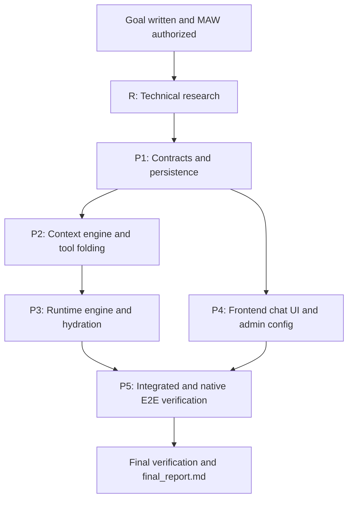

# State & Dependency Graph: In-Session Context Compaction & Semantic-Ready Memory

## Workflow configuration

- Keep all workflow artifacts directly in `docs/context-compaction-memory/`.
- Create no unnecessary directories; reuse existing source directories (`backend/src/**`, `frontend/src/**`).
- Skipped phases declared: `--skip review`.
- Mandatory phases: Brainstorming, research, planning, worker execution, meaningful tests, and final verification remain required.
- Current authorization: User approved `goal.md`, authorized MAW conversion with `--skip review`, and prioritized minimal latency, minimal cost, smooth experience, and avoiding over-engineering/excessive validation.
- Concurrency cap: At most 3 child agents alongside the orchestrator; serialize shared git commits.
- File preservation rules: Preserve all unrelated user changes (`benchmarks/voice-architectures/**`, `docs/voice-latency-benchmark/**`, `.openchamber/**`). Stage named files explicitly; never use `git add .`.

## Workflow milestones

- [x] Step 1: Brainstorming & Goal Alignment (`docs/context-compaction-memory/goal.md`; `dd7580a`)
- [x] Step 2: Technical Research (`docs/context-compaction-memory/research.md`; `81719e1`)
- [x] Step 3: Planning Completed (P1–P5 plans committed: `9a1a3a0`, `3097f59`, `e2395c4`, `2a8f0c7`, `0bc2f4b`)
- [x] Step 4: Execution Completed (P1–P5 workers finished)
- [x] Step 5: Unified Code Review (Skipped via `--skip review`; never passed)
- [x] Step 6: Final Verification & Report (`docs/context-compaction-memory/final_report.md`)

## Brainstorming tasks

- [x] Explore project context: `context/`, `contracts/`, `chat-runtime/`, `persistence/`, `model/`, `frontend/src/features/chat/`.
- [x] Clarify requirements, edge cases, scope boundaries (in-session compaction first, async 80% checkpoint, task-aware density, configurable `active-fork` default model, quiet inline UI divider + silent live voice).
- [x] Compare approaches and select Approach 1 (two-stage cache-aligned pipeline).
- [x] Present design in 4 sections and receive user approval.
- [x] Simplify spec against Ponytail principles and write `docs/context-compaction-memory/goal.md`.
- [x] Self-check specification for completeness, consistency, ambiguity, and scope.
- [x] Construct the pre-research DAG, file ownership, dependencies, acceptance mapping, and resume procedure below.

## Initial findings

- `checkContextBudget` (`backend/src/context/context-budget.ts`), `calendarContext`, and `webContext` enforce `maxHistoryTokens` (default `10,000` JSON-byte estimate), `maxContextTokens`, and `maxMessagesInContext` (default `80`) fail-closed without compaction.
- `agentMemoryManifestSchema` (`backend/src/contracts/agent-memory.ts`) already reserves `summaryRefSchema` / `activeSummaryRef`, `sourceRanges`, and `messageRefs` (max 500), currently gated off via `activeSummaryRef === null` assertions in `reference-selection.ts`, `persistence/memory.ts`, and `finalization.ts`.
- `MemoryFirstFoundation` (`backend/src/chat-runtime/memory-first-foundation.ts`) and `MemoryText.hydrate` (`backend/src/chat-runtime/memory-text.ts`) enforce hard `128`/`250`-turn and `500`-message archive ceilings that must be decoupled from the active tail so sessions can continue indefinitely.
- `backend/src/model/policy.ts` and `openrouter-adapter.ts` already emit `cache_control: { type: 'ephemeral' }` (Anthropic) and per-session `session_id`; keeping `[0..prefixCount-1]` + `[activeSummary]` append-only between 80% checkpoints preserves prompt KV-cache hits.
- `product_knowledge.md` and `backend/test/evaluations/deterministic.behavior.spec.ts` pin digests and wording about compaction being deferred and must be updated cleanly in P2/P5.

## Confirmed product decisions

- Scope: In-session structured compaction + tool-payload folding on a semantic-ready schema (Text + Live Voice).
- North star: Maximum KV-cache hits, minimal latency (zero pre-model DB I/O), minimal cost, smooth UX, and zero over-engineering or redundant validations.
- Trigger: Async background compaction at 80% soft watermark; live conversation keeps flowing; promote atomically between turns; burst fallback (`Stage 1 -> await in-flight -> inline fallback`).
- Ongoing work protection: Plugin-agnostic safe cutpoints (`protectedTail` + active commitment pins) + adaptive-density `
` preserving active workflows, URLs, and IDs.
- Compaction model: Configurable in Admin Config, defaulting to `'active-fork'` (reuses live prompt KV-cache), with optional `'custom'` fast/cheap model.
- UI UX: Full history remains scrollable; quiet inline checkpoint divider (with optional summary preview) + quiet context utilization badge in Text Chat; completely silent in Live Voice.

## Dependency matrix & execution status

`R` means technical research completed and committed. `P#` worker dependencies mean prerequisite implementation is completed, verified, and committed.

| Plan ID | Title & Scope | Worker dependencies | Touched files / subsystems | Planner status | Worker status | Commits |
| :--- | :--- | :--- | :--- | :--- | :--- | :--- |
| **P1** | Contracts, Admin Config Schema & Persistence Primitives | R (`81719e1`) | `backend/src/contracts/{agent-memory,context,budgets,admin-config-wire,admin-config,config-runtime,session,repositories,api,stream,metadata}.ts`, `frontend/src/api/admin-config-protocol.ts`, `backend/src/platform/config/{manageable-config,legacy-config-import}.ts`, `backend/src/persistence/{memory,metadata,messages,records}.ts` | [x] 9a1a3a0 | [x] Complete | `b9b6864`, `95bbdbd`, `2d864de`, `16612be`, `11bbd83` |
| **P2** | Context Engine: Tool Folding, Cutpoint, Compaction Prompt & Prompt Copy | P1 | `backend/src/context/{tool-folding,cutpoint,compaction-prompt,referenced-context-assembler,reference-selection,calendar-context,web-context,context-budget}.ts`, `product_knowledge.md` | [x] 3097f59 | [x] Complete | `568354f`, `7ca1d62`, `5b8ff1b`, `70d2753`, `620f91b`, `5d19db6`, `43e0de0` |
| **P3** | Runtime Compaction Engine, Working-Set Eviction & Model Dispatch | P1, P2 | `backend/src/chat-runtime/{memory-first-foundation,memory-text,durable-chat-runtime,finalization,calendar-history}.ts`, `backend/src/persistence/memory-text-archive.ts`, `backend/src/agent/state.ts`, `backend/src/model/{compaction-runner,catalogue}.ts`, `backend/src/admin-config/admin-config.service.ts`, `backend/src/app.service.ts`, `backend/src/http/{chat-http.service,chat-stream.transport}.ts` | [x] e2395c4 | [x] Complete | `a39bdff`, `337725b`, `f42aad1`, `6fa13ae`, `8cf5974`, `ae29dbb` |
| **P4** | Frontend Chat Checkpoint UI, Context Meter & Admin Config | P1 | `frontend/src/api/protocol.ts`, `frontend/src/features/chat/**`, `frontend/src/components/{Transcript,Composer}.tsx`, `frontend/src/features/admin-config/**`, `frontend/src/styles/**` | [x] 2a8f0c7 | [x] Complete | `17d9b12`, `debca9a`, `1ee8b57`, `6d3d5aa`, `e4fc4d7`, `39e5fbe`, `de6ecf8` |
| **P5** | Integrated Verification, Native Long-Session E2E & Eval Alignment | P2, P3, P4 | `backend/test/integration/compaction.native.e2e-spec.ts`, `backend/test/evaluations/**`, cross-layer voice/calendar/cache verification | [x] 0bc2f4b | [ ] Pending | - |

### Execution graph

### Planner readiness and immediate worker dispatch

| Planner | Earliest planning prerequisites | Worker start condition |
| :--- | :--- | :--- |
| P1 | R committed | P1 plan committed |
| P2 | P1 worker committed (or P1 plan committed if contracts frozen; wait for P1 worker for clean typecheck) | P2 plan committed and P1 worker complete |
| P4 | P1 worker committed | P4 plan committed and P1 worker complete |
| P3 | P2 plan committed and P1 worker committed | P3 plan committed and P1 + P2 workers complete |
| P5 | P2, P3, P4 workers complete | P5 plan committed and P2, P3, P4 workers complete |

## Plan scopes, file ownership, and completion gates

### P1 — Contracts, Admin Config Schema & Persistence Primitives
**Deliverable:** `plan1.md`; bounded contract extensions and persistence store/archive primitives without over-engineered validation layers.
**Owned files:**
- `backend/src/contracts/{agent-memory,context,budgets,admin-config-wire,admin-config,config-runtime,session,repositories,api,stream,metadata}.ts`
- `frontend/src/api/admin-config-protocol.ts` *(verbatim mirror required by `admin-config.spec.ts`)*
- `backend/src/platform/config/{manageable-config,legacy-config-import}.ts`
- `backend/src/persistence/{memory,metadata,messages,records}.ts`
- Targeted unit tests in `backend/src/contracts/*.spec.ts`, `backend/test/persistence/*.spec.ts`
**Exit gate:** `ActiveSummaryRecord`, non-null `activeSummaryRef`, `compaction` admin settings (default `enabled: true, watermarkRatio: 0.8, modelMode: 'active-fork'`), `purpose: 'chat' | 'compaction'` accounting, and wire checkpoint/usage schemas parse cleanly; `MongoMemory` and `MongoMetadata` store/read/redact `<calendar_context>` cleanly; `backend` `npm run build` and targeted contract/persistence specs pass.

### P2 — Context Engine: Tool Folding, Cutpoint, Compaction Prompt & Prompt Copy
**Deliverable:** `plan2.md`; minimal pure functions for Stage 1 folding, cutpoint `K`, two-block compaction prompt/anchored merge, and summary injection.
**Owned files:**
- `backend/src/context/{tool-folding,cutpoint,compaction-prompt,referenced-context-assembler,reference-selection,calendar-context,web-context,context-budget}.ts`
- `product_knowledge.md`
- Targeted tests in `backend/test/context/*.spec.ts` (updating `context-failures.spec.ts` where `activeSummaryRef !== null` was previously rejected)
**Exit gate:** Stage 1 batch-folds stale `web_tool` / Calendar / duplicate Canvas / oversized plugin payloads without breaking append-only KV caches between checkpoints; `calendar-context.ts` anchors `catalogIndex` to `prefixCount` so plugin catalog stays before `<compacted_history>`; `<analysis>` stripped on parse; Cycle 2+ anchored merge resolves contradictions; `activeSummary` sits after `prefixCount` inside `historyTokens`; `npm run build` and context specs pass.

### P3 — Runtime Compaction Engine, Working-Set Eviction & Model Dispatch
**Deliverable:** `plan3.md`; async 80% background compaction, non-blocking live turns, between-turn promotion, burst fallback, $O(\text{tail})$ hydration, and thin model runner.
**Owned files:**
- `backend/src/chat-runtime/{memory-first-foundation,memory-text,durable-chat-runtime,finalization,calendar-history}.ts`
- `backend/src/persistence/memory-text-archive.ts`
- `backend/src/agent/state.ts`
- `backend/src/model/{compaction-runner,catalogue}.ts`
- `backend/src/admin-config/admin-config.service.ts`
- `backend/src/app.service.ts`, `backend/src/http/{chat-http.service,chat-stream.transport}.ts`
- Targeted runtime/model/admin specs in `backend/test/runtime/*.spec.ts`, `backend/src/admin-config/*.spec.ts`, `backend/src/app.controller.spec.ts`
**Exit gate:** Live turns run at zero pre-model DB latency while async compaction executes at 80%; concurrent turns preserve `K+1..latest` and prune orphaned `baseCalendar`/`baseWeb` groups; `calendar-history` & `hydrate` read only tail sequences; >100% bursts resolve via Stage 1 -> await in-flight -> inline fallback; turns >128 succeed without `STORAGE_BUDGET_EXCEEDED`; live voice compacts silently; compaction emits `AccountingRecord` (`purpose: 'compaction'`); `backend` `npm run build`, `npm run lint`, and `npm test` pass.

### P4 — Frontend Chat Checkpoint UI, Context Meter & Admin Config
**Deliverable:** `plan4.md`; quiet checkpoint divider + summary preview, quiet context usage pill, and Admin Config compaction settings UI.
**Owned files:**
- `frontend/src/api/protocol.ts`, chat client/SSE parser
- `frontend/src/features/chat/**`, `frontend/src/components/{Transcript,Composer}.tsx`
- `frontend/src/features/admin-config/**`, `frontend/src/styles/**`
- Targeted tests in `frontend/src/**/*.test.ts`
**Exit gate:** `Transcript` renders quiet checkpoint divider at `compactedThroughSequence` with optional preview while preserving full scrollable history; quiet context meter updates smoothly and stays silent in Live Voice; Admin Config edits/validates `compaction` settings and `catalogCoverage` passes; `frontend` `npm run build`, `npm run lint`, and `npm test` pass.

### P5 — Integrated Verification, Native Long-Session E2E & Eval Alignment
**Deliverable:** `plan5.md`; native MongoDB E2E proving >128-turn sessions, crash recovery, Calendar expiry redaction, KV-cache parity, and eval pin alignment.
**Owned files:**
- `backend/test/integration/compaction.native.e2e-spec.ts`
- `backend/test/evaluations/**` (only pinned wording/digest updates if affected by `product_knowledge.md`)
**Exit gate:** Native MongoDB suite (when URI available, plus deterministic integration fallback) verifies 150+ turn persistence/hydration, crash-window safety, and Calendar redaction; full backend & frontend suites pass.

## Acceptance coverage

| Goal criterion | Primary owner(s) | Integrated verification |
| :--- | :--- | :--- |
| AC1: Zero pre-model DB latency & append-only KV-cache preservation | P2, P3 | P3, P5 |
| AC2: Stage 1 deterministic tool folding & ongoing-task protection (`protectedTail`, URLs/IDs, proposals) | P2 | P2, P5 |
| AC3: Async 80% compaction, non-blocking live turns, between-turn swap & burst fallback | P3 | P3, P5 |
| AC4: `<analysis>` stripping, 8-section anchored merge & Calendar `<calendar_context>` redaction | P1, P2, P3 | P2, P5 |
| AC5: Lift 128-turn / 500-message ceiling with full UI scrollback & $O(\text{tail})$ hydration | P1, P3 | P5 |
| AC6: Admin Config (`active-fork` default + custom model) & quiet Text/Voice UX | P1, P3, P4 | P4, P5 |

## Research handoff — complete (`81719e1`)

External + internal codebase research completed (`docs/context-compaction-memory/research.md`, commit `81719e1`) with critical catches reconciled into P1–P5:
- **KV-Cache Preservation (Manus/Factory.ai/OpenRouter):** Never fold older turns turn-by-turn between checkpoints (invalidates downstream KV cache at `4x–10x` prefill cost). Use Stage 1 deterministic folding strictly when pre-processing `[0..K]` at checkpoints and for emergency RAM-only Burst Step A (`>100%`); between 80% checkpoints, keep `[0..prefixCount-1] + [activeSummary] + [K+1..M]` strictly append-only. `defaultEnvironmentContext` already uses UTC `YYYY-MM-DD`, preserving within-day prefix invariance.
- **`calendar-context.ts:244` Prefix Boundary Catch:** `catalogIndex` currently uses `positions[0]?.index ?? ...`, which would push `Enabled plugin catalog` *after* `<compacted_history>`. P2 must anchor `catalogIndex` to `prefixCount` so catalog + voice Canvas inventory remain inside `nativePrefixCount`.
- **Orphaned Tool Groups Catch:** `calendar-context.ts:235` and `web-context.ts:71` throw `INVALID_REQUEST` if historical groups contain a `turnId` outside `historyPositions`. P3 must prune `baseCalendar`, `baseWeb`, `cold.groups`, and `cold.webGroups` to tail `turnId`s on promotion/execute, and bound `calendar-history.ts:49-55` `listAttempts` to `sequence >= minRecordSequence`.
- **Compaction Accounting Seam:** `MongoMetadata.putAccountingConfirmed` (`persistence/metadata.ts:336-339`) expects a matching `AttemptRecord`. Adding `purpose?: 'chat' | 'compaction'` on `accountingRecordSchema` skips the `getAttempt` check only for compaction records while feeding `accountingTotalsPipeline` cleanly without fake user-turn attempts.
- **Model Runner & Config Seams:** `CompactionRunner` (`model/compaction-runner.ts`) reuses `providerParameters` / `OpenRouterAttemptAdapter` (`session_id`, `cache_control`, `user`), lifting `maxMessagesInContext` slightly for the appended compaction prompt. Validate `compaction.customModelId` against the existing single `/models` `CatalogueSnapshot` (`model/catalogue.ts`, `admin-config.service.ts`).
- **O(tail) Hydration & 128-Turn Ceiling Removal:** Replace `MemoryFirstFoundation` `requests.size >= maxRequestsPerSession` lock (`line 371`) with $O(1)$ eviction of oldest settled keys; evict `0..K` from `base`, saved `results`, `baseCalendar`, `baseWeb`, `archive` on promotion; remove `MemoryText.hydrate` full `messages.listForContext` scan and fall back to `p.messages.listPublished` for older UI scrollback.
- **Pinned Test Hazards:** `admin-config.spec.ts:256-262` asserts verbatim equality between `admin-config-wire.ts` and `frontend/src/api/admin-config-protocol.ts` (owned together in P1); `config-edit-state.test.ts` asserts `catalogCoverage` across `ADMIN_CONFIG_FIELD_PATHS`; `context-failures.spec.ts:28` expects `activeSummaryRef !== null` failure (updated in P2); `deterministic.behavior.spec.ts` (`test:behavior`, already has 2 pre-existing `SYSTEM_DIGEST`/`<canvas_guidelines>` failures) pins `KNOWLEDGE_DIGEST`/`PK-01` (aligned in P5).

## Final verification commands and evidence

| Working directory | Command | Expected purpose |
| :--- | :--- | :--- |
| `backend` | `npm run build` | TypeScript compilation & dist check |
| `backend` | `npm run lint` | ESLint verification |
| `backend` | `npm test` | Full unit/deterministic suite |
| `backend` | `npm run test:e2e` | Native/e2e integration verification |
| `frontend` | `npm run build` | Vite/TS production build |
| `frontend` | `npm run lint` | ESLint verification |
| `frontend` | `npm test` | Frontend unit suite |

## Artifact and commit record

| Artifact | State | Commit |
| :--- | :--- | :--- |
| `goal.md` | Written, self-reviewed & approved | `dd7580a` |
| `state.md` | Research reconciled; resumed for planning | `b477a62` |
| `research.md` | Committed | `81719e1` |
| `plan1.md` | Written | `9a1a3a0` |
| `plan2.md` | Written | `3097f59` |
| `plan3.md` | Written | `e2395c4` |
| `plan5.md` | Written | `0bc2f4b` |
| `plan4.md` | Written | `2a8f0c7` |
| `review.md` | Skipped (`--skip review`) | - |
| `final_report.md` | Written; final verification complete | Pending commit |

## Current gate and resume procedure

**CURRENT GATE: COMPLETE — ALL PLANS EXECUTED, FINAL VERIFICATION DONE, REPORT WRITTEN**

Resume steps:
1. [x] Commit `goal.md` and initial `state.md` (`dd7580a`).
2. [x] Dispatch Technical Researcher (`maw-researcher`) for `docs/context-compaction-memory/research.md` (`81719e1`).
3. [x] Reconcile `state.md` from researcher summary + commit hash (without reading `research.md`).
4. [x] Dispatch P1 -> pipeline P2 + P4 in parallel -> P3 -> P5; all five plans committed and all five workers finished.
5. [x] Skip unified review (`--skip review`; recorded as skipped, never passed), run full final verification (one regression found and fixed in `8466183`), write `final_report.md`, and complete `state.md`.

Final verification: backend/frontend build and lint PASS; compaction suites PASS (298 tests / 27 files); P5 E2E 3 passed / 1 native skip (NOT-RUN: no URI); full backend 4027 passed / 66 failed (all 66 proven pre-existing at baseline `dd7580a`); behavior 3 passed / 2 pre-existing failures; frontend 902 passed / 1 pre-existing voice-fixture failure. See `final_report.md`.
