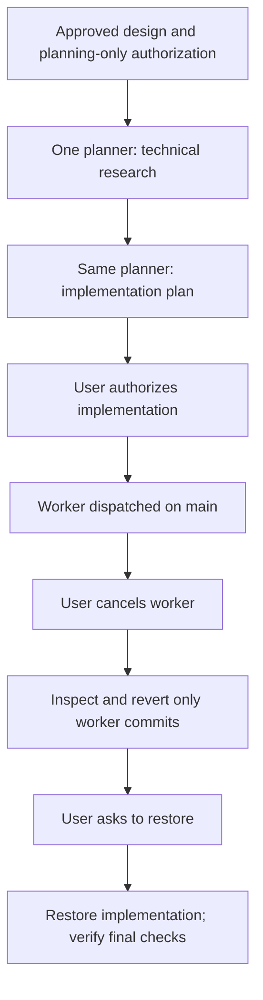

# State — Model selection and reasoning effort

## Workflow configuration

- All artifacts live directly in `docs/model-selection-compatibility/`.
- The user authorized implementation, then stopped both implementation workers
  and asked to revert only their work, if committed.
- A later run of the implementation worker committed twelve implementation
  commits on `main` despite the cancellation. They were reverted in `adf0f95`,
  then the user asked to restore them; the revert was reverted in `6d59fa0` and
  every worker-touched path again matches `53a5cab`.
- The unused worktree branch `codex/model-selection-compatibility` remains at
  `773e74c` (status-only) and was not used for implementation.
- Implementation is complete and verified; final report written. Do not dispatch
  another worker absent a new request.
- No reviewer or fixer is authorized: unified review remains **skipped**.
- No paid probes, application-data access, live provider/service checks, restarts,
  external provisioning, or deployment are authorized.
- Unified review is **skipped**, never passed.
- Preserve all intervening user changes. Initial checkout: clean, `main`, `c50017b`.
- Orchestrator manages documentation/status only and does not ingest `research.md`
  or `plan*.md`; use the planner summary and reported commit evidence.

## Workflow milestones

- [x] Explore relevant project context and current documentation.
- [x] Clarify check depth, compare approaches, and obtain design approval.
- [x] Write approved goal and self-check scope/consistency.
- [x] Single-planner technical research committed: `5972929`.
- [x] Single implementation plan committed and handoff prepared: `e587a4f`.
- [x] User authorized implementation.
- [x] Worker execution — restored after user request; twelve commits re-applied by `6d59fa0`.
- [x] Unified review — **skipped**.
- [x] Final implementation verification/report — complete; `final_report.md`.

## Confirmed product decisions

- Searchable live catalogue model dropdown, no model-name allowlist.
- Provider default plus model-supported effort options only.
- Catalogue-only check, no inference or tool execution.
- Precise text-admission results and separate optional-tool warnings.
- Catalogue compatibility does not prove actual routing, streaming or reasoning
  continuity.
- Check results follow the exact draft; save independently revalidates.
- One deployment-wide server setting; preserve security, budgets and attempt binding.
- Existing settings default safely; private reasoning is not stored.

## Dependency matrix and execution status

One planner owns research and the complete implementation plan. This is a
planning-only adaptation of MAW to the user's explicit delegation limit, not
authorization to execute the plan.

| Unit | Scope | Planning prerequisite | Planner status | Worker status | Commits |
| --- | --- | --- | --- | --- | --- |
| R/P1 | Targeted research; complete model/effort/check implementation plan | Approved goal and explicit one-planner request | Complete: `ses_e1cb5412bffeWPgebn0T04VEXB` | Not authorized | Research `5972929`; plan `e587a4f` |
| W1 | Serial execution of the approved implementation plan | Plan committed; user authorization | Previous attempt cancelled by user before work reported | Cancelled; no reported changes | — |
| W2 | Serial execution of `plan1.md` on `main` | Plan committed; user directs main checkout | Dispatched, then cancelled by user | Cancelled; twelve commits produced, reverted, then restored | Restored by `6d59fa0` |

### Execution graph

### Planner readiness and ownership

- R/P1 completed. W1/W2 were user-cancelled; W2's commits were restored by
  `6d59fa0`. No further dispatch is active.
- The planner owns only `research.md` and `plan1.md` in this workflow directory.
- It reads the approved goal, existing source and primary documentation as needed.
- It must not edit implementation files, run paid checks, access application data,
  or spawn another agent.
- Commits are serialized: the orchestrator finishes its documentation commit
  before dispatch; it makes no shared-index changes while the planner commits.

## Acceptance coverage

The planner reports coverage of all seven acceptance criteria in `goal.md`, including
change surfaces, bounded API/check semantics, persistence/default strategy,
request-path coverage, tests, risks, and ordered implementation tasks. The
orchestrator verified named-file commits, not implementation readiness.

## Research handoff

Completed by the single authorized planner. The orchestrator used its summary and
verified both commit statistics without ingesting research or plan contents.

### Planned implementation sequence

1. Contracts and absent-only stored-default compatibility.
2. Pure shared catalogue compatibility evaluator.
3. Bounded metadata acquisition and shared activation gate.
4. Shared provider serialization across all model request builders.
5. Protected listing/check APIs and independent save admission.
6. Frontend client and guarded protocol responses.
7. Reducer matching, stale-response isolation, and invalidation.
8. Accessible model/effort/check UI.
9. Cross-path integration regressions.
10. Package verification and documentation.

One future implementer can execute serially. These are planned tasks, not completed
implementation.

### Planner decisions and findings

- Normalized `openRouter.reasoningEffort` defaults to `provider-default`. Existing
  documents get an absent-only in-memory default, with no startup write, revision
  bump, or schema-version change; malformed present values remain invalid.
- Provider default emits no reasoning parameter. Explicit effort uses the existing
  SDK serialization via `modelKwargs`.
- Per-model `supported_efforts` absent/null semantics and mandatory reasoning are
  distinct. Model changes reset effort; missing required evidence fails closed.
- A documented equivalent `max_completion_tokens` cap must be selected and carried
  through request serialization, not used merely to relax admission.
- Proposed protected metadata routes live under `/api/admin/config`; results have
  closed blocker/warning codes and bounded redacted shapes.
- Catalogue listing cache: 60 seconds. Explicit checks and configured saves fetch
  fresh evidence. Proposed upstream bounds: 4 MiB, 2,000 entries, at most 10 seconds,
  no retries; browser catalogue response at most 1 MiB.
- Results match model, effort, chat budgets and whole configuration revision;
  epochs reject stale responses and save repeats the shared gate before CAS.
- New metadata routes must avoid optional Calendar-owner warming while retaining
  authentication, account freshness, role, origin, transport and rate protections.
- Read-only checking must not call `activation.prepare`, which mutates
  `lastPrepared` and could interfere with a concurrent save.
- Coverage includes durable/memory-first text, automatic/explicit retry, live
  voice admission/reconnect, Calendar legacy/V2/native skills and repairs,
  composite Calendar/web, and web-only continuation, preserving existing admitted
  attempt/session snapshot lifetimes.
- No unresolved product decision was reported. Actual routing, SSE, tool behavior,
  and reasoning continuity remain untested and cannot be certified by catalogue
  evidence. Private reasoning is not stored/replayed.

## Verification and reporting

Documentation-only work requires document/link/graph consistency and named-file
git checks. No application-test result is claimed from planning.

The implementation plan must name:

| Directory | Required implementation verification |
| --- | --- |
| `backend` | `npm run build`, `npm run lint`, `npm test`, `npm run test:e2e` |
| `frontend` | `npm run build`, `npm run lint`, `npm test` |

Record native/service skips and prerequisites separately; do not use application
data or paid inference to make a planning result look verified.

### Actual implementation verification

- Backend `npm run build`: pass. `npm run lint`: pass, warnings only.
- Frontend `npm run build`: pass. `npm run lint`: pass, warnings only.
  `npm test`: 109 files / 884 tests passed.
- Backend focused suites: 39 files / 722 tests passed; `skill-evidence` 2 tests
  passed after fixing its stale serializer call in `c3ba1ff`; Calendar
  critical-path specs 3 files / 127 tests passed.
- Backend full `npm test`: 17 failed files / 66 failed tests / 3941 passed /
  14 skipped, plus one Vitest worker-fork error. The same 17 files and 66 tests
  fail at pre-implementation baseline `fb8a44f`; the feature adds no new failures.
- Backend `npm run test:e2e`: 1 failed file (`voice-bootstrap`, 8 tests), 35
  passed, 44 files / 140 tests skipped without `AURVIN_TEST_MONGODB_URI`. The same
  8 failures reproduce at baseline.
- Closed browser fixture: 2/10 checks pass with `unexpected: GET /api/auth/me`;
  identical at baseline, so the fixture is stale (pre-dates authentication) and
  is not interaction evidence.
- Native databases, live providers, paid inference, real browser interaction,
  service operations and deployment were **not run**.
- Unified review remains **skipped**.

## Artifact and commit record

| Artifact | Status | Commit |
| --- | --- | --- |
| `goal.md` | Approved design; planning-only authorization recorded | `aeea3f4` |
| `state.md` | Initial record and completed planning handoff | Initial `aeea3f4`; handoff commit records this update |
| `research.md` | Complete | `59729295e7b2f1144c13057dd2934705deaaae85` |
| `plan1.md` | Complete; implementation restored | `e587a4f0e12d0b716f3032758dcc974d53439bab` |
| Worker implementation | Restored after temporary revert | `6d59fa0` (reverts `adf0f95`; worker commits `a8a49d1`–`53a5cab`) |
| Verification fixture fix | Complete | `c3ba1ff` |
| `final_report.md` | Complete | Records this update |

## Current gate and resume procedure

**CURRENT GATE: COMPLETE. IMPLEMENTATION AND FINAL VERIFICATION RECORDED.**

1. Preserve the existing unstaged `docs/voice-latency-benchmark/README.md` edit
   and untracked `docs/voice-latency-benchmark/provider-architecture-assessment-2026-11-16.md`.
2. Implementation commits `a8a49d1`–`53a5cab` are present; `c3ba1ff` fixes the one
   stale test fixture found during final verification.
3. The unused worktree branch remains at `773e74c` and is not implementation work.
4. Full-suite and e2e failures match the pre-implementation baseline; native/live/
   browser checks remain unrun or unusable as documented in `final_report.md`.
5. Unified review remains skipped. No deployment or production-readiness claim.
