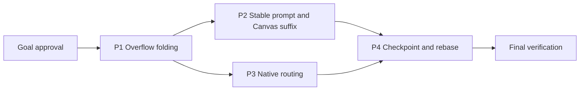

# State & Dependency Graph: Prompt caching and compaction fixes

## Workflow configuration

- Artifacts: `docs/prompt-cache-compaction-fixes/`.
- Skip dedicated research and unified code review. Brainstorming, planning, implementation and final verification are required.
- The user approved the written spec and chose the current checkout. Preserve existing overlapping runtime and Canvas edits. No reset, stash, or incidental staging; only stage attributable hunks for mixed source files.

## Milestones and brainstorming

- [x] Audit the existing context, transport and compaction paths; compare emergency-only, always-fold and cutoff-only options.
- [x] Written `goal.md` approved through the interactive approval card; current checkout selected; goal commit `2929b0d`.
- [x] Technical research — skipped.
- [x] Plans committed (P1 `60f9218`, P2 `c6860cc`, P3 `e5e6395`, P4 `d054d74`).
- [x] Workers complete (P1 `d428b5a`; P2 `541e1be`, `52a6b3a`; P3 `79ff453`, `410767a`; P4 `5e78feb`).
- [x] Unified code review — skipped.
- [x] Final verification and `final_report.md`.

## Initial findings

- The Web loop uses the history start as the protected-tail boundary and captures the outgoing messages before it attempts a fold.
- Calendar/composite does not try Stage 1; native groups affect checkpoint sizing but are not sent to the summarizer.
- Canvas state precedes history; native routes omit the conversation routing ID; same-model compaction only receives the instructions as its prefix.
- The audited checkout had a failing Calendar/voice overflow settlement test (`Invalid memory turn handle`). Reproduce on the selected baseline; fix if present and retain a regression.

## Confirmed decisions

Emergency-only historical Web folding; preserve append-only ordinary prompts. No generic Calendar/Canvas folding, new settings, or live provider checks.

## Dependency matrix and execution status

| Plan | Scope and primary file ownership | Planning prerequisites | Worker prerequisites | Planner | Worker |
| --- | --- | --- | --- | --- | --- |
| P1 | Stage 1 admission and Web projection; runtime and Calendar/Web context, folding tests, overflow wire regressions | Approved goal | None | Done `60f9218` | Complete `d428b5a` |
| P2 | Voice Canvas suffix and shared stable prompt ordering; Calendar context and referenced assembler, position and ordering regressions | Approved goal; coordinate the admission boundary with P1 | P1, because Calendar context overlaps | Done `c6860cc` | Complete `541e1be`, `52a6b3a` |
| P3 | Native routing across provider serializers and runner; model wire tests; pass trusted session ID at the MemoryText Web call site after P1 releases it | Approved goal | Initial worker may land disjoint model changes first; change the single shared call site after P1 | Done `e5e6395` | Complete `79ff453`, `410767a` |
| P4 | Stable compaction prefix, checkpoint Web evidence and rebase; runner, MemoryText/foundation, checkpoint regressions | P1/P2 interfaces known | P1, P2 and P3 | Done `d054d74` | Complete `5e78feb` |

All plans are committed; the user assigns workers. Worker order is recorded in the handoff section below. Avoid concurrent edits to `memory-text.ts`; serialize staging and commits. Do not ingest worker plan documents as orchestrator.

## Worker handoff order

1. P1: overflow folding; owns the shared `memory-text.ts` admission/dispatch boundary first.
2. P2: stable prefix and Canvas suffix; after P1 because Calendar context overlaps.
3. P3: native routing; provider serializer work may overlap P1, but its `memory-text.ts` call site waits for P1.
4. P4: compaction prefix, checkpoint evidence and rebase; after P1, P2 and P3.

Safe serial order: **P1 → P2 → P3 → P4**. Avoid concurrent workers on `memory-text.ts`.

## Exit gates and verification evidence

- P1 → Goal 1: a wire-level overflow test shows folded results in the dispatched request, a verbatim protected tail, no extra model dispatch or storage call, and rejection if no safe fold can fit.
- P2 → Goal 2: older prompt messages stay stable when Canvas state changes, including tool continuations; the catalog, summary, and input are still ordered and bounded.
- P3 → Goal 3: identical conversation grouping across serializers.
- P4 → Goals 1 and 3: stable safe same-model prefix, useful and valid checkpoint evidence, a healthy rebase path, and a lean custom request.
- Final: backend focused suites, `npm test`, `npm run lint`, and `npm run build`; record any baseline failures and skipped integration prerequisites separately.

## Final verification commands and evidence

- `backend`: `npm run build` — passed after integrated commit `5e78feb`.
- `backend`: `npm run lint` — exit 0; pre-existing warnings only.
- `backend`: focused 25-file workflow suite — 383 passed, 0 failed.
- `backend`: `npm test` — 17 failed files / 400 passed / 3 skipped; 66 failed tests / 4073 passed / 14 skipped; 1 worker error. The 66 failing tests reproduce on clean baseline and are pre-existing assembly/readiness 503s, persistence setup, built-dist import, and frozen performance gates.
- Not run: native MongoDB/Azure, live provider, staging, paid calls, cache-hit, TTFT/TTFA, and cost measurements.

## Artifacts

- `goal.md` and this state file: approved.
- `research.md`, `review.md`: skipped.
- `plan2.md`: stable Canvas prompt plan committed `c6860cc`.
- `plan3.md`: native session routing plan committed `e5e6395`.
- `plan1.md`: overflow folding plan committed `60f9218`.
- `plan4.md`: compaction rebase plan committed `d054d74`.
- `final_report.md`: written and committed `a83311a` with integrated verification evidence.

**Current gate: Complete.** All plans and worker changes are committed, final verification is recorded, and review remains skipped. No live, native, staging, or paid validation was performed.
