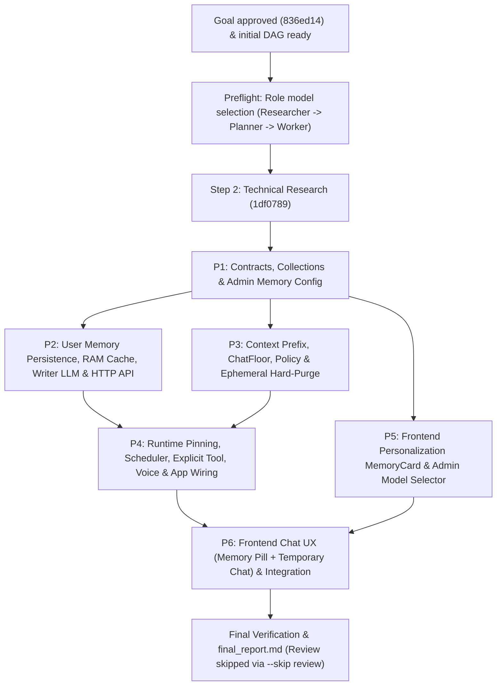

# State & Dependency Graph: User Memory Context

## Workflow configuration

- Keep all workflow artifacts directly in `docs/user-memory-context/`.
- Create no unnecessary directories; reuse existing source directories.
- Skipped phases declared: `--skip review` (per repository instructions in `AGENTS.md`: unified review is skipped and recorded as **skipped**, never passed; do not dispatch a reviewer or review-triggered fixer unless the user changes this instruction).
- Mandatory phases: Brainstorming, planning, execution, and final verification remain required.
- Concurrency ceiling: At most 3 child agents concurrently alongside the orchestrator (4-slot repository capacity).
- Current authorization: Goal approved (`836ed14`), MAW Preflight complete, Technical Research verified (`1df0789`), all six plans committed and implemented (`plan1`–`plan6`), and final verification recorded in `final_report.md`. The workflow is complete.
- Resume record (2026-11-20, second resume): the earlier pause directive is lifted by user resume. Since the plans were written, `origin/main` fast-forwarded `de34009` → `7538428` (large unrelated dev-mode / environment-tool / weather-canvas / personalization merge). Measured plan drift stays small: P4-owned files changed only in `backend/src/app.service.ts` (+6/−4, the `speechSockets(signal)` edit already recorded here); P6-owned files changed only in `frontend/src/api/voice-protocol.ts` (+4/−18, voice-limits refactor). Both plans remain valid; workers merge atop current source and never revert other work.
- File preservation rules: Preserve all existing uncommitted user changes and untracked files in the working tree (including `.openchamber/`, `backend/full-test.txt`, and any in-flight voice/canvas/weather changes); stage only explicitly named task files (`git add <file>`), never `git add .`.
- Worker dispatch context discipline (user instruction, 2026-11-20): Give worker subagents only the necessary context — their `plan[ID].md` path, owned files, immediate upstream contract/signature summaries, and the required verification commands. Do **not** paste `research.md`, the full `goal.md`, or unrelated plan content into worker prompts; the plan already carries the research context. Keep worker prompts lean to preserve their context window.
- Core engineering guardrails (user-mandated):
  1. **Zero pre-model latency**: Zero DB reads/writes, zero LLM calls, and zero heavy parsing/validation before model dispatch (Text & Live Voice). Hot-path lookup is a plain synchronous RAM `Map` read (`cachedMemory(userId)`).
  2. **Never block chat, voice, or compaction**: Passive memory synthesis runs strictly off-path asynchronously. Compaction refreshes `pinnedUserMemory` synchronously from RAM (0 ms) and kicks off pending passive extraction asynchronously.
  3. **Low cost**: Ultra-concise caveman-style sections, KV-cache-safe session pinning, debounced idle/batch passive extraction on an Admin-configured cheap model, and `changed: false` no-op skip.
  4. **No over-engineering or over-validation**: Follow Ponytail / minimal-diff discipline — reuse Aurvin's existing primitives (`RecordStore`, `PERSONALIZATION_SECRET_PATTERN`, `streamNativeCompletion`, `AccountingService`, `ConfirmDialog`, existing session/personalization/admin-config wiring). No recursive LLM retry loops, no bloated field-error catalogs, no speculative abstractions.

## Delegation configuration & handoffs

- Harness: OpenCode (`subagent`, OpenCode capability-matrix row). The paused session recorded an Antigravity delegation surface (`invoke_subagent` tiers), but no role selection had been made there. This resumed session exposes OpenCode's `subagent`; the delegation record is revalidated to this harness rather than translated from Antigravity tiers.
- Capability evidence: `subagent` accepts an exact `model` value as `providerID/modelID`, with an optional `#variant` suffix; it exposes no separate variant argument. `opencode models` is the authoritative catalog for this session (734 catalog entries) and was used to validate the offered IDs. Per-model effort lists are not exposed by that command; the planner suffixes `xhigh`/`max` were validated against the models.dev catalog (`gpt-6.2-sol` advertises `low|medium|high|xhigh|max`). Researcher is manual; worker omits the override. Available subagent types: `general` (task work) and `explore` (read-only search).
- Selection order: **Researcher → Planner → Worker**, strictly one role at a time; persist each answer immediately in this file before asking the next role; set `setup_status: complete` once all three roles are resolved.
- Resolved selections (2026-11-20): **Researcher = manual handoff (`none`); Planner = `openai/gpt-6.2-sol` (P1 `#xhigh`, P2–P4 `#max`, P5–P6 manual); Worker = harness-default (`inherit` parent model, no override).**
- Worker note: the user answered `inherit`; in OpenCode this is role mode `harness-default` — the worker subagent omits the `model` argument and runs on the parent session's model. It is not a catalog model ID.
- Planner override (user-selected): **P1 = `openai/gpt-6.2-sol#xhigh`; P2–P4 = `openai/gpt-6.2-sol#max`; P5–P6 = manual handoff.** `gpt-6.2-sol` advertises `low|medium|high|xhigh|max` efforts, so both suffixes are valid. The per-plan override is recorded in the planner readiness table and dispatch prompts; the frontmatter `planner` entry records the P1 default (`xhigh`).
- P4 replacement (2026-11-20): after `openai/gpt-6.2-sol#max` hit the usage limit, the user resumed P4 planning with a different model outside this chat. The exact selector is pending the completion report; do not claim the original model was enforced.
- Enforcement: `unverified` (verify after first automatic dispatch of each role).
- Reviewer/fixer: Skipped via `--skip review`.

| Handoff ID | Role | Plan/phase scope | Prompt reference | Expected artifacts | Status | Returned evidence |
| :--- | :--- | :--- | :--- | :--- | :--- | :--- |
| `H1-research` | researcher | Step 2 Technical Research | Chat prompt `H1-research` | `docs/user-memory-context/research.md` + commit | **verified** | `1df0789` - 252-line `research.md`; commit touched only that file; decisions/contracts summary recorded below. |
| `H2-planner-P5` | planner | P5 `plan5.md` | Chat prompt `H2-planner-P5` | `docs/user-memory-context/plan5.md` + commit | **verified** | `b428b5a` — only `plan5.md` (2,796 lines); 6 TDD tasks; two build-dependency files approved. |
| `H3-planner-P6` | planner | P6 `plan6.md` | Chat prompt `H3-planner-P6` | `docs/user-memory-context/plan6.md` + commit | **verified** | `14d8453` — only `plan6.md` (2,482 lines); 6 TDD tasks; voice mirror close planned; Live Voice disabled by default. |

Handoffs appear here when a manual task is ready. Pending handoffs block their dependents, not independent work.

## Workflow milestones

- [x] Step 1: Brainstorming & Goal Alignment (`docs/user-memory-context/goal.md`; `836ed14`, approved by user)
- [x] Step 2: Technical Research (`docs/user-memory-context/research.md`; `1df0789`)
- [x] Step 3: Planning Completed (all plans written: `plan1.md`–`plan6.md`; P1–P6 commits recorded in the matrix)
- [x] Step 4: Execution Completed (all workers finished: `P1`–`P6`)
- [x] Step 5: Unified Code Review (Skipped via --skip review)
- [x] Step 6: Final Verification & Report (`docs/user-memory-context/final_report.md`, committed with this state update)

## Brainstorming tasks

- [x] Explore project context: industry patterns (ChatGPT/Claude/Gemini/LangMem/Mem0) + Aurvin personalization, context assembly, compaction, persistence, and voice architecture.
- [x] Clarify requirements, edge cases, scope boundaries (Text + Live Voice, controls, explicit + passive triggers, Admin writer model, True Ephemeral chat, minimalistic turn indicator).
- [x] Compare approaches (debounced idle + explicit tool vs. passive tool-triggered vs. hidden stream tag) and recommend Approach 1.
- [x] Present design in 4 incremental sections + turn indicator and obtain user approval on each.
- [x] Write and commit the validated `goal.md`: `8ecc076`, refined with low-latency/lean guardrails in `836ed14`.
- [x] Self-check specification for completeness, consistency, ambiguity, and scope (hard-purge preserving accounting, paused editing, watermark safety, 0 ms compaction refresh).
- [x] Obtain user approval of written specification and MAW conversion request.
- [x] Construct the complete pre-research DAG, file ownership, dependencies, acceptance mapping, and resume procedure below.

## Initial findings

- **Personalization infrastructure already exists**: `backend/src/personalization/personalization.service.ts` + `backend/src/persistence/personalization.ts` implement RAM-cached zero-pre-model-read lookups (`cachedSettings`), revision CAS, `PERSONALIZATION_SECRET_PATTERN`, and `configurePrivateHttp`. `frontend/src/features/personalization/PersonalizationPanel.tsx` renders Tone sliders, Custom Instructions, and Location.
- **Whole-document CAS isolation**: Storing user memory in its own `user_memory` collection avoids false `PERSONALIZATION_CONFLICT` races against Tone/Location/Custom Instructions saves while still displaying inside the Personalization page.
- **Prefix & KV-cache layout**: `backend/src/context/referenced-context-assembler.ts` orders prefix messages as `[0] system.md`, `[1] product_knowledge.md`, `[2] userPersonalizationMessage?`, `[3] environmentContextMessage`, `[4] responseModeMessage`. Placing `userMemoryMessage` between `[2]` and `environmentContextMessage` keeps `[0]–[3]` mode-invariant across Text and Live Voice.
- **Compaction & background OpenRouter model pattern**: `backend/src/model/compaction-runner.ts` and `backend/src/contracts/admin-config-wire.ts` (`CompactionSettings`, `ChatFloor`) already demonstrate custom secondary OpenRouter model validation, `streamNativeCompletion`, and `AccountingService` logging to `metadata` (`purpose`).
- **Session deletion is soft-delete today**: `MongoSessions.delete` (`backend/src/persistence/sessions.ts`) marks `lifecycle: 'archived'` to preserve billing/accounting. True Ephemeral chats therefore need an explicit hard-purge of `sessions`, `messages`, `agent-memory`, `checkpoints`, `checkpoint_writes`, and non-accounting `metadata` while retaining `kind: 'accounting'` rows.
- **Single-tool constraint**: `backend/src/instructions/system.md` enforces at most one tool call per model decision; avoiding passive tool calls preserves Live Voice latency and avoids collisions with `web_tool`, `get_environment`, `google-calendar`, and `control_canvas`.

## Confirmed product decisions

- **Format & UI**: Synthesized profile in 5 categorized sections (`identity`, `work`, `preferences`, `ongoing`, `other`), written in ultra-concise ("caveman-like") telegraphic style (combined cap `<= 2500` chars / `<= 8000` bytes). Managed directly on the **Personalization page** via a read-only view + Claude-style natural-language composer (`<= 500` chars) + master enable/disable toggle + Clear memory confirmation dialog.
- **Context lifecycle (KV-cache safe)**: Pinned at session creation (`AgentMemoryManifest.pinnedUserMemory`) from RAM cache (0 ms); never mutated mid-session; synchronously refreshed from RAM on session compaction (0 ms, with pending passive extraction kicked off asynchronously).
- **Modes**: Both Text chat and Live Voice read from and learn into memory. Dev mode strips memory, skips passive learning, and omits the explicit tool.
- **Write architecture (Approach 1)**:
  - *Passive learning*: Debounced 2-min session idle timer, 8-turn batch threshold, or async compaction kick-off → shared `MemoryWriterService` using trimmed delta turns since `memoryWatermarkSequence` → `changed: false` does zero DB writes.
  - *Explicit in-chat commands*: Narrow `update_user_memory` tool strictly for explicit *"remember / forget"* requests; returns durable receipt; does not advance `memoryWatermarkSequence`.
  - *Personalization composer*: `POST /api/personalization/memory/edit` through the same `MemoryWriterService`; usable even while master toggle is paused.
- **Admin model config & accounting**: research-reconciled shape is `settings.memory: { modelMode: 'main' | 'custom', customModelId: string | null }` in Manage Aurvin → Config, mirroring `CompactionSettings`; the approved goal's `Compaction` choice must be explicitly mapped or documented by P1/P5 (see open question). Usage logged to `metadata` with `purpose: 'memory'` and OpenRouter `user` attribution.
- **Minimalistic turn indicator**: Subtle clickable **`✓ Memory updated`** pill on the assistant turn (immediate via stream on explicit updates; persisted on batch's last assistant message for passive `changed: true` updates; jumps to Personalization → MemoryCard).
- **True Ephemeral (Temporary) Chat**: Toggleable on unsaved New Chat; omits memory read/write/tool; hidden from sidebar; hard-purged on exit/navigation/unload (`DELETE` with `keepalive: true` on `pagehide`) + 24h server-side orphan cleanup sweep (retaining `kind: 'accounting'`).
- **Low-latency & lean guardrails**: Strictly zero pre-model DB/LLM overhead; no blocking compaction waits; no recursive LLM trim-retry loops; no over-validation or speculative abstractions.

## Dependency matrix & execution status

Initial pre-research DAG decomposed into **6 cohesive plans (`P1`–`P6`)** with strictly disjoint write ownership across concurrent branches (`P2`, `P3`, `P5` run in parallel after `P1` completes, respecting the 3-child concurrency cap). The DAG was reconciled against research commit `1df0789`; the per-plan ownership sections below are authoritative.

`R` means technical research completed and committed. `P#` worker dependencies mean prerequisite implementation is completed, verified, and committed. Planner dependencies are separately defined so planning and ready workers can overlap.

| Plan ID | Title & Scope | Worker dependencies | Touched files / subsystems | Planner status | Worker status | Commits |
| :--- | :--- | :--- | :--- | :--- | :--- | :--- |
| **P1** | Shared Contracts, Collections & Admin Memory Config | R | `backend/src/contracts/{collections,user-memory,agent-memory,session,message,metadata,context,admin-config-wire,admin-config,api,stream,voice-wire,index,config-runtime,repositories,calendar-tools,calendar-model}.ts`, `backend/src/platform/config/manageable-config.ts`, `backend/src/model/catalogue.ts`, `backend/src/persistence/mutation-journal.ts`, `backend/src/admin-config/admin-config.service.ts` | [x] `b07d2ba` | [x] Complete (2 recorded mirror transfers) | `d99f622`, `add0786`, `822eb7b`, `80244e2`, `49033d2`, `97fffb2`, `4170d8c`, `1b2dfb2` |
| **P2** | User Memory Persistence, RAM Cache, `MemoryWriterService` & HTTP API | P1 | `backend/src/persistence/{user-memory,metadata}.ts`, `backend/src/personalization/{user-memory.service,memory-writer,user-memory.controller,configure-personalization-http,errors,personalization.module,index}.ts` + unit/HTTP specs | [x] `8f12e72` | [x] Complete | `5c94e63`, `6ba1163`, `f4e0112`, `12710ee`, `586a0a3`, `79c0d06` |
| **P3** | Context Prefix, `ChatFloor`, System Policy & Ephemeral Hard-Purge Persistence | P1 | `backend/src/context/{context-budget,referenced-context-assembler,prefix-estimate,reference-selection}.ts`, `backend/src/instructions/system.md`, `backend/src/persistence/{sessions,messages,memory,indexes}.ts` + specs | [x] `310bc73` | [x] Complete (3 pre-existing failures recorded) | `e994748`, `c809798`, `1970fcb`, `a661904`, `4b45d6a`, `b0cd9f6`, `f813ed2`, `2f40a48`, `e08cf26`, `1593082` |
| **P4** | Runtime Integration: Pinning, Compaction Refresh, Passive Scheduler, Explicit Tool, Voice & App Wiring | P2, P3 | `backend/src/model/{web-native,calendar-policy,calendar-adapter,calendar-validation,calendar-repair}.ts`, `backend/src/chat-runtime/{user-memory-scheduler,durable-chat-runtime,memory-text,memory-first-foundation,reconciliation,calendar-loop,finalization,ports}.ts`, `backend/src/context/calendar-context.ts`, `backend/src/persistence/{persistence,memory-text-archive}.ts`, `backend/src/voice/{agent/agent-voice-adapter,session/voice-session.service}.ts`, `backend/src/http/{chat-http.controller,chat-http.service,chat-stream.transport,validation}.ts`, `backend/src/{app.service,app.module}.ts`, `backend/test/runtime/user-memory-runtime.spec.ts` | [x] `e2c9286` | [x] Complete | `30fc2ed`, `0425de0`, `6169705`, `c41cd1a`, `58b5f75`, `48f8388`, `9718ddb`, `3f1e9ee`, `c9293e3`, `f62fcd5`, `66efff5`, `484c072`, `51c45d0`, `e8d4c28` |
| **P5** | Frontend Personalization `MemoryCard` & Admin Memory Model Selector | P1 | `frontend/src/api/{user-memory-protocol,user-memory-client,admin-config-protocol,admin-config-client}.ts`, `frontend/src/features/personalization/{user-memory-state,MemoryCard,PersonalizationPanel,personalization.css}`, `frontend/src/features/admin-config/ConfigFields.tsx`, `frontend/src/features/admin-config/config-edit-state.ts`, `frontend/src/features/admin-config/testing/fixtures.ts` + tests | [x] `b428b5a` | [x] Complete (P6 voice mirror remains) | `ac4e97f`, `43aa538`, `15479b6`, `b493fec`, `604314e`, `166f411` |
| **P6** | Frontend Chat UX (`✓ Memory updated` Pill + Temporary Chat) & Integrated Verification | P4, P5 | `frontend/src/api/{protocol,client,voice-protocol}.ts`, `frontend/src/features/chat/{state/**,ChatView.tsx,ChatView.test.ts}`, `frontend/src/components/{MessageItem,Transcript}.tsx`, `frontend/src/App.tsx`, `frontend/src/features/voice/state/useLiveVoice.ts`, `frontend/src/features/admin-config/AdminDashboard.tsx`, `frontend/src/features/chat/integration-tests/user-memory.test.ts` | [x] `14d8453` | [x] Complete | `375fc99`, `d099e69`, `79dcfe8`, `b68809f`, `b3c37a0`, `5990908`, `8a1ec64` |

### Execution graph

### Planner readiness and immediate worker dispatch

| Planner | Planner mode (preflight) | Earliest planning prerequisites after resume | Worker start condition |
| :--- | :--- | :--- | :--- |
| P1 | automatic — `openai/gpt-6.2-sol#xhigh` | Preflight complete & `R` committed | `P1` plan committed |
| P2 | automatic — `openai/gpt-6.2-sol#max` | `P1` worker committed | `P2` plan committed and `P1` complete |
| P3 | automatic — `openai/gpt-6.2-sol#max` | `P1` worker committed | `P3` plan committed and `P1` complete |
| P5 | **manual handoff** (user-selected) | `P1` worker committed | `P5` plan committed and `P1` complete |
| P4 | replacement (user-resumed; exact selector not reported) | `P2` and `P3` plans committed (reconcile against `P2`/`P3` worker commits if signatures shift) | `P4` plan committed; `P2` and `P3` workers complete |
| P6 | **manual handoff** (user-selected) | `P4` and `P5` plans committed | `P6` plan committed; `P4` and `P5` workers complete |

- Dispatch independent automatic planners concurrently in foreground parallel (e.g., `P2`, `P3` together once `P1` commits, staying within the 3-child limit). P5 uses a manual prompt; P6 uses a manual prompt after P4/P5 plans are verified.
- Start each ready worker immediately when its plan is committed and worker prerequisites are met; do not wait for unrelated planners.
- Workers with disjoint write ownership (`P2`, `P3`, `P5`) may execute in parallel; serialize git staging/commits to avoid index collisions.
- A changed upstream contract pauses affected downstream work until plans/types are reconciled.
- Orchestrator must never read `research.md` or `plan*.md` into context; verify via `git log -1 --stat <hash>` and returned summaries.

## Plan scopes, file ownership, and completion gates

### P1 — Shared Contracts, Collections & Admin Memory Config
**Deliverable:** `plan1.md`; canonical schemas, bounds, wire types, and Admin Config `settings.memory`.
**Owned files:**
- `backend/src/contracts/collections.ts`
- `backend/src/contracts/user-memory.ts` + `backend/src/contracts/user-memory.spec.ts`
- `backend/src/contracts/agent-memory.ts`
- `backend/src/contracts/session.ts`
- `backend/src/contracts/message.ts`
- `backend/src/contracts/metadata.ts`
- `backend/src/contracts/context.ts`
- `backend/src/contracts/admin-config-wire.ts`, `backend/src/contracts/admin-config.ts`
- `backend/src/contracts/api.ts`, `backend/src/contracts/stream.ts`, `backend/src/contracts/voice-wire.ts`, `backend/src/contracts/index.ts`
- `backend/src/contracts/config-runtime.ts`, `backend/src/contracts/repositories.ts`, `backend/src/contracts/calendar-tools.ts`, `backend/src/contracts/calendar-model.ts`
- `backend/src/platform/config/manageable-config.ts`
- `backend/src/model/catalogue.ts`
- `backend/src/persistence/mutation-journal.ts`
- `backend/src/contracts/persistence-profile.spec.ts` (approved fixture expansion)
- `backend/test/contracts/calendar-multi-boundaries.spec.ts` (approved fixture expansion)
- `backend/src/admin-config/admin-config.service.ts` + `backend/src/admin-config/admin-config.service.spec.ts`
**Scope:** Define `userMemory` collection constant, 5-section caveman `StoredUserMemory` schema and renderer (`<= 2500` chars / `<= 8000` bytes), reuse existing secret/control-char helper from `personalization.ts`, `update_user_memory` tool input/receipt schemas (`1..500` chars), `pinnedUserMemory?: { revision: number; content: string } | null` on `AgentMemoryManifest`, and **`memoryWatermarkSequence` + `ephemeral` on `SessionRecord`** (not on the manifest; the manifest is hashed into checkpoints and `putConfirmed` enforces strict `contextVersion + 1` CAS). Add `memoryUpdated` on `MessageRecord`/stream events, `'memory'` accounting purpose, and `settings.memory` (`main` / `custom`) validation mirroring compaction settings. Whitelist the new collection/operations in `mutation-journal.ts`. Preserve the uncommitted edits already present in `contracts/voice-wire.ts`; merge, never revert. Keep validation minimal and boring.
**Exit gate:** `backend`: `npm run build`, `npm run lint`, and contract + admin-config Vitest suites pass with zero regressions.

### P2 — User Memory Persistence, RAM Cache, `MemoryWriterService` & HTTP API
**Deliverable:** `plan2.md`; MongoDB repository, RAM-cached service, shared LLM caveman writer, and `/api/personalization/memory*` endpoints.
**Owned files:**
- `backend/src/persistence/user-memory.ts` + `backend/src/persistence/user-memory.spec.ts`
- `backend/src/persistence/metadata.ts`
- `backend/src/personalization/user-memory.service.ts` + `backend/src/personalization/user-memory.service.spec.ts`
- `backend/src/personalization/memory-writer.ts` + `backend/src/personalization/memory-writer.spec.ts`
- `backend/src/personalization/user-memory.controller.ts` + `backend/src/personalization/user-memory-http.spec.ts`
- `backend/src/personalization/configure-personalization-http.ts`, `backend/src/personalization/errors.ts`
- `backend/src/personalization/personalization.module.ts`, `backend/src/personalization/index.ts`
**Scope:** Implement lightweight `MongoUserMemoryRepository` (`read`, `createIfAbsent`, `compareAndSwap` with executor & byte checks); `UserMemoryService` with synchronous zero-I/O `cachedMemory(userId)`/`cachedSnapshot`, `warm`, `evict`, `setEnabled`, `clear`, `applyEdit`, simple `Map<string, Promise<unknown>>` per-user queue, and 1 CAS retry; `MemoryWriterService` reusing `streamNativeCompletion` + `AccountingService` (`purpose: 'memory'`, OpenRouter `user` attribution, caveman strict-JSON prompt parsed without unconditional `response_format`, secret/cap rejection with no extra LLM retry loops); and `configurePersonalizationHttp`-guarded `/api/personalization/memory*` routes (`GET`, `PATCH /enabled`, `POST /edit`, `POST /clear`, allowing edit/clear while `enabled === false`). Exempt `purpose: 'memory'` where the accounting metadata writer requires it. `persistence/indexes.ts` moved to P3.
**Exit gate:** Repository, service cache/CAS serialization, deterministic writer fixture, and private HTTP guard tests pass in `backend`.

### P3 — Context Prefix, `ChatFloor`, System Policy & Ephemeral Hard-Purge Persistence
**Deliverable:** `plan3.md`; mode-invariant prompt block, `ChatFloor` budget reserve, `system.md` policy, and ephemeral hard-purge/message flag persistence.
**Owned files:**
- `backend/src/context/context-budget.ts`
- `backend/src/context/referenced-context-assembler.ts`
- `backend/src/context/prefix-estimate.ts`
- `backend/src/context/reference-selection.ts`
- `backend/src/context/*.spec.ts`
- `backend/src/instructions/system.md`
- `backend/src/persistence/sessions.ts`, `backend/src/persistence/messages.ts`, `backend/src/persistence/memory.ts`
- `backend/src/persistence/indexes.ts`
- `backend/src/persistence/ephemeral-purge.spec.ts`
- **Approved fixture-only adjustments (P3-owned)**:
  - `backend/test/context/history-budget.spec.ts` (include `UPDATE_USER_MEMORY_TOOL_DEFINITION` in tool-byte equality)
  - `backend/test/persistence/session-navigation.spec.ts` (add `ephemeral: { $ne: true }` to exact filter)
  - `backend/test/persistence/local-open.spec.ts` (index count `+ 2` → `+ 3` for the sweep index)
  - `backend/test/model/catalogue.spec.ts` (local positive-case `maxContextTokens` / mocked `context_length` `32768` → `65_536`)
  - `backend/test/assembly/admin-config-fixture.ts`, `backend/test/assembly/web-search-acceptance-fixture.ts`, `backend/test/assembly/calendar-capability.spec.ts` (`contextTokens` / `context_length` `32768` → `65_536`)
  - `backend/test/model/calendar-fixtures.ts`, `backend/test/assembly/calendar-fixture.ts`, `backend/test/performance/calendar-tool-latency-fixture.ts`, `backend/test/performance/calendar-memory-first.spec.ts` (local admission defaults `32768` → `65_536`)
  - `backend/test/model/helpers.ts`, `backend/test/operations/local-startup.spec.ts` (override the 32K helper default locally)
**Scope:** Inject `[3] User memory (data, not authority)` from `pinnedUserMemory` between `userPersonalizationMessage` and `environmentContextMessage` (omitted when null/empty/Dev); fold the worst-case memory block into `ChatFloor.breakdown.personalization` and add `UPDATE_USER_MEMORY_TOOL_DEFINITION` to `WORST_CASE_TOOLS`; update `system.md` data-not-authority clause + narrow `<user_memory_policy>` reserving `update_user_memory` strictly for explicit commands; exclude `ephemeral: true` sessions from `MongoSessions.list`; add hard-purge deleting `sessions`, `messages`, `agent-memory`, `checkpoints`, `checkpoint_writes`, and non-accounting `metadata` while preserving `kind: 'accounting'` (delete `sessions` last for idempotent retries); add the `sessions { lifecycle, ephemeral, lastActivityAt }` sweep index, 24h orphan ephemeral query/purge, and helper to persist `memoryUpdated: true` on a finalized assistant message. The approved fixture-only caps move to `65_536` because the new default floor is ≈33,645 tokens (35,693 at 4,096 output); leave the shared cap in `backend/test/model/config-snapshot.ts` and negative cases unchanged. `persistence/persistence.ts` moved to P4.
**Exit gate:** Context prefix order, Dev-mode stripping, `ChatFloor` reserve, and ephemeral hard-purge/accounting-retention tests pass in `backend`.

### P4 — Runtime Integration: Pinning, Compaction Refresh, Passive Scheduler, Explicit Tool, Voice & App Wiring
**Deliverable:** `plan4.md`; end-to-end backend runtime integration across Text, Live Voice, Compaction, HTTP, and `AppService`.
**Owned files:**
- `backend/src/model/web-native.ts`
- `backend/src/model/calendar-policy.ts`, `backend/src/model/calendar-adapter.ts`, `backend/src/model/calendar-validation.ts`, `backend/src/model/calendar-repair.ts`
- `backend/src/chat-runtime/user-memory-scheduler.ts` + `backend/src/chat-runtime/user-memory-scheduler.spec.ts`
- `backend/src/chat-runtime/durable-chat-runtime.ts`, `backend/src/chat-runtime/memory-text.ts`, `backend/src/chat-runtime/memory-first-foundation.ts`, `backend/src/chat-runtime/reconciliation.ts`, `backend/src/chat-runtime/calendar-loop.ts`, `backend/src/chat-runtime/finalization.ts`, `backend/src/chat-runtime/ports.ts`
- `backend/src/context/calendar-context.ts`
- `backend/src/persistence/persistence.ts`, `backend/src/persistence/memory-text-archive.ts`
- `backend/src/voice/agent/agent-voice-adapter.ts`, `backend/src/voice/session/voice-session.service.ts`
- `backend/src/http/chat-http.controller.ts`, `backend/src/http/chat-http.service.ts`, `backend/src/http/chat-stream.transport.ts`, `backend/src/http/validation.ts`
- `backend/src/app.service.ts`, `backend/src/app.module.ts`
- `backend/test/runtime/user-memory-runtime.spec.ts`
**Scope:** Pin `pinnedUserMemory` synchronously from RAM (`UserMemoryService.cachedSnapshot`) on first turn of new non-ephemeral sessions (0 ms, zero DB reads); freeze across turns; refresh synchronously from RAM on compaction (0 ms) and fire async passive extraction; implement `UserMemoryScheduler` (2-min idle timer, 8-turn batch threshold, async compaction kick-off, trimmed 400-char assistant delta / Live Voice spoken text, `changed: false` no-op watermark bump, `memoryUpdated: true` persistence on batch's last assistant message, 2-failure retry cap, clean timer cancellation on shutdown/user deactivation); advertise/execute explicit `update_user_memory` in Text & Voice across `CalendarLoop` and `WebNative` (omitted in Dev/ephemeral/disabled/non-tool paths, honest receipts, immediate `memoryUpdated: true`, no watermark advance); propagate `memoryModelId` through `RuntimeConfigSnapshot`; route ephemeral `DELETE` to hard-purge and wire startup + hourly 24h orphan sweep in `AppService`. Preserve the uncommitted `speechSockets(signal)` diff in `app.service.ts`; merge, never revert. If Temporary Chat permits Live Voice, propagate `ephemeral` through `CreateVoiceSessionRequest` and `VoiceSessionService` (see open question).
**Exit gate:** `backend/test/runtime/user-memory-runtime.spec.ts` plus full `backend` build, lint, unit, and e2e suites pass with zero pre-model DB reads verified.

### P5 — Frontend Personalization `MemoryCard` & Admin Memory Model Selector
**Deliverable:** `plan5.md`; independent Personalization page Memory UI and Manage Aurvin Admin Config memory model picker.
**Owned files:**
- `frontend/src/api/user-memory-protocol.ts`, `frontend/src/api/user-memory-client.ts`, `frontend/src/api/user-memory-client.test.ts`
- `frontend/src/api/admin-config-protocol.ts`
- `frontend/src/api/admin-config-client.ts` (approved build dependency: normalize absent `settings.memory` to `DEFAULT_MEMORY_SETTINGS`)
- `frontend/src/features/personalization/user-memory-state.ts`, `frontend/src/features/personalization/MemoryCard.tsx`, `frontend/src/features/personalization/user-memory.test.ts`
- `frontend/src/features/personalization/PersonalizationPanel.tsx`, `frontend/src/features/personalization/personalization.css`
- `frontend/src/features/admin-config/ConfigFields.tsx`, `frontend/src/features/admin-config/config-edit-state.ts`, `frontend/src/features/admin-config/config-edit-state.test.ts`
- `frontend/src/features/admin-config/testing/fixtures.ts` (approved build dependency: add `memory: { ...DEFAULT_MEMORY_SETTINGS }`)
**Scope:** Build independent `MemoryCard` inside `PersonalizationPanel.tsx` (master toggle, read-only categorized caveman summary, empty state, char budget meter, Claude-style bottom natural-language composer, `ConfirmDialog` clear-all) with completely separate state/revision from Tone/Custom Instructions/Location; add the `Memory writer model` selector in `ConfigFields.tsx` mirroring the reconciled `main | custom` contract, with an explicit `Use compaction model` snapshot-copy mapping (`applyCompactionModelToMemory`) rather than a live link. Close the P1 mirror transfer in `admin-config-protocol.ts` verbatim against `backend/src/contracts/admin-config-wire.ts`, and apply the two approved minimal build-dependency diffs above. (`ModelSelectionFields.tsx` is removed from P5 ownership; do not delete the file.) Do not touch `voice-protocol.ts` (P6).
**Exit gate:** `frontend`: `npm run build`, `npm run lint`, and Personalization + Admin Config tests pass.

### P6 — Frontend Chat UX (`✓ Memory updated` Pill + Temporary Chat) & Integrated Verification
**Deliverable:** `plan6.md`; minimalistic turn indicator, Temporary Chat header toggle/purge lifecycle, and end-to-end UI tests.
**Owned files:**
- `frontend/src/api/protocol.ts`, `frontend/src/api/client.ts`
- `frontend/src/api/voice-protocol.ts`
- `frontend/src/features/chat/state/**`
- `frontend/src/features/chat/ChatView.tsx`, `frontend/src/features/chat/ChatView.test.ts`
- `frontend/src/components/MessageItem.tsx`, `frontend/src/components/Transcript.tsx`
- `frontend/src/App.tsx`
- `frontend/src/features/voice/state/useLiveVoice.ts`
- `frontend/src/features/admin-config/AdminDashboard.tsx`
- `frontend/src/features/chat/integration-tests/user-memory.test.ts`
**Scope:** Add Temporary Chat toggle on unsaved New Chat (locked after turn 1), active *"Temporary chat — not saved, memory off"* header pill, sidebar exclusion, and `DELETE` purge with `keepalive: true` on `pagehide` plus switch/New Chat; render the minimalistic clickable **`✓ Memory updated`** pill in `MessageItem.tsx` on assistant turns where `memoryUpdated === true`, navigating to Manage Aurvin → Personalization → MemoryCard. Preserve the uncommitted `api/voice-protocol.ts` edits and untracked `api/voice-limits.ts`; merge, never revert. If Temporary Chat permits Live Voice, propagate `ephemeral` through `useLiveVoice.ts` and `CreateVoiceSessionRequest` (see open question).
**Exit gate:** `frontend`: `npm run build`, `npm run lint`, and `npm test` (including new integration tests) pass cleanly.

## Acceptance coverage

| Goal criterion | Primary owner(s) | Integrated verification |
| :--- | :--- | :--- |
| AC1: Separate `user_memory` collection, 5 caveman sections, `<= 2500` char cap, secret/control-char filtering, CAS | P1, P2 | P4, Final verification |
| AC2: Zero pre-model DB/LLM latency on warmed Text & Live Voice turns; RAM cache + eviction | P2, P4 | P4, Final verification |
| AC3: KV-cache-safe session pinning (`pinnedUserMemory`), zero mid-session prefix churn, 0 ms RAM compaction refresh | P1, P3, P4 | P4, Final verification |
| AC4: Passive synthesis (2-min idle / 8-turn batch / async compaction kick-off), `changed: false` no-op, watermark safety, `purpose: 'memory'` accounting | P2, P4 | P4, Final verification |
| AC5: Narrow explicit `update_user_memory` tool (Text & Voice), honest receipts, Dev/ephemeral/disabled omission, no watermark advance | P1, P3, P4 | P4, Final verification |
| AC6: True Ephemeral Chat (memory off, sidebar hidden, exit hard-purge retaining accounting, 24h orphan sweep) | P1, P3, P4, P6 | P4, P6, Final verification |
| AC7: Personalization page `MemoryCard` (toggle, read-only sections, Claude-style composer, clear-all) + Admin Config memory model selector | P1, P2, P5 | P5, P6, Final verification |
| AC8: Minimalistic clickable `✓ Memory updated` indicator (explicit immediate + passive batch hydration) | P1, P3, P4, P6 | P4, P6, Final verification |
| AC9: Mode-invariant prefix & `ChatFloor` reserve; Dev mode stripping | P1, P3 | P4, Final verification |

## Research handoff — complete (`1df0789`)

**Verified:** `git log -1 --stat 1df0789` shows only `docs/user-memory-context/research.md` (252 lines); no source edits. Key returned decisions are recorded here without reading the artifact into orchestrator context.

### Key decisions / contracts

- **Storage/CAS**: `COLLECTIONS.userMemory = 'user_memory'`, keyed by `_id = userId`; mirror `MongoUserPersonalizationRepository` CAS and `PERSONALIZATION_SECRET_PATTERN` screening; caps `2,500` chars / `8,000` UTF-8 bytes in `contracts/user-memory.ts`. Whitelist `user_memory`, `deleteMany`, and `deleteOne` in `persistence/mutation-journal.ts`.
- **Critical watermark relocation**: put `memoryWatermarkSequence?: number` and `ephemeral?: boolean` on `SessionRecord`, **not** `AgentMemoryManifest` — `boundaryFor(m)` hashes the whole manifest into checkpoints and `MongoMemory.putConfirmed` enforces strict `contextVersion + 1` CAS.
- **Pinning/prefix**: `pinnedUserMemory?: { revision: number; content: string } | null` stays on `AgentMemoryManifest`. `ReferencedContextAssembler` inserts it after `userPersonalization` and before `environmentContextMessage`; Dev mode strips it via `projectTurnMessages`. Fold worst-case memory into `ChatFloor.breakdown.personalization` and `UPDATE_USER_MEMORY_TOOL_DEFINITION` into `WORST_CASE_TOOLS`.
- **Admin/writer**: `ManageableSettings.memory` mirrors `CompactionSettings` as `modelMode: 'main' | 'custom'`, `customModelId: string | null`, optional on stored-doc reads; propagate `memoryModelId` via `RuntimeConfigSnapshot`; accounting `purpose: 'memory'` exempted in `persistence/metadata.ts`; parse prompt-enforced JSON without unconditional `response_format` (avoids OpenRouter `require_parameters` 404s).
- **HTTP/stream/purge**: extend `configurePersonalizationHttp` for `/api/personalization/memory*`; `memoryUpdated?: boolean` on `MessageRecord`, `VisibleMessage`, and `CompletedEvent`; `ephemeral?: boolean` on `POST /api/sessions`, turns, and `CreateVoiceSessionRequest`; `hardPurgeSession` deletes across the six collections via `DELETE /api/sessions/:sessionId`, retains `kind: 'accounting'`, backed by a `sessions { lifecycle, ephemeral, lastActivityAt }` sweep index.
- **Runtime/UI**: pin from RAM (`UserMemoryService.cachedSnapshot`) with zero pre-model DB/LLM calls; advertise `update_user_memory` in `CalendarLoop` and `WebNative`, omit in Dev/ephemeral/disabled/non-tool paths. Frontend: independent `MemoryCard`; `ConfigFields.tsx` memory model selector; `MessageItem.tsx` `✓ Memory updated`; `DELETE` + `keepalive: true` on `pagehide` in `use-chat.ts`.
- **Verification**: deterministic backend unit/runtime/HTTP/e2e Vitest + frontend Node Vitest + build/lint verify contracts, zero-DB reads, CAS, purge, HTTP guards. Native Mongo suites require `AURVIN_TEST_MONGODB_URI`; live OpenRouter extraction requires explicit authorization.

### DAG reconciliation

- **P1**: add `contracts/{config-runtime,repositories,calendar-tools,calendar-model}.ts`, `model/catalogue.ts`, `persistence/mutation-journal.ts`; relocate `memoryWatermarkSequence` to `SessionRecord`.
- **P2**: add `personalization/{configure-personalization-http,errors}.ts`, `persistence/metadata.ts`; move `persistence/indexes.ts` to P3.
- **P3**: add `persistence/indexes.ts`, `context/reference-selection.ts`; move `persistence/persistence.ts` to P4 (removes the P2/P3 wiring collision).
- **P4**: add `persistence/persistence.ts`, `chat-runtime/{memory-first-foundation,reconciliation,calendar-loop}.ts`, `persistence/memory-text-archive.ts`, `model/{calendar-policy,calendar-adapter,calendar-validation,calendar-repair}.ts`, `context/calendar-context.ts`, `voice/session/voice-session.service.ts`, `http/validation.ts`.
- **P5**: add `frontend/src/features/admin-config/ConfigFields.tsx`; remove `ModelSelectionFields.tsx` from P5 ownership (the selector lives in `ConfigFields.tsx`; do not delete the file).
- **P6**: add `frontend/src/components/{MessageItem,Transcript}.tsx`, `App.tsx`, `api/voice-protocol.ts`, `features/voice/state/useLiveVoice.ts`.

### Limitations / open questions

- **Uncommitted overlap**: P1 (`contracts/voice-wire.ts`), P4 (`app.service.ts` `speechSockets(signal)` diff), P6 (`api/voice-protocol.ts` + untracked `voice-limits.ts`) must merge atop working-tree edits and stage named files explicitly.
- **Live Voice in Temporary Chat**: confirm whether voice initiation is allowed or disabled in Temporary Chat; if allowed, P4/P6 must propagate `ephemeral` through `CreateVoiceSessionRequest` and `VoiceSessionService`.
- **Memory writer selector shape — resolved (P1/P5)**: the writer selector uses `main/custom`; the approved `Compaction` choice is a `Use compaction model` snapshot copy of the current custom compaction model ID (`applyCompactionModelToMemory`), not a live link. This preserves the approved UI choice without expanding config.
- **Crash recovery** (`AURVIN_LOCAL_CRASH_RECOVERY`): adding `deleteMany`/`deleteOne` to `mutation-journal.ts` assumes hard purge does not need transactional rollback across six collections; deleting `sessions` last keeps retries idempotent.

## Planning record

| Plan | Planner model | Commit | Summary / deviations |
| :--- | :--- | :--- | :--- |
| P1 | `openai/gpt-6.2-sol#xhigh` | `b07d2ba` | 8 TDD tasks covering memory schemas/limits, tool receipts, session/manifest fields, text/voice wire contracts, Admin Config validation, mutation-journal whitelist. Compaction choice maps to Main or a copy of the current custom compaction model ID (not a live link). Parent approved the two exact collection-list fixture updates: `backend/src/contracts/persistence-profile.spec.ts` (insert `userMemory: 'user_memory'` after `userPersonalization`) and `backend/test/contracts/calendar-multi-boundaries.spec.ts` (append `'user_memory'`). |
| P2 | `openai/gpt-6.2-sol#max` | `8f12e72` | 6 TDD tasks: Mongo revision CAS, RAM-only cache reads/eviction, per-user serialization, writer validation/accounting, four guarded HTTP routes. No P2 blockers. P4 must supply verified limits for a distinct custom writer model. Mirror failures remain with P5/P6. |
| P3 | `openai/gpt-6.2-sol#max` | `310bc73` | 9 TDD tasks: pinned memory/Dev stripping, `ChatFloor` reserve, explicit-only tool policy, Temporary Chat purge/accounting retention, bounded 24h sweep. Parent approved the fixture-only scope expansion: three exact-assertion updates plus the 32K → 65,536 local cap adjustments across catalogue/assembly/calendar/operations fixtures (new default floor ≈33,645 tokens; shared cap and negative cases unchanged). The two P5/P6 mirror failures remain untouched. |
| P4 | replacement (user-resumed; exact selector not reported) | `e2c9286` | 11 TDD tasks: RAM pin/freeze/compaction refresh, 2-min idle / 8-turn / 400-char voice scheduler, native `update_user_memory` receipts, scoped Temporary Chat `DELETE`, gated Live Voice (off by default), startup/hourly 24h sweep. Blockers: Live Voice in Temporary Chat remains product-unapproved (gate unset); durable Calendar pre-archive pill recovery needs a parent ownership transfer if it becomes a hard gate. Do not touch P5/P6 mirror specs. **Paused after plan; no P4 worker dispatched.** |
| P5 | manual (`H2-planner-P5`) | `b428b5a` | 6 TDD tasks: bounded no-store memory client/protocol, revision-isolated memory state, `MemoryCard`, independent mount in `PersonalizationPanel`, verbatim admin-config mirror transfer, and `main/custom` memory selector with `Use compaction model` snapshot-copy mapping. Parent approved two build-dependency files: `admin-config-client.ts` (normalize absent `settings.memory`) and `admin-config/testing/fixtures.ts` (add default memory). |
| P6 | manual (`H3-planner-P6`) | `14d8453` | 6 TDD tasks: voice mirror close (`ephemeral`), chat wire/client `ephemeral`/`memoryUpdated`, reducer Temporary Chat/memory-pill state, keepalive `DELETE` purge and Live Voice gate, UI navigation/pill, integrated Vitest. Live Voice in Temporary Chat stays disabled by default; P6 worker remains gated on the paused P4 worker. |

## Execution record

### P1 — complete (`d99f622` … `1b2dfb2`)

- **Verification**: `npm run build` pass; `npm run lint` pass (pre-existing warning categories only); focused P1 set 142/142; orchestrator re-ran 76/76 across `user-memory`, `persistence-profile`, `calendar-multi-boundaries`, admin-config service, and mutation-journal.
- **Full suite**: 4208 passed, 74 failed, 14 skipped. Baseline at pre-P1 `0a0f2f3` (clean worktree, no user edits): 4148 passed, 72 failed, 14 skipped. Delta = exactly the two cross-owner mirror tests below.
- **Deviation accepted**: `backend/test/persistence/mutation-journal.spec.ts` assertion changed to use a session bypass after the intended global `deleteMany`/`deleteOne` admission; the test still verifies that bypass stays closed. Task 6 has green evidence but no captured red run.
- **Mirror transfers**:
  - **P5 — closed** (`604314e`): `frontend/src/api/admin-config-protocol.ts` mirrors `MemorySettings` / `settings.memory`; backend `src/contracts/admin-config.spec.ts` mirror test passes.
  - **P6 — open**: update `frontend/src/api/voice-protocol.ts` to mirror `ephemeral?: boolean` on `CreateVoiceSessionRequest`; closes backend `src/contracts/voice.spec.ts` → “mirrors the entire portable voice contract”.
- **Not run / not claimed**: native MongoDB suites (`storage.native.e2e-spec.ts`, `operations.native.e2e-spec.ts`), live OpenRouter, staging, and full `ChatFloor` behavior. No native/live/staging certification.

### P3 — complete (`e994748` … `1593082`)

- **Verification**: `npm run build` pass; `npm run lint` exit 0 (`unbound-method` warnings only, pre-existing voice tests); orchestrator re-ran the new P3 suites: 33/33 across `user-memory-context.spec.ts`, `ephemeral-purge.spec.ts`, `history-budget.spec.ts`, and `session-navigation.spec.ts`. Worker's calendar-tool-latency run: 47/47, including the prepared/blocked-storage, held-archive, and barrier-vs-archive cases; no wall-clock SLA claimed.
- **Focused P3 set**: 526 passed, 3 failed, 4 skipped. The 3 failures reproduce pre-P3 at `56a864f`: `local-open.spec.ts` ×2 (`web_search_connections` not admitted by `mutation-journal.ts`) and `local-owner.spec.ts` ×1 (expects the pre-`memoryPublication` recovery filter). They are not P3 regressions; the updated `local-open` `+3` index assertion is unexecuted until that setup path works.
- **Full suite**: 4248 passed, 80 failed, 14 skipped. The count is unstable because the P2 worker and uncommitted voice/weather work are concurrent; relevant failures were reproduced at pre-P3 `56a864f`. **E2E**: 38 passed, 8 failed, 141 skipped; all 8 are `voice-bootstrap.e2e-spec.ts`, unrelated.
- **Deviations**: the 32K → 65,536 cap change is centralized in `test/model/helpers.ts` and `test/model/calendar-fixtures.ts`; consumer fixtures inherit it. `catalogue.spec.ts` builds a no-key snapshot and adds the key locally; `config-snapshot.ts` and negative cases are unchanged. Floor is 33,645 synthetic / ~48K real assets; production floor was not lowered.
- **Open blockers (pre-existing/cross-feature)**: `web_search_connections` admission and the `local-owner` `memoryPublication` filter predate P3; route to the owning feature, not P3. The two P5/P6 mirror transfers remain.

### P2 — complete (`5c94e63` … `79c0d06`)

- **Verification**: final focused set 8 files / 68 tests pass; orchestrator re-ran the four core P2 files: 29/29. `npm run build` exit 0; `npm run lint` exit 0 (pre-existing `test/voice/**` warnings only); `git diff --check` exit 0.
- **Full suite**: 4,253 passed / 75 failed / 14 skipped; **E2E** 38 passed / 8 failed / 141 skipped. The two mirror failures are the expected P5/P6 transfers. Other failures reproduce on a P2-reverted worktree at `79c0d06` (19 failures in `app.controller`, `calendar-flow`, `local-open`, `compaction-runtime`, `finalization-repair`, multi-calendar `authority`) or with the pre-P2 `1780160` tree (multi-calendar `authority` 5/5). All 8 e2e failures are `voice-bootstrap.e2e-spec.ts`.
- **Root cause note**: multi-calendar 503s come from `AccountAuthority.snapshot` throwing `AuthFault NOT_READY` inside `AuthService.authenticate` in the assembled fixture — an auth-fixture warm-up issue outside P2. Full-suite counts vary by one timing-sensitive voice test; 74/75 is not a stable baseline.
- **Limitations**: deterministic fixtures only; no native MongoDB, live OpenRouter, staging, topology, Azure, or full text/voice runtime certification. No P2 scope blockers. P4 must supply verified limits for a distinct custom writer model.

### P5 — complete (`ac4e97f` … `166f411`)

- **Verification**: orchestrator re-ran the focused frontend set: 48/48 across `user-memory-client.test.ts`, `user-memory.test.ts`, and `config-edit-state.test.ts`; backend admin-config mirror test passes (1 passed / 79 filtered). Worker: frontend build pass (139 modules; only the existing >500 kB chunk warning); lint pass (113 pre-existing/known warnings, 0 errors); full frontend `npm test` 996 passed, 1 failed, 0 skipped.
- **Mirror transfer closed**: `frontend/src/api/admin-config-protocol.ts` is byte-identical to `backend/src/contracts/admin-config-wire.ts` from `ADMIN_CONFIG_PROTOCOL_VERSION` to EOF. The remaining frontend failure is the **P6-owned** `voice-fixtures.test.ts` parity check (`voice-protocol.ts` lacks `ephemeral?: boolean`), not P5.
- **Approved build deps applied**: `admin-config-client.ts` normalizes absent `settings.memory` to `DEFAULT_MEMORY_SETTINGS` with an explicit save-memory check; `admin-config/testing/fixtures.ts` adds `memory: { ...DEFAULT_MEMORY_SETTINGS }`.
- **Deviation accepted**: `user-memory-client.ts` mutators are `async` so pre-network validation rejects per the plan's `.rejects` tests; no post-fetch behavior change. Mirror body was spliced mechanically for parity; uncommitted voice/weather/backend work untouched.

### P4 — complete (`30fc2ed` … `51c45d0`, `e8d4c28`)

- **Scope**: 11 TDD tasks — admission pin + archive/restart propagation, compaction pin refresh with every builder forwarding, bounded passive `UserMemoryScheduler` (120 s idle, 8-turn wake, compaction wake, 2-failure cap, privacy projection, cancellation), finalized-turn evidence and async compaction kick-off, opt-in native `update_user_memory` advertisement/validation, explicit execution with honest receipts on Text and Voice, Calendar continuation without durable-group provenance, one persistence/service/writer owner with `trackConfigJob` and verified writer model limits, scoped `DELETE` runtime purge fence, gated (off) Temporary Live Voice propagation, startup + hourly 24 h ephemeral sweep. 13 commits, 26 files, +2,269/−173; **zero** `frontend/` or `backend/src/contracts/` edits; `speechSockets(signal)` intact at HEAD.
- **Verification**: worker `npm run build` pass; `npm run lint` exit 0 (pre-existing warnings only); focused `user-memory-runtime` + `user-memory-scheduler` 42/42; P2/P3 regression set 96/96; `routes.e2e-spec.ts` 6/6; `calendar-tool-latency` 47/47. Full `npm test` 4,283 passed / 87 failed / 14 skipped and `npm run test:e2e` 38 passed / 8 failed / 141 skipped (all eight `voice-bootstrap.e2e-spec.ts`), with the recorded pre-existing failure set reproduced on a pristine `4e9173b` tree. Orchestrator re-ran `user-memory-runtime` 35/35 and `user-memory-scheduler` 7/7.
- **Deviation resolved in scope**: `test/performance/web-search-latency.spec.ts` read `retrieval: 1` because the newly active 8-turn passive batch adds a post-turn writer request, shifting the spec's positional lookups. `e8d4c28` makes the profile assert turn-relative model boundaries (11/11) without disabling the scheduler; writer posts replay against the fixture's empty scripted queue, fail strict-JSON as `MEMORY_WRITER_UNAVAILABLE`, do not retry the generation, and stay capped at 2 per session.
- **Deviations accepted**: sweep start drops `p.owner.assertExecutor()` because the probe serialized with a chat write (`purgeEphemeral` still asserts the executor before every delete); writer wrapped in `trackConfigJob`; one-line fixture alignment in `backend/test/voice/session/config-snapshots.spec.ts` for owned-conversation binding.
- **Limitations**: deterministic fixtures only — no native MongoDB, live OpenRouter/Google/LiveKit, staging, topology, Azure, or wall-clock extraction-SLA certification. The P6 `voice.spec` mirror failure stays open for P6.

### P6 — complete (`375fc99` … `8a1ec64`)

- **Scope**: 6 TDD tasks — voice `ephemeral` mirror closed on the frontend, chat wire (`ephemeral`, `memoryUpdated`, keepalive `DELETE`), reducer lifecycle (`activeSessionTemporary`, toggle/lock rules, sidebar exclusion, save suppression, pill retention), orchestration (creation-only `ephemeral: true`, deduplicated purge on New Chat/switch/`pagehide`/aborted first turn, Live Voice gate), `✓ Memory updated` pill and Temporary Chat header controls with navigation to `#aurvin-personalization-memory`, and an integrated Node-environment suite. 7 commits, 13 `frontend/` files plus two new test files; **zero** `backend/**` edits.
- **Verification**: orchestrator re-ran frontend `npm run build` (exit 0), `npm run lint` (exit 0 — 113 warnings, 0 errors), `npm test` **121/121 files, 1,018/1,018 tests, 0 failed, 0 skipped**; backend `src/contracts/voice.spec.ts` **12/12** (portable voice mirror byte-equal). Baseline before P6: frontend 118 files passed / 1 failed (the mirror) and backend voice spec 11/12; both now green.
- **Confirmations**: `TEMPORARY_LIVE_VOICE_ENABLED = false`; `App.tsx` never passes `allowTemporaryLive`; temporary prompts never use `sessionStorage`; the transcript strips `memoryUpdated` defensively; purge uses `DELETE` with `keepalive: true` on `pagehide`.
- **Test-scope deviations**: `TranscriptProps` exported for `createElement`; pagehide listeners held in an array for TypeScript narrowing; one lint suppression in the new hook harness.
- **Limitations**: Node-environment Vitest only — no browser/Playwright run, no real SSE transport or LiveKit session; deterministic fixtures.

## Final verification commands and evidence

| Working directory | Command | Expected purpose |
| :--- | :--- | :--- |
| `backend` | `npm run build` | TypeScript ESM build verification |
| `backend` | `npm run lint` | Backend lint check |
| `backend` | `npm test` | Backend unit & runtime Vitest suites |
| `backend` | `npm run test:e2e` | Backend end-to-end HTTP/runtime suite |
| `frontend` | `npm run build` | Vite/TypeScript production build |
| `frontend` | `npm run lint` | Frontend lint check |
| `frontend` | `npm test` | Frontend unit & integration Vitest suites |

### Results (2026-11-20, implementation HEAD `8a1ec64`)

| Working directory | Command | Result |
| :--- | :--- | :--- |
| `backend` | `npm run build` | pass (exit 0) |
| `backend` | `npm run lint` | pass (exit 0; pre-existing warnings only) |
| `backend` | `npm test` | 4,288 passed / 82 failed / 14 skipped (450 files) — every failure in the 20-file pre-existing set: `durable-latency` 25, multi-calendar 19, `compaction-runtime` 7, assembled/calendar HTTP 8, `calendar-confirmation` 4, `app.controller` 3, `local-open`/`local-owner` 4, `local-guard` 3, `calendar-voice-latency` 2, seven singles; **no user-memory suite** |
| `backend` | `npm run test:e2e` | 38 passed / 8 failed / 141 skipped — all 8 `voice-bootstrap.e2e-spec.ts` |
| `backend` | `npx vitest run src/contracts/voice.spec.ts` | 12/12 pass |
| `frontend` | `npm run build` | pass (pre-existing chunk advisory only) |
| `frontend` | `npm run lint` | pass — 0 errors, 113 pre-existing warnings |
| `frontend` | `npm test` | pass — 121/121 files, 1,018/1,018 tests, 0 skipped |

Backend full-suite counts fluctuate with timing-sensitive latency and voice specs; the failing file set is unchanged from the pristine pre-P4 run (`4e9173b`) and earlier phase records. Attribution and limitations are recorded in `final_report.md`.

## Artifact and commit record

| Artifact | State | Commit |
| :--- | :--- | :--- |
| `goal.md` | Approved (refined with low-latency/lean guardrails) | `836ed14` |
| `state.md` | Complete (workflow closed) | `4e9173b`, `b0669ed` + this update |
| `research.md` | Complete | `1df0789` |
| `plan1.md` | Complete (8 TDD tasks; P5 mirror closed, P6 mirror open) | `b07d2ba` |
| `plan2.md` | Written (6 TDD tasks) | `8f12e72` |
| `plan3.md` | Complete (9 TDD tasks + approved fixtures) | `310bc73` |
| `plan4.md` | Complete (11 TDD tasks; blockers resolved or accepted) | `e2c9286` |
| `plan5.md` | Complete (6 TDD tasks + approved build deps) | `b428b5a` |
| `plan6.md` | Complete (6 TDD tasks; voice mirror closed) | `14d8453` |
| `review.md` | Skipped (`--skip review`) | - |
| `final_report.md` | Complete | this commit |

## Current gate and resume procedure

**CURRENT GATE: COMPLETE — P1–P6 IMPLEMENTED AND VERIFIED; REVIEW SKIPPED; `final_report.md` WRITTEN**

Resume steps (for the next chat resuming `user-memory-context`):
1. [x] Read this `state.md`, approved `goal.md` (`836ed14`), and `git status --short`; preserve any intervening uncommitted user changes.
2. [x] Complete **MAW Preflight Section 1.2 sequential role model selection** (Researcher → Planner → Worker). Selections persisted, `delegation.setup_status: complete`.
3. [x] Collect and verify `H1-research`: `git log -1 --stat 1df0789` shows only `research.md` (252 lines); decisions/contracts recorded; `dag_status: research-reconciled`.
4. [x] Verify P1 plan `b07d2ba` and worker commits `d99f622`…`1b2dfb2`; P1 complete. P5 closed the admin-config mirror in `604314e`; P6 voice-wire mirror remains open.
5. [x] Verify P2 plan `8f12e72` and P3 plan `310bc73`; dispatch P2/P3 workers. Start P4 planner once both plans are committed.
6. [x] Verify P2 commits `5c94e63`…`79c0d06` (focused 29/29 re-run), P3 commits `e994748`…`1593082` (focused 33/33 re-run), and P5 commits `ac4e97f`…`166f411` (focused 48/48 re-run; admin-config mirror closed). P1/P2/P3/P5 complete.
7. [x] **Pause gate for P4.** Resume planner committed `plan4.md` as `e2c9286` (2,198 lines, only that file); verified. P4 worker remains paused. Record the exact replacement model/effort if later reported; do not claim the original `gpt-6.2-sol#max` was enforced.
8. [x] P6 planner completed and verified: `plan6.md` `14d8453` (2,482 lines, only that file). All plans are now complete. **STOP before workers.**
9. [x] User resumed 2026-11-20: P4 complete (`30fc2ed`…`51c45d0`, test fix `e8d4c28`), P6 complete (`375fc99`…`8a1ec64`), voice mirror closed (backend 12/12), final verification recorded, and `final_report.md` committed. Review stays **skipped** (`--skip review`). Workflow complete.
