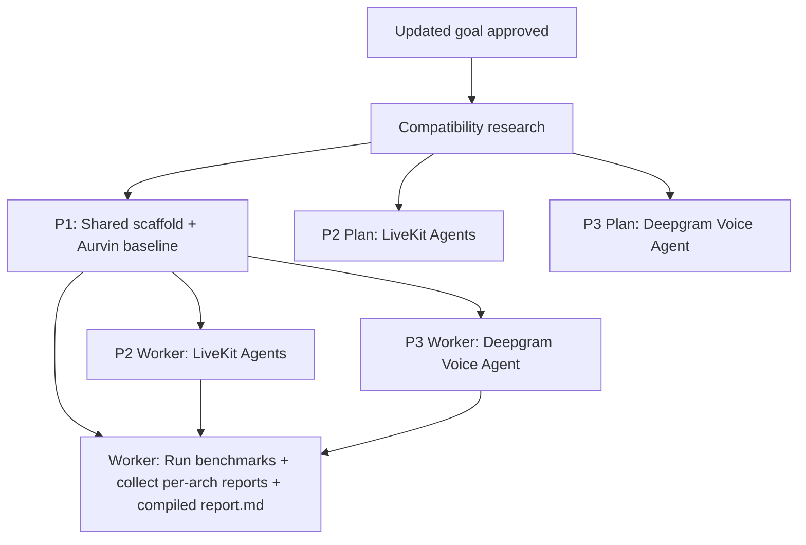

# State and dependency graph: three voice benchmark harnesses

## Workflow configuration

- Artifacts: `docs/voice-architecture-benchmark/`.
- Source: strictly isolated package under `benchmarks/voice-architectures/`, with zero edits to `backend/`, `frontend/`, root `package.json`, or production database/settings.
- Architecture folders & reports:
  - `benchmarks/voice-architectures/aurvin/` (+ `aurvin/report.md`)
  - `benchmarks/voice-architectures/livekit-agents/` (+ `livekit-agents/report.md`)
  - `benchmarks/voice-architectures/deepgram-agent/` (+ `deepgram-agent/report.md`)
  - `benchmarks/voice-architectures/shared/` (shared contracts, `.env` credential importer/redactor, corpus, timing, budget guards, sequential runner & report compiler)
  - `benchmarks/voice-architectures/report.md` (main compiled report combining all three architecture reports and stating the verdict)
- Selected candidates: Aurvin baseline, LiveKit Agents/Flux/Silero, Deepgram Voice Agent/Flux/OpenRouter.
- User approved build plus bounded live pilot and requested low cost on 16 November 2026; updated 16 November 2026 to enforce strict isolation, `.env` credential import, per-architecture `report.md` + compiled main `report.md`, and 1 researcher + 3 architecture planners + worker-executed benchmark/report collection (no separate runner planner), skipping code review.
- Written specification tightens the envelope to US$2 estimated, 18 submitted user turns and 15 paid-active minutes; no automatic paid retries/speculation.
- Written-goal approval recorded on 16 November 2026 (`I approve`). Compatibility Research (`R`) is authorized; no implementation, dependency install, or live calls before research and plan gates.
- Unified review is **skipped** (`--skip review`), never passed. Research, planning, implementation, meaningful tests, defect correction and final verification remain required.
- Three child slots maximum. Shared git commits and manifest/lockfile changes are serialized.
- Preserve preexisting `docs/model-selection-compatibility/state.md`, `backend/src/contracts/admin-config.spec.ts`, `docs/voice-latency-benchmark/README.md`, and `docs/voice-latency-benchmark/provider-architecture-assessment-2026-11-16.md`. Do not include them in this workflow's commits.

## Workflow milestones

- [x] Goal alignment and updated written specification approved (16 November 2026).
- [x] Technical research committed and summarized (`docs/voice-architecture-benchmark/research.md`; `7a40c2a`).
- [x] All three architecture implementation plans (`plan1.md`–`plan3.md`) committed (`e0e80af`, `f4f8115`, `4e1d590`).
- [x] All three architecture workers complete (`P1` `1e51331`…`9a1a335`, `P2` `dd40398`, `P3` `e8cd1a8`).
- [x] Unified review skipped by user instruction (`--skip review`).
- [x] Worker-executed integrated verification, dry-run pilot, per-architecture `report.md`, compiled `benchmarks/voice-architectures/report.md`, and `docs/voice-architecture-benchmark/final_report.md` complete (`V1`; `d73e97f`).

## Brainstorming tasks

- [x] Explore project context, benchmark layout, and isolation boundaries.
- [x] Clarify live scope, low-cost envelope, strict project isolation, `.env` import, per-folder `report.md` + compiled `report.md`, and planner/worker topology.
- [x] Reconcile `goal.md` and `state.md` to updated user constraints.
- [x] Obtain user approval of the updated written specification (16 November 2026).
- [x] Authorize research/dispatch.

## Initial findings

- `benchmarks/` does not yet exist; `benchmarks/voice-architectures/` can be created cleanly without touching `backend/`, `frontend/`, or root manifests.
- Backend already has a benchmark CLI, timing/report modules, LiveKit headless consumer, and egress guard under `backend/src/benchmark/` and `backend/src/voice/`.
- Historical driver pins one older model/voice and eight-turn envelope. It cannot simply be rerun as an all-provider harness.
- Existing headless consumer deliberately does not prove playback; this must not be bypassed.
- Backend has RTC and server SDKs, but not the LiveKit Agents framework/plugins.
- Existing `.env` credentials (and encrypted admin config if applicable) can be imported read-only at runtime without modifying `.env` or production files.
- Managed BYO inference may not expose all attribution/output/routing controls. Research must establish feasibility before paid admission; no public callback proxy is approved.

## Confirmed product decisions

- Isolate all benchmark files inside `benchmarks/voice-architectures/` with zero interference to `backend/`, `frontend/`, or root config.
- Import existing `.env` credentials read-only server-side (redacted; never printed or committed).
- Place each candidate in its own subfolder (`aurvin/`, `livekit-agents/`, `deepgram-agent/`) with its own `report.md`, and compile all three into `benchmarks/voice-architectures/report.md` with the verdict.
- Topology: 1 Researcher (`R`), 3 Architecture Planners (`P1`–`P3`) + workers, and 1 Execution/Verification Worker to run the benchmark and collect/compile results (no separate planner for running/collecting). Skip code review.
- Prioritize low cost; measure decoded headless timing accurately and keep baseline production playback-proof gaps visible.

## Dependency matrix and execution status

`R` means research is committed and summarized. Worker dependencies require completed, tested worker implementation, not merely a committed plan.

| Unit | Scope | Worker dependencies | Planner prerequisites | Planner status | Worker status | Commits |
| --- | --- | --- | --- | --- | --- | --- |
| P1 | Shared scaffold (`package.json`, `shared/`), runner/report compiler & Aurvin baseline (`aurvin/`) | R (`7a40c2a`) | R (`7a40c2a`) | [x] `e0e80af` | [x] Complete | `1e51331`…`9a1a335` (12 commits) |
| P2 | LiveKit Agents/Flux/Silero harness & `report.md` generator (`livekit-agents/`) | P1 | R (`7a40c2a`) | [x] `f4f8115` | [x] Complete | `dd40398` |
| P3 | Deepgram Voice Agent/BYO OpenRouter harness & `report.md` generator (`deepgram-agent/`) | P1 | R (`7a40c2a`) | [x] `4e1d590` | [x] Complete | `e8cd1a8` |
| V1 (Worker only) | Final Verification: offline checks, authorized sequential pilot, per-architecture `report.md`, compiled `benchmarks/voice-architectures/report.md` & `final_report.md` | P1, P2, P3 | No separate planner (executes against `goal.md` & verified harnesses) | N/A (Skipped per user) | [x] Complete | `d73e97f` |

### Execution graph

### Readiness and dispatch

- No agents before updated written-goal approval.
- Researcher (`R`) investigates package/managed API compatibility, `.env` credential import seams, exact controls/prices, and defines the shared interface/package recommendations in `research.md`; reports a short decision summary and commit. Orchestrator does not read `research.md`.
- Once `R` completes, dispatch `P1`, `P2`, and `P3` planners concurrently in foreground parallel (3 slots).
- `P1` worker starts immediately upon `P1` plan commit (sole owner of `benchmarks/voice-architectures/package.json`, `package-lock.json`, `shared/`, and `aurvin/`, incorporating any `P2`/`P3` dependency requirements).
- `P2` and `P3` workers start in parallel in their disjoint folders (`livekit-agents/`, `deepgram-agent/`) once `P1` worker commits and `P2`/`P3` plans are committed.
- Once `P1`–`P3` workers complete, dispatch the **Benchmark Execution & Report Worker (`V1`)** (no separate planner needed) to run offline verification, execute the bounded sequential live pilot under the US$2 / 18-turn / 15-min guard, generate all three per-architecture `report.md` files, compile `benchmarks/voice-architectures/report.md` with the verdict, and produce `docs/voice-architecture-benchmark/final_report.md`.
- Shared git index is serialized: agents request commit permission before staging/committing, and the orchestrator grants one at a time.

## Ownership and completion gates

### Research (`R`)

- Owns `docs/voice-architecture-benchmark/research.md` only.
- Checks official APIs, published/installed package compatibility, Windows/native support, `.env` import & read-only backend seams, provider controls, attribution, privacy/routing, and cost.
- No keys/env contents, live probes, paid calls, provisioning, dependency installation or implementation.
- Exit: committed findings plus concise feasible/blocked summary, shared contract/dependency list, and `.env` import path.

### P1 — Shared isolated scaffold + Aurvin baseline

- Sole manifest/lockfile owner for `benchmarks/voice-architectures/package.json` and `package-lock.json`.
- Owns `benchmarks/voice-architectures/shared/` (contracts, `.env` credential importer/redactor, synthetic corpus, monotonic timer, budget/turn/time guards, sequential comparison runner & compiled `report.md` builder) and `benchmarks/voice-architectures/aurvin/` (harness, tests, per-arch `report.md` formatter).
- Zero edits to `backend/`, `frontend/`, or root config; isolated DB/executor if booting a baseline backend.
- Exit: deterministic no-network checks pass for guards/redaction/corpus/Aurvin routing & lifecycle; explicit onset/completion proof labels; dependencies reconciled for P2/P3.

### P2 — LiveKit Agents (`livekit-agents/`)

- Owns `benchmarks/voice-architectures/livekit-agents/` only (harness, deterministic tests, per-arch `report.md` formatter).
- Requests any package additions through P1 rather than editing `package.json` independently.
- Uses actual LiveKit Agents framework + Flux STT + Silero VAD/interruption + OpenRouter + Flux TTS with tested controls and bounded lifecycle.
- Exit: configuration identity, attribution, interruption, cancellation and failure fixtures pass; exact support limitations recorded.

### P3 — Deepgram Voice Agent (`deepgram-agent/`)

- Owns `benchmarks/voice-architectures/deepgram-agent/` only (harness, deterministic tests, per-arch `report.md` formatter).
- Uses actual managed Voice Agent protocol with BYO OpenRouter (not direct STT/TTS masquerading as Voice Agent).
- Must establish BYO attribution/privacy/output-cost controls without public infrastructure. Unsupported requirements cause an explicit preflight block and user decision, not a silent waiver.
- Exit: protocol/guard/configuration/error fixtures pass; supported versus blocked live path documented.

### V1 — Benchmark Execution & Report Worker (Final Verification)

- No separate planner; executes after `P1`–`P3` workers complete.
- Runs full offline verification (`build`, `lint`, `test`, dry-run) for `benchmarks/voice-architectures/` and confirms zero edits to `backend/` and `frontend/`.
- Executes the authorized sequential live pilot under the single shared US$2 / 18-turn / 15-min guard and cleans up owned benchmark rooms/resources.
- Produces `benchmarks/voice-architectures/aurvin/report.md`, `benchmarks/voice-architectures/livekit-agents/report.md`, `benchmarks/voice-architectures/deepgram-agent/report.md`, compiled `benchmarks/voice-architectures/report.md` (with verdict), and `docs/voice-architecture-benchmark/final_report.md`.

## Acceptance coverage

| Criterion | Owner | Integrated verification |
| --- | --- | --- |
| Strict isolation (zero project interference) | P1–P3 | V1 git diff / check |
| `.env` read-only import & redaction | P1 | V1 redaction/read-only checks |
| Independent folders & per-arch `report.md` + compiled `report.md` verdict | P1–P3, V1 | V1 report generation & checks |
| Finite low-cost envelope & no implicit paid work | P1 | V1 guard totals & negative tests |
| Baseline preserves playback proof | P1 (Aurvin) | V1 labels & incomplete outcomes |
| Real LiveKit Agents configuration | P2 | V1 dependency/configuration evidence |
| Managed Deepgram Voice Agent + safe BYO feasibility | P3 | V1 admitted or blocked preflight |
| Live comparison, cleanup & honest verdict | V1 | Compiled `report.md` & `final_report.md` |

## Research handoff — complete (`7a40c2a`)

- **Environment:** Windows `win32 x64`, Node `v24.18.0`, npm `12.0.1`.
- **Aurvin baseline (`aurvin/`):** Feasible by invoking `AppService.create` from `backend/dist/app.service.js` against an isolated MongoDB (`aurvin_voice_arch_<uuid>`), passing `ports.assets` explicitly to `system.md`/`product_knowledge.md`, `ports.authProvider` stub + seeded synthetic `UserAccount`, `ports.configRepository` read-only config, `ports.fetcher`/`ports.speechSockets` wrapped with `BudgetGuard`, and `calendar: null`. `backend/dist/` was noted stale (`prefix-estimate.js` absent), so Aurvin preflight checks `dist/` freshness and requires `npm run build` in `backend/` when stale (zero source edits to `backend/`). Headless decoded receipt does not emit `playback.progress(proof: 'proven')`, so `voice-delivery.ts` settles `status: 'unknown'` and `live-flow.ts` enters recoverable pause; harness retains onset metrics and `BENCHMARK_UNPROVEN_PLAYBACK` / `VOICE_DELIVERY_UNKNOWN` without fabricating playback proof.
- **LiveKit Agents (`livekit-agents/`):** Feasible on Node `v24.18.0`/`win32-x64` using `@livekit/agents@1.10.0`, `@livekit/agents-plugin-deepgram@1.10.0`, `@livekit/agents-plugin-silero@1.10.0` (uses `onnxruntime-node@1.24.3`, requires VC++ 2015–2022 Redistributable; offline `silero.VAD.load()` test required), `@livekit/agents-plugin-openai@1.10.0`, `@livekit/rtc-node@1.2.2`, `livekit-server-sdk@2.19.2`, `zod@3.25.76`. Custom `OpenAI({ baseURL: 'https://openrouter.ai/api/v1', maxRetries: 0, fetch: guardedFetch })` enforces `user`, ZDR/no-fallback routing, disabled plugins, token caps, and `BudgetGuard`. Standalone `AgentSession.start` + `RoomIO` uses `turnDetection: 'stt'`, `sileroVAD`, VAD interruption, `preemptiveGeneration: false`, and `maxRetry: 0` across LLM/STT/TTS. Note TTSv2 cancels via stream abort + `RoomIO` buffer clear rather than `/v2/speak` `Interrupt`.
- **Deepgram Voice Agent (`deepgram-agent/`):** Offline WebSocket protocol + deterministic fixtures feasible; **live BYO OpenRouter preflight-blocked without a public proxy** (`BLOCKED_BYO_CONTROLS_UNSUPPORTED`, US\$0 spent) because `Settings.agent.think` lacks `user` attribution, OpenRouter routing/ZDR/transforms fields, `max_tokens`/`max_completion_tokens`, local `BudgetGuard`/`maxRetry: 0` enforcement, and token usage/generationId events, while typing `model` as an OpenAI-only enum. Build genuine Voice Agent v1 harness + fixtures + fail-closed preflight and do not substitute Deepgram-managed LLM or add a public proxy.
- **Credentials & isolation:** Read-only `.env` import (`--env-file` or `backend/.env` fallback) via `shared/credentials.ts`, optional read-only `config._id = 'aurvin'` decryption via `AURVIN_CONFIG_ENCRYPTION_KEY`, wrapped in `SecretRedactor`.
- **Shared package & budget bounds:** P1 owns `benchmarks/voice-architectures/package.json` (`ws@^8.18.0`, `mongodb@6.21.0`, `openai@^6.8.1`, LiveKit/Deepgram/Silero/Zod, TypeScript/Vitest devDeps), `shared/` (contracts, credentials, 6-turn synthetic 16 kHz PCM16 corpus, `BudgetGuard`, monotonic `timing.ts`, `webrtc-participant.ts`, `compiler.ts`, `cli.ts`), and `aurvin/`. Dynamic OpenRouter `/api/v1/models` pricing check + conservative US\$2 reservation math (`<= 18` turns, `<= 15` min) gates live execution.

## Verification commands and evidence

Exact new-package scripts are chosen by P1 and recorded after implementation.

| Directory | Command/check | Purpose/status |
| --- | --- | --- |
| repository | `git status --short`; `git diff --check` | Passed: zero changes under `backend/`, `frontend/`, root manifests, `.env`, or production database |
| `benchmarks/voice-architectures` | `npm run lint`, `npm run build`, `npm test` | Passed (`4313cb3`): TypeScript lint/build clean; 23 test files / 140 tests passed (0 failed, 0 skipped) |
| `benchmarks/voice-architectures` | `npm run bench -- --live --authorization=results/auth-live-pilot.json --waive-deepgram-byo --publish-reports` | Passed live pilot (`runId: 854c24ce-bb4a-4598-94d4-7fae2535c268`): `aurvin` (6 turns), `livekit-agents` (4 turns; Turn 3 failed `AGENTS_PROVIDER_ERROR`), `deepgram-agent` (6 turns under pilot-only BYO waiver; Turn 5 failed `INTERRUPTION_ANCHOR_MISSING`); aggregate `submittedTurns: 16`, `modelDispatches: 10`, `activeMs: 357033.05`, `conservativeReserveUsd: 1.359666`, `denied: null`, all `cleanup.complete: true` |
| `benchmarks/voice-architectures` | offline default checks (`npm run bench*`) | Passed dry-run fail-closed checks; `deepgram-agent` remains `BLOCKED_BYO_CONTROLS_UNSUPPORTED` without `--waive-deepgram-byo` |

### Implementation record

- P1 commits: `1e51331`, `474dd58`, `da6ebf9`, `876b9c9`, `355b876`, `5200b9f`, `62c3dbb`, `d9911e4`, `1c3eabc`, `ba567a5`, `541f26f`, `9a1a335`.
- P2 commit: `dd40398` (`livekit-agents/` candidate harness, offline Silero VAD test, custom OpenRouter client with ZDR/no-fallback/token caps, AgentSession wiring, interruption test, report formatter).
- P3 commit: `e8cd1a8` (`deepgram-agent/` candidate harness, genuine Voice Agent v1 wire protocol, measurements, WebSocket lifecycle, fail-closed preflight block `BLOCKED_BYO_CONTROLS_UNSUPPORTED`, report formatter).
- Live-enablement & pilot fixes: `832879e` (`verifyBuild` `createProgram`, `speech-proxy.ts`, live `livekit-agents` & `deepgram-agent` runners, `--waive-deepgram-byo`, dynamic compiler verdict), `389be16` (`SecretRedactor` numeric config exclusion), `8db56f5` (Atlas cold-start readiness retry), `cd0a303` (`livekit-agents` cleanup/exit fix), `c19f77c`, `3f0bb7c` (`pacePcm` wakeup/spike fix), `7fcb7bd` (Deepgram `KeepAlive` allowlist), `58e3194` (Aurvin `SKILL_NATIVE_TOOLS` allowlist), `6174ae4` (`/api/v1/models` 30 s timeout), `df67167` & `2b8bf7d` (Aurvin `AudioStream` teardown/recovery + Agents `tools: []` + Deepgram `withSilenceTail`), `6ff7c35` (Opus dither normalization + Agents cleanup/error unwrap + per-turn `BudgetGuard` isolation), `7a9b5fd` (`startAurvin` `/api/v1/models` cache), `4313cb3` (content-hash `fs.watch` verification).
- Package: exact pinned dependencies; build and lint clean; 23 test files / 140 tests passing across all three candidates and shared utilities.
- Review: skipped by user instruction (`--skip review`).

## Artifact record

| Artifact | State | Commit |
| --- | --- | --- |
| `goal.md` | Approved (16 November 2026) | `e083d33` |
| `state.md` | P1–P3 complete; V1 verification in progress | (updating) |
| `research.md` | Committed (`7a40c2a`) | `7a40c2a` |
| `plan1.md` | Committed (`e0e80af`) | `e0e80af` |
| `plan2.md` | Committed (`f4f8115`) | `f4f8115` |
| `plan3.md` | Committed (`4e1d590`) | `4e1d590` |
| `benchmarks/voice-architectures/shared` & `aurvin` | P1 complete (12 commits) | `1e51331`…`9a1a335` |
| `benchmarks/voice-architectures/livekit-agents` | P2 complete | `dd40398` |
| `benchmarks/voice-architectures/deepgram-agent` | P3 complete | `e8cd1a8` |
| `benchmarks/voice-architectures/*/report.md` & `report.md` | Published from live run `854c24ce-bb4a-4598-94d4-7fae2535c268` | (this commit) |
| `final_report.md` | Updated with live pilot results & verdict | (this commit) |

## Current gate and resume

**CURRENT GATE: WORKFLOW COMPLETE (LIVE PILOT PUBLISHED).**

1. All three candidate harnesses (`aurvin/`, `livekit-agents/`, `deepgram-agent/`) are built, tested offline (`23` test files / `140` tests passing), and executed in the bounded live sequential pilot (`runId: 854c24ce-bb4a-4598-94d4-7fae2535c268`, commit `4313cb3`) within the US$2 / 18-turn / 15-minute envelope.
2. Zero edits to `backend/` source, `frontend/`, root manifests, `.env`, production databases, or preexisting `docs/voice-latency-benchmark/*`.
3. Published per-architecture reports (`aurvin/report.md`, `livekit-agents/report.md`, `deepgram-agent/report.md`), compiled verdict report (`benchmarks/voice-architectures/report.md`), and `docs/voice-architecture-benchmark/final_report.md` are complete.
4. Unified review was skipped per user instruction (`--skip review`), and `--waive-deepgram-byo` applied strictly to the US$2 pilot. Workflow is complete.
