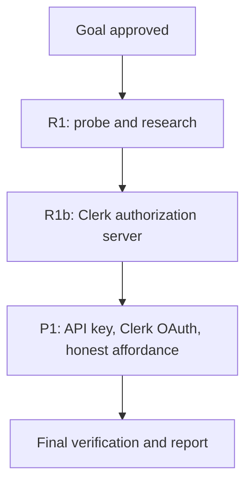

# State & Dependency Graph: web-search-tinyfish-auth

## Workflow configuration

- All artifacts live directly in `docs/web-search-tinyfish-auth/`.
- Skipped phases declared: `review` (standing user instruction, recorded in root `AGENTS.md`).
- Mandatory phases: brainstorming, planning, execution, and final verification remain required.
- Current authorization: goal approved by the user on 15 November 2026; the live OAuth metadata probe
  was separately authorized in the same exchange. No paid checks, provisioning, or deployment.
- File preservation: `backend/test/runtime/web-search-followup-verify.spec.ts` is untracked user work;
  never stage, edit, or delete it.
- Worker dispatch rule: the worker receives `plan1.md` plus root `AGENTS.md` only. Do **not** point it at
  `research.md` — the planner already incorporated that evidence into the plan, and re-reading it invites
  the worker to re-litigate settled decisions.

## Delegation configuration & handoffs

- Harness: OpenCode. Delegation surface is the `subagent` tool; the model is passed as the `model`
  argument in `provider/model#variant` form, where the `#variant` suffix is the thinking effort.
- Capability evidence: `opencode.models` catalog queried live in this session. `openai/gpt-6.1-terra`
  advertises `none,low,medium,high,xhigh,max`; `openai/gpt-6.1-sol` advertises
  `low,medium,high,xhigh,max`; `mistral/deepseek-v4-1-flash-1017` advertises `none,low,high,max`.
  All three selected values are valid catalog entries.
- Selection order: researcher → planner → worker, resolved in one preflight exchange and persisted here.
- Worker selector note: the user answered `inherit#max`. `inherit` is not a catalog model ID; it was
  resolved to the orchestrator's own model at maximum effort, recorded above. No other translation was
  applied.
- Enforcement: `unverified`. OpenCode exposes no session-inspection surface that reports the model or
  variant a child session actually ran on, so the requested values are recorded but cannot be confirmed
  after dispatch. Recorded honestly rather than claimed.
- Reviewer/fixer: not dispatched. Review is skipped per standing instruction and must be recorded as
  skipped, never passed.
- Planner decisions (from its report, not re-read): remove the dead `markOAuthSupported` and offer an
  explicitly labeled unverified support check that runs the real `oauth/start`; request only
  `offline_access` for TinyFish and fail closed on anything broader.

| Handoff ID | Role | Plan/phase scope | Prompt reference | Expected artifacts | Status | Returned evidence |
| :--- | :--- | :--- | :--- | :--- | :--- | :--- |
| - | - | - | - | - | - | - |

## Workflow milestones

- [x] Step 1: Brainstorming & Goal Alignment (`docs/web-search-tinyfish-auth/goal.md`; user approval 15 Nov 2026)
- [x] Step 2: Technical Research (`docs/web-search-tinyfish-auth/research.md`; `bc9c5b9`, follow-up `7784abc`)
- [x] Step 3: Planning Completed (`plan1.md`; `7b5c514`)
- [x] Step 4: Execution Completed (`7349b41`, `2680ba7`, `56e16e7`, `1922f74`)
- [x] Step 5: Unified Code Review (Skipped via --skip review)
- [x] Step 6: Final Verification & Report (`docs/web-search-tinyfish-auth/final_report.md`)

## Brainstorming tasks

- [x] Explore project context: provider table, OAuth gate, panel affordances, existing docs.
- [x] Clarify requirements and scope boundaries with the user (three deliverables).
- [x] Compare approaches: API-key route vs OAuth-only vs status quo.
- [x] Present the design and obtain approval.
- [x] Write `goal.md`.
- [x] Construct the pre-research DAG, ownership, and acceptance mapping below.

## Initial findings

- TinyFish's hosted MCP endpoint accepts `Authorization: Bearer <api key>` per the vendor's own
  Command Code configuration, which Aurvin's `credentialHeaders` already produces verbatim.
- TinyFish publishes no OAuth discovery documents, so Aurvin's stricter `assertMetadata` cannot be
  satisfied from documentation alone; the SDK's legacy fallback is deliberately refused here.
- The OAuth connect button is unreachable by construction: `markOAuthSupported` is dead code and the
  `supported` flag comes only from a completed install.
- The web-search workflow is already closed (`docs/web-search/final_report.md`), so this is a new
  objective rather than a revision of plans 1-5.

## Confirmed product decisions

- Resolve TinyFish through the documented API-key path first; OAuth is conditional on real evidence.
- Never weaken the OAuth gate to make a provider fit.
- An `unverified` provider must offer a real support check rather than a hidden control.
- Review stays skipped.

## Dependency matrix & execution status

`R` means technical research completed and committed. Planner dependencies are separate from worker
dependencies so planning can overlap execution where safe.

| Plan ID | Title & Scope | Worker dependencies | Touched files / subsystems | Planner status | Worker status | Commits |
| :--- | :--- | :--- | :--- | :--- | :--- | :--- |
| **R1** | OAuth metadata probe and provider-auth research | None | `docs/web-search-tinyfish-auth/research.md` | n/a | n/a | - |
| **P1** | TinyFish API-key route, Clerk-origin OAuth enablement, honest OAuth affordance, and documentation reconciliation | R1 | `backend/src/plugins/web-search/providers.ts`, `connection.ts`, `frontend/src/api/web-search-protocol.ts`, `frontend/src/features/plugins/web-search/WebSearchPanel.tsx`, related tests, web-search docs | [x] `7b5c514` | [x] Complete | `7349b41`, `2680ba7`, `56e16e7`, `1922f74` |
| ~~**P2**~~ | Collapsed into P1 | - | - | n/a | n/a | - |

**P2 collapsed into P1.** R1's first pass recommended the collapse; R1b then proved OAuth is viable, so
the work is real but lands in the same two backend files P1 already owns. Two workers on
`providers.ts` and `connection.ts` would only create a rebase for a five-file diff, so P1 carries both
deliverables with separate commits per task group.

### Execution graph

### Planner readiness and immediate worker dispatch

| Planner | Earliest planning prerequisites | Worker start condition |
| :--- | :--- | :--- |
| P1 | R1 and R1b committed | P1 plan committed |

- P1 is the only plan; P2 collapsed into it.
- Serialize git staging and commits across all agents.

## Plan scopes, file ownership, and completion gates

### R1 — OAuth metadata probe and provider-auth research
**Deliverable:** `research.md`; exact discovery evidence plus a go/no-go on OAuth.
**Owned files:** `docs/web-search-tinyfish-auth/research.md`
**Scope:** Issue unauthenticated GETs to TinyFish's protected-resource and authorization-server
discovery documents. Record URL, status, and body or absence. Evaluate the returned metadata against
Aurvin's unchanged `assertMetadata` conditions one by one. Confirm the documented Bearer-key-over-MCP
claim and list the exact code sites that gate it.
**Exit gate:** Every claim carries a URL and an observed status; the OAuth conclusion is stated as
pass/fail per condition, with no inference presented as observation.

### P1 — TinyFish API-key route, honest OAuth affordance, documentation
**Deliverable:** `plan1.md`; TDD steps for the four code sites, test flips, and doc reconciliation.
**Owned files:** the backend provider/connection modules, the frontend protocol catalog and panel,
their tests, and the web-search documentation set.
**Scope:** Enable the Bearer key path without touching the fixed-origin or gate logic; make the
`unverified` state actionable; reconcile every document that currently asserts TinyFish is unsupported.
**Exit gate:** AC1-AC3, AC6-AC8 pass with deterministic fixtures; no live provider call in the suite.

## Acceptance coverage

| Goal criterion | Primary owner(s) | Integrated verification |
| :--- | :--- | :--- |
| AC1, AC2, AC3 | P1 | P1 fixtures, final verification |
| AC4 | R1 | Final verification |
| AC5 | P2 (or P1 if collapsed) | P2 fixtures, final verification |
| AC6 | P1 | P1 fixtures, final verification |
| AC7, AC8 | P1 | Final verification |

## Research handoff

R1 committed `bc9c5b9`. Observed evidence, not inference:

- RFC 9728 protected-resource metadata exists only at the path-suffixed form:
  `GET https://agent.tinyfish.ai/.well-known/oauth-protected-resource/mcp` → **200**. The bare
  `/.well-known/oauth-protected-resource` → 404.
- Every authorization-server discovery path on `agent.tinyfish.ai` and `accounts.tinyfish.ai` → 404.
- Keyless `POST https://agent.tinyfish.ai/mcp` → 401, and
  `GET https://agent.tinyfish.ai/mcp/.well-known/openid-configuration` → 401.
- The protected-resource document advertises authorization server `https://clerk.tinyfish.ai`, which is
  outside `tinyfish.oauthOrigins` (`['https://agent.tinyfish.ai', 'https://accounts.tinyfish.ai']`).
- R1's initial verdict was therefore **no-go on the allowlist condition**, and it recommended collapsing
  P2 into P1.

**Open follow-up (R1b) — complete (`7784abc`):** R1b probed `clerk.tinyfish.ai` directly.

| Clerk endpoint | Status |
| :--- | ---: |
| `/.well-known/oauth-authorization-server` | 200 |
| `/.well-known/openid-configuration` | 200 |
| `/.well-known/oauth-protected-resource` | 404 |
| `/.well-known/jwks.json` | 200 |

Gate conditions 4-10: issuer equality, `code` response type, both grants, S256, and secret-free token
authentication all pass. The only failing condition is the per-provider origin pin. DCR is advertised
but its response shape is unverified; loopback callback acceptance is unverified; token exchange and
refresh rotation are unverified. Those are live-flow residuals of the same class already accepted for
the other four providers — not static-gate failures.

**Decision (user, 15 November 2026):** add `https://clerk.tinyfish.ai` to `tinyfish.oauthOrigins`.
Recorded in `goal.md` as an evidenced correction of a stale entry, with the pinning mechanism untouched.
P2 collapsed into P1 accordingly.

The API-key route is unaffected by this question and remains the primary deliverable.

## Final verification commands and evidence

Independently re-run by the orchestrator on the committed tree at `1922f74`, not taken from the
worker's report:

| Working directory | Command | Result |
| :--- | :--- | :--- |
| `backend` | `npm run build` | exit 0 |
| `backend` | `npm run lint` | exit 0, pre-existing warnings only |
| `backend` | `npm test -- test/plugins/web-search/ --no-file-parallelism` | 9 files / 199 tests passed |
| `frontend` | `npm run build` | exit 0, pre-existing chunk-size warning |
| `frontend` | `npm run lint` | exit 0, pre-existing warnings only |
| `frontend` | `npm test` | 109 files / 871 tests passed |

Worker-reported full-suite comparison, not independently re-run:

| Suite | Baseline | Post-change |
| :--- | :--- | :--- |
| `backend npm test` | 21 failed files / 381 pass / 3 skip (406); 82 fail / 3864 pass / 14 skip | 19 failed files / 382 pass / 3 skip (405); 75 fail / 3887 pass / 14 skip |
| `backend npm run test:e2e` | 1 failed file / 3 pass / 44 skip; 29 fail / 14 pass / 140 skip | identical |

Delta is the 16 added tests with no newly failing test. Native MongoDB suites were **skipped**, not
passed: 14 routine and 140 e2e.

## Artifact and commit record

| Artifact | State | Commit |
| :--- | :--- | :--- |
| `goal.md` | Approved | pending |
| `state.md` | Initial DAG | pending |
| `research.md` | Complete (`bc9c5b9`, follow-up `7784abc`) | `7784abc` |
| `plan1.md` | Written (`7b5c514`) | `7b5c514` |
| `final_report.md` | Written | pending |

## Current gate and resume procedure

**CURRENT GATE: COMPLETE**

Resume steps:
1. [ ] Read this state and the final report; preserve intervening user changes.
2. [ ] Re-open only if a live TinyFish account check is separately authorized, or if a pre-existing
   backend failure is assigned to a new objective.
