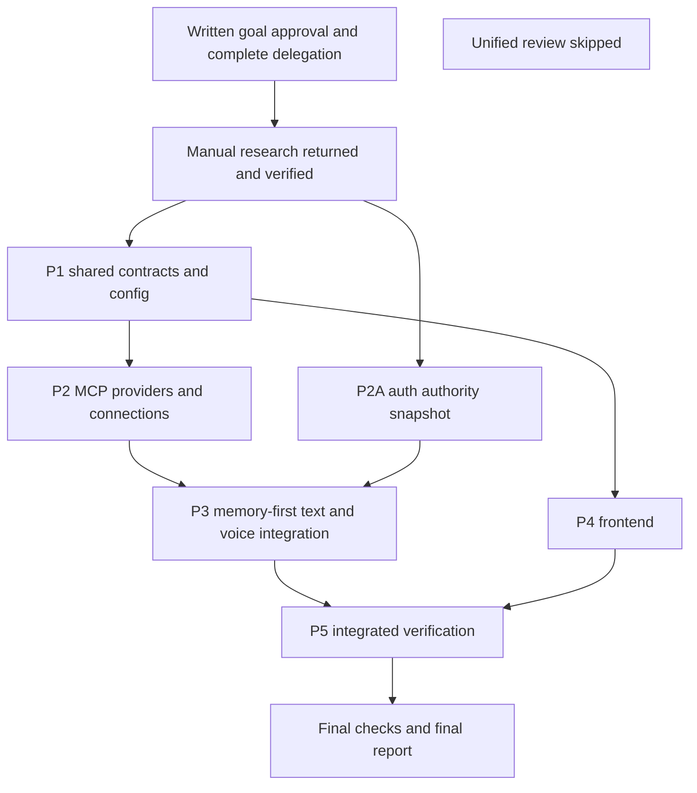

# Web Search — MAW State

## Policy update — 2026-11-15

- Fetch admission is now `verified` for all five providers under Aurvin's client-side URL guard, public-DNS checks, provider-returned URL validation, and the untrusted-evidence prompt guardrail.
- `verified` no longer claims provider-side redirect, DNS-rebinding, or private-network enforcement. The provider fetches from its own network, so intermediate hops remain outside Aurvin's observation.
- Earlier "production fetch closed" entries below remain as historical execution records and are superseded by this policy update.

## Workflow configuration

- User requested conversion to MAW and permission to proceed with `--skip review`.
- Review is **skipped**, not passed. Do not dispatch a reviewer or review-triggered fixer.
- Research, planning, execution, defect correction, and final verification remain required.
- Keep workflow artifacts directly in `docs/web-search/`.
- Keep implementation simple and latency-sensitive; reuse existing patterns and avoid speculative abstractions.
- Delegation setup, written-goal approval, manual research, all plans, all workers, D1 correction, and final verification are complete. Review remains skipped.
- Approval evidence: on 2026-11-14 the user selected **Approve and proceed** after the three-retry revision `ba60aaf`, approving `goal.md` and the MAW workflow, including the documented event-notified planner adaptation.
- Documentation setup does not imply implementation or service verification.

## Delegation configuration and handoffs

- Selection order: researcher, planner, worker. Persist each resolved choice before advancing.
- Capability evidence: exposed `functions.subagent` accepts `model: provider/model#variant`; the OpenCode model catalog was consulted on 2026-11-14.
- Available OpenAI chat models: `openai/gpt-6.1-terra`, `openai/gpt-6.1-sol`, `openai/gpt-6-luna`, `openai/gpt-6-astra`, `openai/gpt-5.6-cyber`.
- All advertise low, medium, high, xhigh, and max; Terra, Luna, and Cyber also advertise the none effort variant. Omitting the override is supported by the delegation tool.
- The selection `none` means manual handoff, not the model's none effort variant.
- Researcher: user selected `none`; research will be a manual handoff after goal approval. No research agent will be spawned, and research is not skipped.
- Planner: `openai/gpt-6.1-sol#xhigh`, selected by the user.
- Worker: user supplied `mistral/deepseek`, which uniquely resolves in that provider's catalog to `mistral/deepseek-v4-1-flash-1017`, then selected max effort. Dispatch with `mistral/deepseek-v4-1-flash-1017#max`.
- Verify requested model and effort on each role's first dispatch; do not claim enforcement without evidence.
- Planner enforcement verified from local session metadata for `ses_e26f644e8ffevDRZRrvmIkkQ2Q`: `openai/gpt-6.1-sol`, variant `xhigh`.
- Worker enforcement verified from local session metadata for `ses_e26e20dafffeN6frsF1mvvJSD6`: `mistral/deepseek-v4-1-flash-1017`, variant `max`.
- Only background subagent dispatch is exposed. Do not invent foreground tool parameters; record and resolve the MAW foreground-planner limitation before planning dispatch.
- **P4 planner exception:** the user will handle the P4 planning handoff. Never spawn a P4 planner; issue a copyable prompt when P1's worker commit and contract summary are ready.
- **P4 worker:** after the user returns and commits `plan4.md`, dispatch the automatic P4 worker once P1 is complete and the plan is verified. The user selected "Auto worker after my plan".
- Maximum capacity: three child agents alongside the orchestrator.
- Serialize shared Git staging/commits. Workers must preserve unrelated changes.

| Handoff ID | Role | Scope | Prompt reference | Expected artifacts | Status | Returned evidence |
| --- | --- | --- | --- | --- | --- | --- |
| WEB-R-20261114-01 | Researcher (manual) | R: five-provider MCP/auth compatibility and minimal integration recommendations | Chat handoff headed WEB-R-20261114-01 following written-goal approval | `docs/web-search/research.md`, locally available commit, concise compatibility/contracts summary | verified | Commit `715b7b0`; only `docs/web-search/research.md`; 282 insertions; summary returned 2026-11-14 |
| WEB-P4-PLAN-20261114-01 | Planner (manual) | P4 frontend plugin, setup/config UI, source/activity presentation | Chat handoff headed WEB-P4-PLAN-20261114-01 after P1 contracts | `docs/web-search/plan4.md`, locally available commit, concise UI/API contract summary | verified | Commit `32b043e`; only `plan4.md`; 4,888 lines; summary returned 2026-11-14 |

## Workflow milestones

- [x] Delegation setup: manual researcher; Sol xhigh planners; DeepSeek V4.1 Flash max workers.
- [x] Step 1: Written goal, self-check, user approval, and complete initial DAG; initial `7f2bd0a`, revision `ba60aaf`, explicit user approval on 2026-11-14.
- [x] Step 2: Technical research: `docs/web-search/research.md`, commit `715b7b0`, manually returned and verified; 0/5 providers live-tested.
- [x] Step 3: All implementation plans committed: `plan1.md` `2335027`, `plan2.md` `37b159f`, `plan2a.md` `b0a37c4`, `plan3.md` `43a8263`, `plan4.md` `32b043e`, `plan5.md` `22f2b69`.
- [x] Step 4: All workers completed with checks. P1, P2, P2A, P3, P4, and P5 are complete; D1 was fixed and rerun.
- [x] Step 5: Unified review **skipped** by user instruction; never passed.
- [x] Step 6: Final verification and final report: `verification.md`, `operations.md`, `final_report.md`; D1 closed at `420abd9`.

## Brainstorming tasks

- [x] Explore existing Plugins UI, composer, Calendar connection pattern, graph, voice integration, recent commits, and provider documentation.
- [x] Clarify provider priority, connection UX, MCP mode, fallback, activation, tool shape, and default turn limits.
- [x] Compare retrieval approaches: as-needed versus mandatory lookup; user selected as-needed.
- [x] Discuss schema stability versus removal while disabled; user selected removal.
- [x] Present complete written specification and acceptance criteria in `goal.md`.
- [x] Commit `goal.md` with this workflow state: `7f2bd0a`.
- [x] Self-check specification for ambiguity, contradictions, scope, and placeholders.
- [x] Obtain approval of written specification: **Approve and proceed**, 2026-11-14, after revision `ba60aaf`.
- [x] Define complete pre-research dependency graph, ownership, and verification gates.

## Confirmed product decisions

- Add one Web Search entry to the existing Plugins page.
- Show five providers in fixed priority: TinyFish, Keenable, Exa, Tavily, Firecrawl.
- Provide concise provider-specific key instructions, an external destination button, and a dedicated masked key field.
- Offer browser authorization where supported; dashboard Google sign-in is not itself delegated API authorization.
- Use full MCP mode, restricted to search and page reading, not unrelated browser or mutation tools.
- Automatically fall back through connected providers in priority order with finite attempts and deadlines.
- No composer toggle. One Plugins-page toggle controls the user's web access across conversations, including text and voice.
- Default off; at least one connected provider is required for use.
- Web off means no external search or URL fetch. Remove the web tool schema from model requests when off.
- Expose one model-facing tool named `web_tool`, with browse mode requiring a query and fetch mode requiring a URL.
- Browse means web search, not interactive browser control.
- Retrieval is as needed; explicit requests to search or read a URL should trigger it.
- Config-page defaults: five searches and five fetches per turn, shared across the turn's model/tool loop.
- Strict memory-first path: zero database reads/writes before initial model dispatch; no MCP discovery, connection setup, or OAuth refresh gating that dispatch.
- Keep immediate follow-ups in memory; asynchronously persist completed turn evidence without blocking streaming or subsequent turns.
- Retrieval necessarily incurs network latency; do not promise instantaneous grounded answers or guaranteed prompt-cache hits.
- Disabling web blocks further external calls; it cannot retract already dispatched requests.
- Latest requested change: schema-invalid model-generated `web_tool` calls trigger up to three additional model repair attempts per accepted turn, with concise feedback and the canonical schema revealed again each time. The budget is shared across the turn. Invalid calls never dispatch a provider; successful calls are not replayed. Permission/safety/budget/provider failures do not enter this loop.

## Initial findings and constraints

- Plugins navigation and panel composition exist in `frontend/src/features/admin-config/AdminDashboard.tsx`.
- Calendar provides an existing plugin connection/UI pattern, but its uncommitted prepared-connection work is not owned by this workflow.
- Text graph integration exists in `backend/src/agent/turn-graph.ts`; current Calendar graph state and execution are specialized. Extend only the shared execution points actually needed for one web tool, not a new general tool framework.
- Voice calls the shared runtime through `backend/src/voice/agent/agent-voice-adapter.ts`. The web design must work through this shared path, not a second model/runtime implementation.
- Backend manageable configuration and admin contracts already exist. The two web limits belong there; credentials remain per-user plugin connections, not admin-wide search keys.
- Existing README and old Phase 1 paragraphs contain historical identity/tool descriptions. Current source and newer authentication implementation must be checked before choosing the identity seam.
- Provider OAuth findings from brainstorming are leads, not live compatibility certification.
- Research must report concrete MCP endpoint/tool/auth compatibility and finite limits; planners must reconcile any unsupported provider before workers claim it implemented.
- OpenCode exposes only background subagents, contrary to MAW's literal foreground-planner instruction. The user approved this harness adaptation with the workflow: dispatch ready planners concurrently through the supported event-notified API, process completion events without polling, and immediately pipeline ready workers. Do not claim literal foreground calls or invent unsupported parameters.
- The root `AGENTS.md` gained a Tool execution critical path section during specification approval. P3/P5 must preserve its memory authority, essential fail-closed checks, mutation barriers, async archive distinction, and required Calendar regression cases. This is not permission to edit the user's Calendar work.
- Research verified reusable seams in plugin HTTP/wiring, identity and encrypted storage, manageable config/warm cache, model repair and shared text/voice loops, and frontend config/chat presentation.
- Research recommends `@modelcontextprotocol/sdk` 1.x, compatible with the pinned zod line; P1 must verify and pin it. No frontend dependency is recommended.
- Research proposes fixed bounds: 5 searches/5 fetches per turn (editable 1..20), 3 shared schema repairs, one fallback attempt per eligible provider, 4s MCP connect, 12s provider call, 25s logical call, 45s web-turn deadline within the existing 180s turn timeout, and the recorded result/context byte limits. P1 freezes these contracts; P2/P3 implement and test them.
- All five hosted MCP endpoints/tools are documented but unverified live. TinyFish API-key-over-MCP was specifically unconfirmed at research time (historical; superseded by the 15 November 2026 follow-up); browser OAuth enablement depends on verified discovery/registration for TinyFish, Keenable, Exa, and Tavily. P2 must fail closed and report unsupported capability rather than use REST or keyless fallback.
- Providers do not publicly guarantee redirect-hop IP filtering. Aurvin must validate public HTTP(S) host/non-private IP before fetch dispatch, use headers rather than query-string keys, forbid anonymous/keyless endpoints, and disclose third-party query/URL transmission including fallback.
- P2 plan fixes the provider mapping: TinyFish `search`/`fetch_content`; Keenable `search_web_pages`/`fetch_page_content`; Exa `web_search_exa`/`web_fetch_exa` (fetch uses `urls`); Tavily `tavily_search`/`tavily_extract`; Firecrawl `firecrawl_search`/`firecrawl_scrape`.
- P2 plan exports a secret-free `WebSearchPort` (`snapshot`, `validateInput`, `execute`), account-scoped aggregate CAS storage, and `WEB_SEARCH_INDEXES`. P3 owns application/persistence composition, private callback routing, preparation scheduling, turn budgets, shared text/voice execution, and archival.
- P2 blockers (historical, superseded): P2 originally refused key setup (historical, superseded) and treated browser OAuth as capability-gated; production fetch was closed until the 2026-11-15 policy update admitted the client-guarded path. Synthetic fixtures do not certify fetch safety.
- P3 plan keeps one `AppService`/`WebSearchModule` composition, P2's unchanged `snapshot` → `validateInput` → `execute` port, shared text/voice execution, 5/5 counters, three schema repairs, cancellation, source/activity events, and consolidated asynchronous archival. P3 owns 13 TDD tasks and exact source/test paths.
- P3 blocker confirmed: `plan3.md` records the existing HTTP-authentication DB read as a limitation rather than solving it. Its zero-DB fixtures enter the runtime with trusted identity and bypass real HTTP authentication; separate HTTP checks acknowledge the read through `configurePrivateHttp`. P3 alone cannot satisfy AC6's arrival-to-model zero-DB requirement.
- Minimal proposed fix: a bounded server-memory account-authority snapshot replacing only `users.bySubject()` in `AuthService.authenticate`, while preserving WorkOS session verification and `admitAccount()`. Warm outside turns; publish confirmed changes; synchronously fence revocations; cold/missing/uncertain authority fails closed with no turn-path DB fallback.
- Security limitation: immediate visibility of out-of-process account changes cannot be guaranteed without coherent invalidation. A simple TTL principal cache is insufficient and would weaken current freshness. A new authentication prerequisite plan is required; P3 explicitly excludes `auth/**`.
- AC6 remains unchanged unless the user explicitly chooses a narrower post-authentication guarantee.
- P4 plan is verified: strict web-source URL sanitization, frontend protocol/client, exact admin/voice mirrors, Plugins section and five provider cards, Config 5/5 controls, text/voice source/activity rendering, and no Composer toggle. It owns 14 new and 35 modified frontend files; backend, Calendar, and Composer.tsx remain untouched.
- P4 coordination blockers resolved in implementation: P2 backend routes and P3 SSE/voice `web.frame` now exist. P5 integrated fixtures cover the assembled boundaries; live HTTP/SSE/LiveKit integration remains unrun.
- P4 implementation complete: 49 unique frontend files (14 new, 35 modified), no backend/Calendar/Composer.tsx edits. Admin-config and voice mirrors are exact. Five ordered cards, default-off global toggle, masked ephemeral key input, capability-gated OAuth, Config 5/5 controls, text/voice source presentation, and no Composer toggle.
- P4 verification: frontend build passed; lint exit 0; frontend tests 107 files/861 tests passed; backend mirror/contract specs 6 files/110 tests passed. Direct orchestrator recheck of `admin-config.spec.ts` + `voice.spec.ts`: 79/79 passed. Live provider/OAuth/HTTP/SSE/LiveKit/native/e2e checks unrun.
- P2 implementation complete. P3 handoff: instantiate `WebSearchConnections`, `WebSearchOAuth`, and `WebSearchRuntime` once from the existing guarded `RecordStore`/`MongoOwnership`; register `WebSearchModule.registerAsync` with AppService factories; add exact static GET callback exemptions for the five callback routes; apply the 16,384-byte body bound before large JSON buffering; warm outside admitted turns; advertise only when enabled, eligible prepared provider exists, and `snapshot.modelLimits?.tools === true`; use `'ok' in validated`/`'args' in validated`; own turn counters, repair, evidence, events, and async archival; evict/invalidate/close on logout/deactivation/shutdown.
- P2 stable APIs: `WebSearchPort` (`snapshot`, `validateInput`, `execute`); `WebSearchConnectionsApi` (`status`, `warmOwner`, `isPrepared`, `settings`, `connect`, `disconnect`, `evict`, `close`); `WebSearchOAuthApi` (`start`, `complete`, `maintainOwner`, `invalidate`, `close`); `WebSearchModule.register/registerAsync`.
- P2 gated/unverified (historical snapshot, superseded by the 15 November 2026 TinyFish follow-up and the 2026-11-15 fetch policy update): P2 originally refused key setup (historical, superseded); browser OAuth was fixture-only for all five; production fetch was closed for all five (`fetchSafety: 'unverified'`); live MCP/OAuth/model/billing/native/staging checks unrun. Synthetic fetch fixtures do not certify production fetch.
- P2 focused verification: 11 files/194 tests passed; contract suites 4 files/23 tests passed; native persistence 4 tests skipped without operator DB; build passed; lint exit 0. Full routine suite 3,723 passed/41 failed/14 skipped/13 failed files; e2e 35 passed/8 failed/140 skipped. Failures are outside P2: P4 mirrors, Calendar assembly/runtime/performance, PowerShell-blocked local-guard tests, and voice-bootstrap e2e. Do not report full suites as passed.
- P2A plan contract: `AccountAuthorityPort` with `snapshot`, `warm`, `fence`, `publish`, `fail`, `close`. Snapshot fields: `workosUserId`, immutable `account`, `revision`, `generation`, `verifiedAt`, `expiresAt`. Bounds: 1,024 entries, 2,048 bytes/snapshot, 15-minute validity, four concurrent warm reads.
- P2A fencing: replacement fences cannot overtake pending mutations; revocation fences invalidate pending replacements; single-use token identity plus revision/session-epoch checks reject stale publication. Cold/expired/fenced/uncertain authority fails closed without turn-path hydration. Login, logout, password/reset, administration, and revocation hooks are specified; recovery-mail requests do not revoke authority.
- P2A ownership: authority implementation, narrow authentication/controller/access changes, Administration hooks, focused tests. P3 injects `auth.authority` into Administration, closes it during shutdown, and replaces bypassing fixtures with real assembled HTTP/voice-to-model instrumentation. No P1/P2 contract changes.
- P2A limitations: external-writer freshness and unknown-subject provider-reset ambiguity are documented; no production authentication certification is claimed.
- P2A implementation complete: `AccountAuthorityPort` with bounded 1,024-entry/2,048-byte/15-minute snapshots and four concurrent warm reads; revision/generation/session-epoch fencing; cold/expired/fenced/uncertain authority fails `NOT_READY` with no repository fallback. `authenticate()` now reads only the in-memory snapshot after WorkOS verification. Hooks cover login replacement, logout, password/reset, administration create/deactivate/reactivate; recovery-mail requests do not fence.
- P2A P3 handoff: keep the existing `AppService` AuthService construction and inject that same `auth.authority` into Administration; call `auth.authority.close()` synchronously when stopping new admissions; update assembled auth fixtures to warm via real `/api/auth/me`; add real HTTP/voice-to-model zero-DB tests with all-application-storage instrumentation; do not add per-turn hydration.
- P2A verification: focused auth set 17 files/177 tests; broad focused set 36 files/359 tests; Calendar regressions 5 files/145 tests; build and lint pass. Full routine/e2e/native/live/frontend checks unrun. Assembly tests `auth-wiring.spec.ts` and `auth-deactivation.spec.ts` intentionally fail until P3 composes the authority; Administration mutations return `NOT_READY` until then.
- P2A limitations retained: out-of-process direct Mongo changes, bootstrap CLI against a live process, other executors, and WorkOS dashboard changes have no coherent push invalidation. Stop/quiesce for such changes. Active WebSocket principals are not automatically reauthenticated by this map.
- P5 plan is verified: 21 exact command entries mapping AC1–AC11 to integrated backend assembly/voice/performance specs, frontend integration/browser fixtures, verification/operations/final-report docs, and narrow README changes. P5 cannot change production source; defects route to P1/P2/P2A/P3/P4 owners.
- P5 execution blockers at planning time (historical snapshot): P3 completion; fetch was closed for all five providers; TinyFish key-over-MCP was unsupported at that time; OAuth fixture-only; 0/5 providers live-tested. Native/browser prerequisites require explicit disposition. No production-readiness claim.
- P5 implementation complete: 14 assembled acceptance tests, 6 voice acceptance tests, 11 latency tests, 6 frontend flow tests, operations/verification/final-report docs, narrow README changes. Real-auth zero-DB observations: every measured first model boundary had `dbReads=0`, `dbWrites=0`, `storageEntries=0`, and zero web initialize/list/connect/refresh/probe; observed `performance.now()` 15.34–86.72 ms in the fixture process.
- P5 results: backend build/lint pass; backend routine 3,854 passed/73 failed/14 skipped with 19 failed files, all pre-existing Calendar/local-guard/performance/integration suites; backend e2e 14 passed/29 failed/140 skipped, only `voice-bootstrap.e2e-spec.ts` failed; frontend build/lint pass; frontend 867/867 passed after D1. Native and browser prerequisites blocked. No P5 spec failed.
- **D1 (P4) fixed at `26c6461`:** TinyFish now uses `https://agent.tinyfish.ai/api-keys`; Keenable uses `https://app.keenable.ai/`. Key instructions were corrected. Focused AC1 flow + panel tests pass 9/9; full frontend 867/867, build, and lint pass. P5 closed D1 in `verification.md`/`final_report.md` at `420abd9`.
- TinyFish follow-up (15 November 2026): Bearer API-key-over-MCP is vendor-documented and fixture-tested through the generic connect/probe-before-save path; authenticated compatibility remains 0/5 live-tested. Unauthenticated metadata evidences `https://clerk.tinyfish.ai`, now an exact pinned origin. TinyFish OAuth explicitly registers/requests only `offline_access`; support stays unverified until confirmed completion. DCR response shape, exact loopback acceptance, token exchange and refresh remain unverified live. Review remains skipped. Commits: A `7349b41` (Bearer API keys), B `2680ba7` (gated Clerk OAuth).
- P5 latency observations are fixture-process observations, not SLA certification. Live provider latency/cache/billing unavailable; voice latency not separately timed. Calendar-specific 5/5 exhaustion remains an integrated gap; B1 covers web-only exhaustion.
- P5 pre-existing failures not claimed as passing: `calendar-memory-voice`, `memory-first-voice` worker exit, `calendar-confirmation`, `calendar-voice-authority`, `voice-bootstrap` e2e, local-guard PowerShell policy. Review remains skipped, never passed.
- P3 implementation completed across three passes: composition/boundaries, web-only execution, then Calendar-capable execution and archive hydration. Final focused evidence: 9 files/55 tests passed; Calendar critical paths 10 files/223 passed; P2 focused 7 files/130 passed; build and lint pass.
- P3 production fixes: Calendar composite reservation uses the same native tool definitions as the request; webContext returns the admitted input budget; voice `web.frame` uses `canvasCurrent()` for epoch/conversation/reservation fencing.
- P5 final report records AC3/AC5/AC6/AC8 as pass in deterministic fixtures, including real HTTP/voice zero-DB admission, Calendar-capable advertisement/execution, archive reload, voice frames, and race matrices. Calendar-specific 5/5 exhaustion and live/native/browser checks remain unrun limitations.
- P3 observed Calendar's existing `calendarConnectionsV2.get` status refresh in `prepareOwner`; P5 measured the assembled first model boundary with zero foreground DB reads/writes and recorded this as a pre-existing Calendar path, not a web-search addition.
- P3 pre-existing failures, not claimed as passing: `calendar-memory-voice` (base `9849691`), `memory-first-voice` worker exit (base `9849691`), `calendar-confirmation` and `calendar-voice-authority` (base `120744a`).

## Dependency matrix and execution status

`R` means the approved manual research handoff has been returned, its commit verified locally, and its concise contracts/decisions summary reconciled here. A plan commit is not an implementation dependency completion.

| Plan ID | Scope | Worker dependencies | Owned subsystems | Planner status | Worker status | Commits |
| --- | --- | --- | --- | --- | --- | --- |
| P1 | Shared web contracts, configuration, and minimum dependency wiring | R | Backend web contracts, collection/index contracts, model-tool limits, stream/message/voice wire, manageable/admin config, package manifests | `[x] 2335027` | `[x] Complete`; only P4-owned frontend mirrors remain failing | Plan: `2335027`; worker: `06ccaca`, `0fbaca8`, `8869d4a`, `d1baaba`, `dd6e749`, `5077ef5`, `baf2039`, `6371607` |
| P2 | Five fixed MCP providers, per-user connection lifecycle, and plugin HTTP | P1 worker | Backend web-search plugin, dedicated storage/crypto helpers, web-search indexes | `[x] 37b159f` | `[x] Complete` | Plan: `37b159f`; worker: `6f0eeff`, `7a041a0`, `fd0dce9`, `886d779`, `6fdf2b4`, `99ad397`, `ef06dd2`, `eb579cd`, `49d87fd`, `8d3312c`, `71eef33`, `6786606`, `6b4ed9d` |
| P2A | Authentication authority snapshot for zero pre-model DB reads | R | Auth service, identity/access, in-memory authority port, focused auth tests | `[x] b0a37c4` | `[x] Complete` | Plan: `b0a37c4`; worker: `48fdb30`, `6ff09c2`, `17e24ad`, `7228a0d`, `4ede9e4`, `0c13f69`, `1a9ee7d`, `69bb789`, `faa736b`, `26b2caa` |
| P3 | Memory-first text/voice tool loop and central backend composition | P1, P2, and P2A workers | Backend runtime, model/catalogue tools, graph, context, voice, application wiring | `[x] 43a8263` | `[x] Complete (focused)`; integrated AC evidence owned by P5 | Plan: `43a8263`; implementation: `333c7d3`, `6af79bd`, `c43ef41`, `33bdae8`, `4cb4c71`, `8a1a0e7`, `9849691`, `e7869ed`, `f093832`, `120744a`; tests/fixes: `091fdcd`, `779f60d`, `83bebfd`, `4dff1ee` |
| P4 | Plugins setup UI, global toggle, Config limits, and source presentation | P1 worker | Frontend web-search API/UI, admin config, chat/voice presentation, strict source URL rendering | `[x] 32b043e` (manual user plan) | `[x] Complete`; D1 fixed | Plan: `32b043e`; worker: `427b125`, `b62bb28`, `0fa5246`, `060552b`, `5a0bb0d`, `d7e2b16`, `4df8178`, `e93d77c`; D1 fix: `26c6461` |
| P5 | Integrated verification, latency evidence, operations, and final report | P1–P4 and P2A workers | Dedicated integrated fixtures and workflow verification/operations/report docs | `[x] 22f2b69` | `[x] Complete`; D1 closed in final docs | Plan: `22f2b69`; worker: `370ebbd`, `93e8f52`, `901ae21`, `1df5b08`, `ccaa87d`, `04c06e6`, `487d45e`, `4ebd1a3`, `3248257`, `e11948e`, `c940752`; D1 docs: `420abd9` |

### Execution graph

The isolated review node is a skipped milestone, not an approval or worker prerequisite.

### Separate planner readiness and worker gates

| Planner | Earliest prerequisites | Worker start condition |
| --- | --- | --- |
| P1 | Written goal approved; R committed and summarized | Own plan committed; R verified |
| P2 | P1 worker committed with public contracts/config summary | Own plan committed; P1 worker verified |
| P2A | R committed and summarized; auth source inspected | Own plan committed; R verified |
| P4 | P1 worker committed with HTTP/config/event contract summary | **Manual planner handoff to the user; never spawn a P4 planner.** Worker gate remains own plan committed and P1 worker verified, subject to the user's P4 implementation preference. |
| P3 | P1 worker complete; P2 plan committed and summarized; P2A plan committed and summarized | Own plan committed; P2 and P2A workers verified |
| P5 | P1 worker complete; P2, P2A, P3, and P4 plans committed with completion summaries | Own plan committed; all P1–P4 and P2A workers verified |

- P2 planner is ready after P1; dispatch it through the supported harness API. **P4 planner is a manual handoff to the user and must never be spawned.** Issue the P4 prompt only after P1's worker commit and contract summary are available. After the user returns/commits `plan4.md`, dispatch the automatic P4 worker once P1 is complete.
- Start each worker immediately once its own plan and worker dependencies are satisfied; do not wait for all planning to finish.
- P2 backend and P4 frontend work are disjoint and may overlap. P3 owns central backend wiring and begins after P2 implementation is committed.
- Keep at most three child sessions active. Never overlap workers with write ownership on the same files.
- Serialize all Git staging/commits with one explicit commit owner at a time. Agents request commit permission before staging and report exact paths. The orchestrator never stages their implementation for them.
- Route contract/dependency changes back through P1 before resuming affected downstream work.
- The orchestrator reads `goal.md`, `state.md`, summaries, commit metadata, and verification evidence; never ingest `research.md` or `plan*.md`.

## Plan ownership and exit gates

### P1 — Shared contracts and configuration

**Deliverable:** `docs/web-search/plan1.md`, implemented contracts/config, and a concise downstream handoff.

**Owned files/subsystems:**

- New backend `contracts/web-search*.ts` and associated focused tests.
- Narrow additive updates to `backend/src/contracts/collections.ts` for `web_search_connections` (do not reuse Calendar's `(userId, provider)` unique index on `integration_connections`).
- `backend/src/contracts/config-runtime.ts` for `VerifiedModelLimits.tools`, plus `backend/src/contracts/stream.ts`, `backend/src/contracts/message.ts`, `backend/src/contracts/api.ts`, and `backend/src/contracts/voice-wire.ts` for source/activity wire and message schemas.
- Existing `backend/src/contracts/admin-config*.ts`, `config-runtime*.ts`, `backend/src/platform/config/manageable-config*.ts`, and necessary `backend/src/admin-config/**` configuration schema/activation changes.
- `backend/package.json`, `backend/package-lock.json`, and frontend manifests only if a documented dependency is actually necessary.
- Narrow frontend admin-config contract mirror changes only if required to keep existing cross-package assertions green. No frontend UI or behavior changes; P4 owns those.
- Relevant backend unit tests for those changes; `docs/web-search/plan1.md` only among workflow plans.

**Scope:** Freeze tool modes/arguments/results, permission/settings/connection HTTP shapes, source/activity events, config defaults, bounded execution policy including three schema-repair retries per turn, and minimum package needs. Verify and pin `@modelcontextprotocol/sdk` 1.x only if it remains compatible with the repository's zod/toolchain pins; do not add a frontend dependency. Keep per-user credentials outside admin-wide config. Use existing schemas, not a parallel settings engine.

**Exit:** Tests prove default 5/5, bounded edits, mode validation, public connection contracts without secrets, and consistent disabled behavior. Build/lint touched contracts. Report exact types/endpoints/events and chosen numeric timeout/content bounds so other agents do not guess.

### P2 — Fixed MCP providers and connections

**Deliverable:** `docs/web-search/plan2.md`, backend plugin, and connection/runtime-port summary.

**Owned files/subsystems:**

- New `backend/src/plugins/web-search/**` and focused `backend/test/plugins/web-search/**`.
- Dedicated web-search persistence/credential additions under existing persistence/platform directories only; no changes to Calendar-owned helpers.
- Add `WEB_SEARCH_INDEXES` for `web_search_connections` in `backend/src/persistence/indexes.ts` without touching `CALENDAR_INDEXES`.
- Required isolated persistence tests; `docs/web-search/plan2.md`.

**Scope:** Five fixed MCP mappings; only search/fetch allowlist; API-key and supported browser authorization; encrypted per-user credentials; prepared in-memory state; bounded token/connection lifecycle; plugin routes/module; deterministic priority/fallback; URL/result bounds. Export a small runtime port and module/options contract. Do not modify central application composition. Treat TinyFish API-key-over-MCP and all browser OAuth flows as capability-gated: validate during connection setup and report unsupported rather than silently using REST/keyless.

**Exit:** Deterministic tests prove setup/auth outcomes, account isolation, capability gating, no credential leakage, allowlisted execution, permission changes, ordered fallback without anonymous usage, finite attempts/deadlines, and provider-specific failures. Report unrun live compatibility explicitly.

### P2A — Authentication authority snapshot

**Deliverable:** `docs/web-search/plan2a.md`, a bounded in-memory account-authority port, and a concise P3 handoff.

**Owned files/subsystems:**

- `backend/src/auth/**` authentication authority and focused tests.
- Narrow identity/access cache or snapshot additions under existing platform identity/access directories.
- No changes to Calendar, web-search plugin, frontend, or central app composition unless explicitly handed to P3.
- `docs/web-search/plan2a.md`.

**Scope:** Replace only the `users.bySubject()` lookup in `AuthService.authenticate` with a bounded server-memory account-authority snapshot. Preserve WorkOS session verification and `admitAccount()`. Warm outside admitted turns. Publish confirmed login/account changes and synchronously fence logout, password/reset, revocation, and administration changes. Cold, missing, or uncertain authority must fail closed with no turn-path database fallback. Keep the change minimal; do not build a general cache framework.

**Exit:** Deterministic tests prove real HTTP authentication reaches model dispatch without a database read on the turn path; cold/uncertain authority fails closed; session verification and admission remain intact; revocation and administration changes fence the snapshot; concurrent changes cannot restore revoked authority. Record the out-of-process freshness limitation and any unrun native/live checks.

### P3 — Shared text/voice execution and composition

**Deliverable:** `docs/web-search/plan3.md`, integrated backend runtime, and event/latency instrumentation summary.

**Owned files/subsystems:**

- `backend/src/app.service.ts`, `app.module.ts`, and necessary central bootstrap/HTTP registration.
- Required files under `backend/src/chat-runtime/**`, `model/**`, `agent/**`, `context/**`, `http/**`, and `voice/**`.
- Populate `VerifiedModelLimits.tools` in `backend/src/model/catalogue.ts` so `web_tool` works independently of `calendar.tools`.
- Focused backend runtime/model/voice tests except existing user-modified Calendar files.
- `docs/web-search/plan3.md`.

**Scope:** Integrate P2 and P2A through the existing composition and shared model loop, not a second runtime. Conditionally advertise exactly one web tool, enforce turn counters and current permission in memory, repair invalid model arguments with the canonical schema and at most three additional model attempts per turn, produce bounded source/activity evidence, handle cancellation and voice interruption, and persist through the existing async post-response path. Preserve Calendar and historical tool linkage. Replace P3's bypassing zero-DB fixture with a real HTTP-authentication-to-model test using the P2A authority snapshot.

**Exit:** Runnable text/voice fixtures prove zero DB/discovery/connect/refresh work before initial model dispatch through the real HTTP authentication path, no persistence wait before follow-up model calls or immediate next turns, no web calls while off/unused, finite turn budgets, schema re-exposure and exactly bounded repair with no provider call before validation and no successful-call replay, cancellation/disable races, source linkage, and non-degrading normal chat.

### P4 — Frontend plugin and presentation

**Deliverable:** `docs/web-search/plan4.md`, UI/API changes, and fixture/browser check summary.

**Owned files/subsystems:**

- New `frontend/src/features/plugins/web-search/**` and `frontend/src/api/web-search*.ts`.
- Required existing frontend admin-config dashboard, config fields/protocol/client, navigation, and style changes.
- Required frontend chat/API/voice activity and source presentation files and focused tests.
- Strict HTTP(S)-only enforcement for web source links in `frontend/src/features/chat/markdown/sanitize-url.ts` and its focused tests.
- `docs/web-search/plan4.md`.

**Scope:** Five provider cards/instructions/destination buttons, key/browser connection, account-global toggle with no composer control, two Config limits, source links and concise search/fetch/fallback states. Reuse existing UI patterns; do not add a new UI framework or credential store.

**Exit:** Fixtures verify default-off and missing-provider gating; connection/replace/disconnect; OAuth cancellation/expiry; priority display; config defaults/editing; no secret rendering/storage; text/voice source/activity rendering; no composer toggle; keyboard and accessible state behavior.

### P5 — Integrated evidence and operations

**Deliverable:** `docs/web-search/plan5.md`, integrated checks, `verification.md`, `operations.md`, and `final_report.md`.

**Owned files/subsystems:**

- New web-search-specific fixtures/tests under backend assembly/performance integration locations and frontend existing integration-test locations.
- `docs/web-search/plan5.md`, `verification.md`, `operations.md`, and `final_report.md`.
- Narrow README links/documentation corrections for the delivered feature.
- Do not change production source for discovered defects; return them to P1–P4 owners for focused correction and regression checks.

**Scope:** Exercise assembled user flows, all provider/mode mappings through deterministic MCP fixtures, model/tool/voice behavior, fallback limits, accounts, interruption, persistence lag, and hot-path counters. Measure fixture dispatch overhead without claiming live latency certification. Record prerequisite skips separately.

**Exit:** Full relevant package checks executed, actual commit set recorded, all discovered feature defects resolved/retested by owners, operations/rollback limitations documented, and final report complete. Live paid/service checks remain unrun without explicit authorization.

For shared critical-path changes, also execute the root instructions' required Calendar cases: prepared blocked-storage routes, held-archive continuation, essential barrier ordering, crash windows W1–W4, ambiguous-create readback, competing tabs/text-live confirmations, cancel-at-dispatch/success, exact expiry/invalidation, and profiling cases. Report synthetic waves separately from `performance.now()` observations. Attribute results against the preserved dirty baseline; do not claim live/topology certification.

## Acceptance coverage

| Goal criteria | Primary owners | Integrated proof |
| --- | --- | --- |
| AC1 provider setup and instructions | P2, P4 | P5 connection fixtures and UI flows |
| AC2 global enablement, text/voice scope | P1–P4 | P5 account/lifecycle flows |
| AC3 one conditional tool schema and three-retry repair | P1, P3 | P5 model-request assertions, corrected/exhausted repair and no-replay cases |
| AC4 fixed MCP tools, account credentials, fallback | P2, P3 | P5 five-provider browse/fetch matrix |
| AC5 Config 5/5 and finite shared budgets | P1, P3, P4 | P5 multi-step and fallback exhaustion |
| AC6 zero pre-model I/O and nonblocking saves | P2A, P2, P3 | P5 real HTTP-auth, text/voice, and slow-save fixtures |
| AC7 off/unused/outage isolation | P2, P3 | P5 no-call and readiness assertions |
| AC8 grounded sources and honest failures | P2–P4 | P5 integrated source/activity and honest-failure flows |
| AC9 safety, isolation, cancellation races | P2–P4 | P5 integrated security/lifecycle fixtures |
| AC10 existing behavior remains covered | P1–P4 | P5 regression runs with baseline attribution |
| AC11 final evidence and skipped review | P5, orchestrator | Verification/report and actual commit metadata |

## Research handoff

- Mode: manual, explicitly selected by user; not skipped.
- Handoff `WEB-R-20261114-01` returned and verified as commit `715b7b0`; only `docs/web-search/research.md` changed. Do not issue a duplicate.
- Documented MCP endpoints/tools: TinyFish `https://agent.tinyfish.ai/mcp`; Keenable `https://api.keenable.ai/mcp` and `/mcp-oauth`; Exa `https://mcp.exa.ai/mcp`; Tavily `https://mcp.tavily.com/mcp/`; Firecrawl `https://mcp.firecrawl.dev/v2/mcp` and `/mcp-oauth`. Allowlist only provider search and fetch/page-read tools.
- Compatibility status: 0/5 live-tested. TinyFish hosted-MCP API-key acceptance and standalone OAuth metadata/DCR/callback/refresh are unconfirmed. Keenable/Exa/Tavily OAuth registration, loopback callback, and refresh rules are not explicitly published. Firecrawl has full documented OAuth 2.1/PKCE, but localhost redirect behavior remains unverified live.
- Reusable seams reported: plugin module/controller and app wiring; request identity and encrypted secret cipher; manageable config and warm personalization cache; model strict JSON/repair and shared memory-text/voice adapter; frontend admin config, Calendar panel, message item, and URL sanitizer.
- Recommended bounds are recorded in Initial findings. P1 freezes exact contracts; P2/P3/P5 must test them without claiming live certification.
- The orchestrator verified commit metadata and summary only; it did not read the research artifact.

## Final verification commands and evidence

| Working directory | Command | Final result |
| --- | --- | --- |
| `backend` | `npm run build` | Pass, exit 0 |
| `backend` | `npm run lint` | Pass, exit 0; warnings only |
| `backend` | `npm test` | 3,854 passed / 73 failed / 14 skipped; 19 failed files, all pre-existing Calendar/local-guard/performance/integration suites; not green |
| `backend` | `npm run test:e2e` | 14 passed / 29 failed / 140 skipped; only `voice-bootstrap.e2e-spec.ts` failed (pre-existing) |
| `frontend` | `npm run build` | Pass, exit 0; chunk-size warning |
| `frontend` | `npm run lint` | Pass, exit 0; existing warnings only |
| `frontend` | `npm test` | 108 files / 867 tests passed after D1 fix |

P5 integrated evidence: B1 14/14, B2 194, B3 55, B4 13 pass/1 fail/2 unreported (pre-existing), B5 57, B6 358, C1–C4 47/82/33/275, F1b 9/9. Native N1 and browser BR1 are prerequisite-blocked. Empty discovery and skipped tests are not passes.

Final documentation checks passed on 2026-11-14: AC1–AC11 mappings, all plan artifacts, role selections, provider order, explicit skipped review, D1 closure, no unresolved placeholders, and staged whitespace checks. Application evidence is fixture-based only; no live provider/OAuth/native/staging/latency certification is claimed.

### P1 verification evidence and attribution

P1 worker ran the plan's focused suites, `npm run build`, `npm run lint`, and `npm ci`. Focused contract suites passed (18/18 web-search; 7/7 dependency pins; 5/5 persistence profile). The full routine suite is **not green**: 53 failed, 3,515 passed, 10 skipped, 17 failed files, one unhandled worker error. Do not report the full suite as passed.

Targeted confirmation on 2026-11-14:

| Check | Result | Attribution / next action |
| --- | --- | --- |
| `src/contracts/admin-config.spec.ts` | Passed after P4 `0fa5246`; final mirror recheck 79/79 | Resolved |
| `src/contracts/voice.spec.ts` | Passed after P4 `0fa5246`; final mirror recheck 79/79 | Resolved |
| `test/contracts/calendar-contract-parity.spec.ts` | Passed after `6371607`: pinned SDK allowed; retired SDK/adapters rejected | P1 follow-up complete |
| `test/contracts/calendar-multi-boundaries.spec.ts` | Passed after `6371607`: expected collection list includes `web_search_connections` | P1 follow-up complete |
| Remaining full-suite failures | Calendar assembly/performance/local-guard/runtime | Not attributed to P1 by source inspection; no clean baseline comparison yet. P5 must separate pre-existing failures from feature regressions with evidence. |

No live provider/model/OAuth checks, native MongoDB tests, frontend build/lint/tests, or e2e were run for P1.

## Artifact and commit record

| Artifact | State | Commit |
| --- | --- | --- |
| `docs/web-search/goal.md` | Approved, including requested three-retry schema repair | Initial specification: `7f2bd0a`; approved revision: `ba60aaf` |
| `docs/web-search/state.md` | Delegation complete; initial DAG and ownership recorded | Initial DAG: `7f2bd0a`; subsequent state edits tracked in Git |
| `docs/web-search/research.md` | Complete and verified; 0/5 providers live-tested | `715b7b0` |
| `docs/web-search/plan1.md` | Written and verified | `2335027` |
| `docs/web-search/plan2.md` | Written and verified | `37b159f` |
| `docs/web-search/plan2a.md` | Written and verified | `b0a37c4` |
| `docs/web-search/plan3.md` | Written and verified | `43a8263` |
| `docs/web-search/plan4.md` | Written and verified (manual user plan) | `32b043e` |
| `docs/web-search/plan5.md` | Written and verified | `22f2b69` |
| P1 implementation | Complete; P4 mirrors resolved | `06ccaca`, `0fbaca8`, `8869d4a`, `d1baaba`, `dd6e749`, `5077ef5`, `baf2039`, `6371607` |
| P2 implementation | Complete; fetch gated; live OAuth unverified | `6f0eeff`, `7a041a0`, `fd0dce9`, `886d779`, `6fdf2b4`, `99ad397`, `ef06dd2`, `eb579cd`, `49d87fd`, `8d3312c`, `71eef33`, `6786606`, `6b4ed9d` |
| P4 implementation | Complete; D1 fixed; frontend checks pass | `427b125`, `b62bb28`, `0fa5246`, `060552b`, `5a0bb0d`, `d7e2b16`, `4df8178`, `e93d77c`, `26c6461` |
| P2A implementation | Complete; P3 composition required for assembled auth | `48fdb30`, `6ff09c2`, `17e24ad`, `7228a0d`, `4ede9e4`, `0c13f69`, `1a9ee7d`, `69bb789`, `faa736b`, `26b2caa` |
| P3 implementation | Complete (focused); integrated AC evidence owned by P5 | `333c7d3`, `6af79bd`, `c43ef41`, `33bdae8`, `4cb4c71`, `8a1a0e7`, `9849691`, `e7869ed`, `f093832`, `120744a`, `091fdcd`, `779f60d`, `83bebfd`, `4dff1ee` |
| P5 implementation | Complete; D1 closed; compatibility gates remain | `370ebbd`, `93e8f52`, `901ae21`, `1df5b08`, `ccaa87d`, `04c06e6`, `487d45e`, `4ebd1a3`, `3248257`, `e11948e`, `c940752` |
| `docs/web-search/verification.md` | Written; D1 closed; final evidence complete | `04c06e6`, `487d45e`, `e11948e`, `420abd9` |
| `docs/web-search/operations.md` | Written | `ccaa87d` |
| `docs/web-search/final_report.md` | Written; D1 closed; final report complete | `04c06e6`, `4ebd1a3`, `e11948e`, `c940752`, `420abd9` |

## Workspace preservation

At setup, the working branch is `main`. Existing modifications were unrelated Calendar work and were not to be overwritten, staged, or committed:

- `backend/src/plugins/google-calendar/connection.ts`
- `backend/test/assembly/calendar-assembly.spec.ts`
- `backend/test/performance/calendar-memory-first.spec.ts`
- `backend/test/performance/calendar-tool-latency-fixture.ts`
- `backend/test/performance/calendar-tool-latency.spec.ts`
- `backend/test/performance/memory-calendar-state.spec.ts`
- `backend/test/plugins/google-calendar/connection-prepared.spec.ts`
- `backend/test/plugins/google-calendar/tools-boundaries.spec.ts`
- `docs/calendar-tool-latency/state.md`
- Untracked `.commandcode/`.

At research verification on 2026-11-14, the Calendar modifications were no longer present in `git status`; only untracked `.commandcode/` remained. This is a changed baseline, not authorization to stage `.commandcode/` or future user work. Recheck status before every commit.

## Current gate and resume procedure

**CURRENT GATE: COMPLETE — REVIEW SKIPPED, NOT PASSED**

1. P1, P2, P2A, P3, P4, and P5 are complete. All plans are committed; D1 was fixed at `26c6461` and closed in final docs at `420abd9`.
2. Final evidence is in `verification.md`, `operations.md`, and `final_report.md`. AC1–AC9 pass deterministic fixtures; AC10 is executed with pre-existing failures separated; AC11 is complete.
3. Review remains **skipped** by user instruction. It was not performed and must never be recorded as passed.
4. Remaining gates, not defects hidden by completion: 0/5 authenticated live providers, browser OAuth fixture-only, TinyFish Bearer key path fixture-tested but not live-verified, page fetch admitted under the client-side guard for all five, native/browser/live/staging/latency checks unrun, and pre-existing Calendar/voice/local-guard failures unresolved.
5. No production readiness, live compatibility, native MongoDB, or wall-clock SLA is claimed. Preserve `.commandcode/` and unrelated user work.
